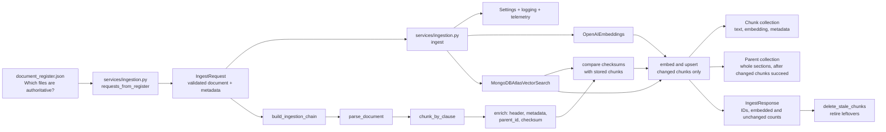
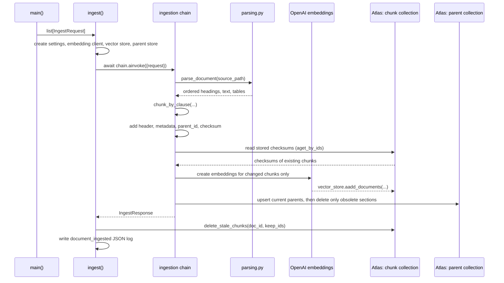
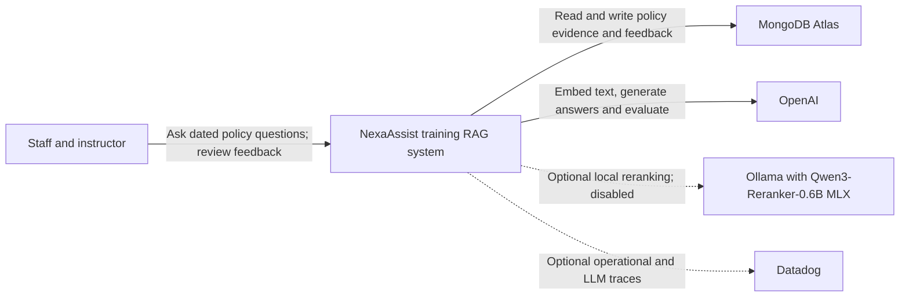
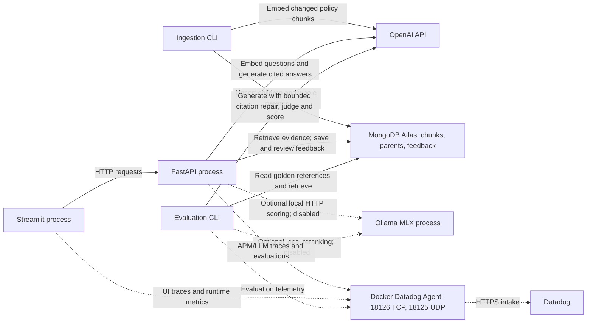
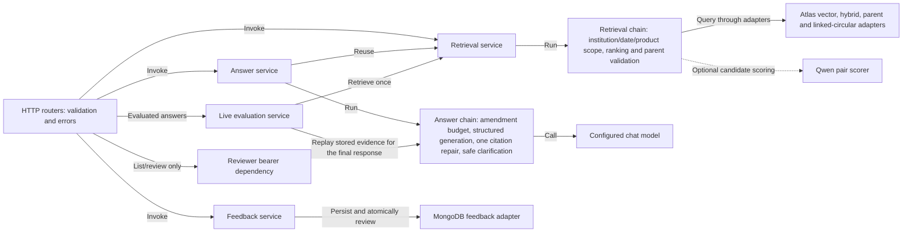

# NexaAssist `app/` component guide

## What this application does today

Updated **21 October 2026** against the current code and saved validation results.
This guide explains where ingestion, retrieval, answer generation, evaluation,
feedback and observability live. Ingestion turns approved policy documents into
clause chunks and parent sections in MongoDB Atlas. Streamlit calls FastAPI to
retrieve that evidence, generate cited answers and collect feedback. See
[README.md](README.md) for setup and public contracts.

For a visual walkthrough, open the [animated architecture explorer](C4-Documentation/nexaassist-architecture.html)
in a browser. Its C4 views and ingestion flow map each component to these source
files; the [reading guide](C4-Documentation/architecture-explorer.md) explains
the notation and boundaries.

`POST /retrieve` returns ranked hits plus complete linked circulars. `/answer`
validates citations and permits one repair draft. `/answer/evaluated` scores the
final answer using the same retrieved evidence. **RAGAS scores are shown in
Datadog only**; the chat shows the answer, citations and a Datadog link. Feedback
is stored in MongoDB, with retry protection and a reviewer token for list/review.

Dense and optional Atlas hybrid retrieval, a local reranker adapter, and
live/batch evaluations are implemented. Hybrid mode requires its manual text
index. The recorded local reranker compatibility check failed, so reranking
remains off by default. **The syllabus Phase 1 exit checkpoint is not complete**:
the full hybrid/reranker comparison, representative quality targets and the
instructor walkthrough remain open. The syllabus mapping below retains its
original pages 2–3 reference; dated reviews at the end are historical snapshots.

### Latest verification

The saved 21 October run passed **121 application tests and 22 separate mock API
tests**, plus Ruff and mypy. Twelve targeted live policy scenarios are recorded;
the final fee evaluation was answered with four scored metrics queued for
Datadog. Desktop/mobile accessibility snapshots scored 100. None of these
counts is a coverage percentage or a production-readiness verdict.

Use the [fix report](app/evaluation/results/fixes_20261021/FIX_REPORT.md) and
[summary](app/evaluation/results/fixes_20261021/SUMMARY.json) for the evidence,
including intermediate failures and independent-review follow-ups. A restored
open sidebar still shifts on reload; date-intent classification can abstain;
cloud receipt and sustained load were not rechecked. No individual user/role
system or multi-institution write isolation is claimed.

### Which session built what

| Session | Topic | Where it lives |
| --- | --- | --- |
| 1 | Architecture, ingestion service contract, load and parse | `models/ingestion.py`, `services/ingestion.py`, `chains/parsing.py`, `chains/embeddings.py`, `database/mongo.py` |
| 2 | Hybrid chunking (structure first, size second) | `chains/chunking.py` |
| 2 | Identity header, clause-based chunk ID, checksum | `enrich` and `chunk_checksum` in `chains/ingestion.py` |
| 2 | Parent documents | `enrich` in `chains/ingestion.py`, `get_parent_store` in `database/mongo.py` |
| 2 | Incremental indexing | `compare` and `embed_and_upsert` in `chains/ingestion.py`, `delete_stale_chunks` in `database/mongo.py` |
| 3 | Embedding configuration and version-controlled vector index | `chains/embeddings.py`, `database/indexes.md` |
| 4 | Dense retrieval, metadata filters, parent expansion, API | `chains/retrieval.py`, `services/retrieval.py`, `models/retrieval.py`, `api/retrieval.py` |
| 5 | Failure diagnosis, health and counters | `evaluation/rag_failure_modes.py`, `evaluation/rag_failure_examples.py`, `database/diagnostics.py`, `api/operations.py` |
| 6 | Atlas hybrid/RRF and local Qwen reranker adapter | `database/retrieval.py`, `chains/rerank.py`, `chains/prompts/rerank.py` |
| 7 | Token-budgeted context, configured chat model, answer generation and citation checks | `chains/answer.py`, `chains/llm.py`, `chains/prompts/answer.py`, `services/answer.py`, `models/answer.py`, `api/answer.py` |
| 8 | Live and batch RAGAS/judge evaluation | `services/evaluation.py`, `evaluation/live.py`, `evaluation/run.py`, `evaluation/ragas_metrics.py` |
| 9 | Feedback submission, retry protection and reviewer access | `models/feedback.py`, `services/feedback.py`, `database/feedback.py`, `api/auth.py`, `api/feedback.py`, `ui/app.py` |
| 10 | Datadog tracing and operational checks | `core/telemetry.py`, `core/observability.py`, `api/operations.py`, `compose.datadog.yaml` |

Sessions 1 and 2 also have standalone teaching notebooks under `notebooks/` (`phase1_session1_ingestion.ipynb`, `phase1_session2_chunking.ipynb`). These two notebooks do not import `app/`; they repeat the stages cell by cell. The separate `direct_ingestion_with_metadata.ipynb` notebook calls the application service.

## Big picture



In ordinary language: the service reads the document register, turns each listed source file into a validated request, then sends it through a reusable pipeline. That pipeline reads the file, splits it into one chunk per clause (keeping each table with its clause), labels and fingerprints each chunk, embeds only the chunks whose fingerprint changed, and saves them to the vector database. Finally the service removes chunks that the source document no longer contains.

## Directory map

| Location | Responsibility | Simple explanation |
| --- | --- | --- |
| `app/core/` | Shared runtime setup | Loads settings, configures structured logs, and optionally enables monitoring. |
| `app/models/` | Data contracts | Defines ingestion, retrieval, citation, answer, evaluation and feedback schemas. |
| `app/chains/` | Pure LangChain processing | Parsing, chunking, embeddings, ingestion, retrieval, context assembly, and generation. It has no web/UI imports. |
| `app/database/` | MongoDB adapters | Chunk/parent stores, hybrid and linked-circular lookup, feedback persistence and index definitions. |
| `app/services/` | Application orchestration | Wires ingestion, retrieval, answer, live evaluation and feedback flows; records completion logs and retrieval counters. |
| `app/api/`, `app/main.py` | HTTP serving | Nine operations for retrieval, answers/evaluation, feedback and diagnostics; bearer-token dependency for feedback listing/review. |
| `app/evaluation/` | Diagnosis and quality checks | Failure demonstrations, local reranker checks, RAGAS/judge runner, compact local stage traces, and scored result artifacts. |
| `evaluation/datasets/` | Golden expectations | Ten retrieval and ten answer cases reused by the retrieval, reranker, generation, and judge workflows. Source references resolve to actual indexed text before evaluation. |
| `app/ui/`, `app/streamlit_app.py` | Thin UI | Chat, evaluated/plain answers, evidence and feedback/review cover six of nine API operations. Operational endpoints have no UI controls. No chain definitions or direct MongoDB access. |
| `app/compose.datadog.yaml` | Local Agent | Docker Agent publishes host-loopback trace TCP 18126 and DogStatsD UDP 18125 for the Mac applications. |
| `app/**/__init__.py` | Python package markers | Empty files that let Python import these directories as packages. |

## Starting the ingestion job

The command-line entry point is `app.services.ingestion.main`:

```bash
uv run --env-file .env python -m app.services.ingestion nexa_synthetic_data/document_register.json
```

`main()` accepts the document register path. Its normal mode ingests that register; `--retire-doc DOC_ID` explicitly deletes a withdrawn document from the current corpus in both MongoDB stores and refuses a document still authoritative in the register. It then performs these steps:

1. `get_settings()` loads settings from `.env`.
2. `init_telemetry()` enables Datadog instrumentation only when `DD_TRACE_ENABLED=true`.
3. `configure_logging()` makes logs JSON-shaped for a log platform such as Datadog.
4. `requests_from_register()` makes one `IngestRequest` for each authoritative document.
5. `asyncio.run(ingest(...))` runs the asynchronous ingestion workflow.

Each document produces one JSON log line:

```json
{"doc_id": "POL-HL-V3", "chunk_count": 32, "embedded_count": 32, "unchanged_count": 0, "stale_chunks_removed": 0, "embedding_model": "text-embedding-3-small", "policy_version": "3.0", "effective_date": "2025-10-01", "event": "document_ingested", "level": "info", "timestamp": "..."}
```

| Field | Meaning |
| --- | --- |
| `chunk_count` | Clause chunks the document produced on this run. |
| `embedded_count` | Chunks that were new or changed, so were sent to the embedding model. |
| `unchanged_count` | Chunks whose stored checksum matched, so were skipped. |
| `stale_chunks_removed` | Chunks deleted because the document no longer produces them. |

For the synthetic corpus a first run gives 177 chunks in total (31, 31, 32 for the three home loan versions, 8 for the circular, 18, 19, 17 and 21 for the others) and 80 parent sections. A second run reports `embedded_count: 0` for every document.

The `nexa_synthetic_data/document_register.json` file is the document catalogue. Its `authoritative` field is important: `requests_from_register()` skips entries where it is false. It also converts the document-ID prefix `POL` or `CIR` into the readable `doc_type` values `policy` and `circular`.

## How a single document moves through the code



The `await` keywords matter because embedding and database writing are I/O work. They allow this code to use asynchronous LangChain/MongoDB operations rather than block the event loop while a remote service responds.

Four situations show what the compare step saves:

| Situation | What is embedded | What is deleted |
| --- | --- | --- |
| Same document ingested again | Nothing | Nothing |
| One clause reworded | That clause's chunk only | Nothing |
| One clause withdrawn | Nothing | That clause's chunk |
| `EMBEDDING_MODEL` changed | Every chunk | Nothing (and a new Atlas index version is needed) |

## Component-by-component explanation

### `app/core/config.py` — one place for configuration

**Class: `Settings(BaseSettings)`**

This Pydantic Settings class defines all environment configuration the application needs. It reads `.env` automatically, validates types, and prevents secrets from being casually displayed because passwords/API keys use `SecretStr`.

Important groups of fields:

- MongoDB: `mongodb_uri`, `mongodb_db`, `mongodb_collection`, `vector_index_name` decide where chunks are saved; `mongodb_parent_collection` is where whole sections are saved.
- OpenAI: `openai_api_key`, `embedding_model`, `embedding_dimensions`, `embedding_batch_size` decide how vectors are generated; `chat_model` selects the answer model.
- Chunking: `chunk_max_characters` is the size above which a clause is split, and `chunk_overlap_characters` is how much text is repeated between the pieces.
- Metadata: `institution`, `jurisdiction`, and `confidentiality_level` are stamped onto every chunk.
- Operations: `log_level` and `dd_trace_enabled` control logging and tracing.
- Feedback: `mongodb_feedback_collection` selects storage; the secret `feedback_reviewer_token` enables privileged listing/review.

The environment variables behind those fields (see `.env.example`):

| Variable | Default | Used for |
| --- | --- | --- |
| `MONGODB_URI`, `MONGODB_DB`, `MONGODB_COLLECTION` | none (required) | Where chunks are written |
| `VECTOR_INDEX_NAME` | `policy_chunks_v1` | The Atlas Vector Search index, created by hand |
| `MONGODB_PARENT_COLLECTION` | `policy_sections` | Where whole sections are written |
| `MONGODB_FEEDBACK_COLLECTION` | `policy_feedback` | Feedback and reviewer decisions |
| `FEEDBACK_REVIEWER_TOKEN` | unset | Secret of at least 32 characters; listing/review are disabled until configured |
| `OPENAI_API_KEY` | none (required) | Embedding and answer-generation calls |
| `EMBEDDING_MODEL`, `EMBEDDING_DIMENSIONS`, `EMBEDDING_BATCH_SIZE` | `text-embedding-3-small`, `1536`, `100` | Which vectors are made and how many texts go in one request |
| `CHAT_MODEL` | `gpt-6-luna` | Configured answer-generation model |
| `EVAL_JUDGE_MODEL` | unset; falls back to `CHAT_MODEL` | Judge and RAGAS model for batch and live evaluation |
| `RETRIEVAL_MODE`, `TEXT_INDEX_NAME` | `dense`, `policy_text_v1` | Optional Atlas hybrid search |
| `RETRIEVAL_CANDIDATES`, `RERANK_ENABLED` | `20`, `false` | Reranker candidate pool and enable flag |
| `CONTEXT_MAX_TOKENS`, `TOKEN_ENCODING` | `6000`, `o200k_base` | Budget for the serialized evidence payload |
| `CHUNK_MAX_CHARACTERS` | `1200` | Size above which a clause is split |
| `CHUNK_OVERLAP_CHARACTERS` | `150` | Text repeated between the pieces of a split clause |
| `INSTITUTION`, `JURISDICTION`, `CONFIDENTIALITY_LEVEL` | none (required) | Corpus-wide metadata the register does not carry |
| `LOG_LEVEL`, `DD_TRACE_ENABLED` | `INFO`, `false` | Logging and Datadog tracing |

**Function: `get_settings()`**

Creates and returns the `Settings` object. `@lru_cache` means repeated calls in the same process reuse the same validated settings object instead of re-reading `.env`.

`UISettings` is deliberately smaller: `API_BASE_URL` defaults to
`http://127.0.0.1:8000`, and `UI_TIMEZONE` to `Asia/Kolkata`. The UI does not need
MongoDB or model credentials. Defaults above describe the Python settings;
`.env.example` explicitly selects `gpt-6-sol` as the judge.

### `app/core/logging.py` — machine-readable logs

**Function: `configure_logging(level)`**

Sets up `structlog` to output JSON logs to standard output. JSON logs are easier for Datadog and other log systems to search by fields such as `doc_id`, `chunk_count`, or `policy_version`.

### `app/core/telemetry.py` — optional Datadog tracing

**Function: `init_telemetry(enabled)`**

Does nothing unless telemetry is enabled. When enabled, it calls `ddtrace.patch_all()` before configuring JSON logging. Serve the API with `uv run --env-file .env ddtrace-run uvicorn app.main:app` so instrumentation starts before FastAPI creates its routes. The SDK reads its standard environment variables directly; loading `.env` only through Pydantic does not export those variables to the SDK.

The local configuration enables APM, LLM Observability, correlated JSON logs and runtime metrics for a local Agent on `datadoghq.com`. Log collection additionally requires the Agent's file-source configuration. `tests/test_telemetry.py` verifies a request span and trace IDs in logs without exporting data. Collector installation, credentials and actual Datadog delivery are separate from passing this test. See [Datadog setup and usage](DATADOG_README.md) for exact start commands and Agent paths.

`core/observability.py` also provides `prompt_annotation_context()`. The shared
answer chain uses it for each generation attempt, and the batch evaluator uses it
for its judge. It derives the tracked template from the existing LangChain prompt
and records a stable ID, explicit version and per-call variables on the OpenAI LLM
span. Prompt text and version constants live together in `chains/prompts/answer.py`
and `chains/prompts/judge.py`; increment the version when changing its template.
The telemetry regression test captures SDK events from the real OpenAI Responses
client with a mocked HTTP transport, including concurrent questions and context
cleanup after failure. It does not send data to Datadog or a model provider.

The local setup now uses the Docker Agent from `app/compose.datadog.yaml`.
The Mac API/UI send traces to `http://127.0.0.1:18126` and runtime metrics to
`udp://127.0.0.1:18125`. Start Docker Desktop and the Agent before launching
the traced applications; load `.env` into the process before `ddtrace-run`.
`DD_*` flags are read by the Datadog SDK, not exported by
constructing `Settings`.

`services/evaluation.py` uses `policy_answer_live_evaluation`; ordinary answers
use `policy_answer`. Scored metrics are submitted as `ragas_*` evaluations on
the exported workflow span. Feedback targets that answer's exported span under
the API service. Streamlit does not display metric cards. Its RAGAS toggle is
on for new Answer-mode questions by default; a reference is needed for context
precision/recall, while faithfulness/relevancy can run without one.

Both workflows explicitly use `agent_service=settings.dd_service`. This keeps
API answers in the `nexaassist-api` LLM application when the traced Streamlit
client propagates `nexaassist-ui`, while preserving the distributed APM trace.
`tests/test_telemetry.py` covers this incoming-client context for both services.

Earlier cloud trace/score visibility was confirmed by the user. The 21 October
checks observed a healthy Docker Agent and SDK `queued` status; they did not
recheck authenticated cloud receipt. A non-LLM prompt-template warning remains
recorded. See [DATADOG_README.md](DATADOG_README.md) for investigation steps.

### `app/models/ingestion.py` — the input and output contracts

**Class: `IngestRequest(BaseModel)`**

Represents one source document to ingest. It includes the file path and document-level business metadata: ID, title, version, dates, product, jurisdiction, document type, and confidentiality level. `extra="forbid"` rejects unexpected fields, helping catch malformed input early.

**Class: `IngestResponse(BaseModel)`**

Represents a successful ingestion result: the source `doc_id`, number of chunks, their deterministic IDs, how many were embedded on this run (`embedded_count`), how many were skipped because their checksum matched (`unchanged_count`), and the embedding model used.

### `app/chains/embeddings.py` — create the embedding client

**Function: `get_embeddings(settings)`**

Builds LangChain's `OpenAIEmbeddings` client with the configured model, vector dimension, batch size, and API key. Ingestion and retrieval use this same factory so stored vectors and search queries use compatible configuration.

### `app/chains/parsing.py` — turn a file into meaningful elements

**Function: `parse_document(path)`**

The public parsing entry point. For a PDF it calls `_parse_pdf`; for other supported formats it delegates to Unstructured's `partition()` function.

**Function: `_parse_pdf(path)`**

The custom path for born-digital PDFs. It uses `pdfplumber` because policy tables and headings need special treatment:

- Removes a fixed top and bottom page margin so recurring headers/footers are not indexed as policy content.
- Detects the most common font size as body text; larger text becomes a `Title` (a heading).
- Groups nearby body-text lines into `NarrativeText` paragraphs.
- Extracts ruled tables as whole tables instead of breaking their cells apart.
- Sorts everything by page and vertical position to restore reading order.

**Function: `_table_element(rows)`**

Normalizes empty cells, creates safe HTML using `escape()`, and returns an Unstructured `Table`. HTML is retained because it preserves the relationship between columns, such as an income range and its corresponding fee or threshold.

### `app/chains/chunking.py` — decide what a chunk is

**Function: `chunk_by_clause(elements, max_characters, overlap)`**

Turns the parser's ordered elements into `Chunk` objects using two rules, in this order:

1. **Structure first.** A heading such as `6. Fees and charges` starts a section. A paragraph starting with a clause number such as `6.2 Processing fee.` starts a clause. Anything that follows (a table, a footnote, a continuation line) belongs to that clause. Each clause becomes one chunk, so a table is never separated from the sentence that introduces it.
2. **Size second.** Only when a clause is longer than `max_characters` is it split. Its tables each become one chunk, never cut. Its narrative is split at sentence boundaries by LangChain's `RecursiveCharacterTextSplitter`, repeating up to `overlap` characters between pieces.

Text before the first numbered section (the title block and document-control table) becomes section 0, "Front matter".

Two regular expressions at the top of the file define the structure: `SECTION_TITLE` (`6. Fees and charges`) and `CLAUSE` (`6.2 Processing fee. ...`). They fit this corpus; a document numbered differently needs them extended.

With the default limit of 1,200 characters no clause in the corpus is split (the longest, with its table, is about 850 characters), so rule 2 is seen in the tests and the Session 2 notebook rather than in a normal run. The header line added later by `enrich` is not counted against the limit.

**Class: `Chunk`**

A small frozen dataclass: the chunk text plus its section number and title, clause number and heading, and whether it contains a table.

### `app/chains/ingestion.py` — the reusable LangChain pipeline

**Function: `build_ingestion_chain(vector_store, parent_store, settings)`**

Returns a LangChain `Runnable`, rather than running immediately. This makes the pipeline testable and composable. Its input must be `{"request": IngestRequest}` and callers run it asynchronously with `await chain.ainvoke(...)`.

The returned chain has five named internal steps:

| Step | Internal function | Input → output | Why it exists |
| --- | --- | --- | --- |
| Parse | `parse` | request → Unstructured elements | Reads the source file through `parse_document()`. |
| Chunk | `chunk` | elements → clause chunks | Calls `chunk_by_clause()` with the size and overlap from settings. |
| Enrich | `enrich` | chunks → child and parent `Document` objects | Children: prefixes a header line (`[POL-HL-V3 \| NexaHome Loan Policy v3.0 \| 6. Fees and charges]`), adds metadata, an ID such as `POL-HL-V3_6.2_c01`, a `parent_id` and a `checksum`. Parents: one `Document` per section holding all of its clauses. |
| Compare | `compare` | children → changed children | Reads the stored chunks with the same IDs and keeps only children whose checksum is new or different. |
| Embed and upsert | `embed_and_upsert` | changed children → `IngestResponse` | Embeds and upserts changed children first, upserts current parent sections, then removes obsolete parent keys. An embedding failure preserves the previous parents. |

`RunnablePassthrough.assign(...)` carries a shared state dictionary through the first four steps while adding `elements`, then `chunks`, then `enriched`, then `changed`. `RunnableLambda(...)` adapts ordinary Python functions into LangChain runnable steps. The `run_name` values make trace views easier to read in a tracing platform.

**Function: `chunk_checksum(text, metadata)`**

A SHA-256 fingerprint of a chunk's text and metadata. Because the metadata includes `embedding_model` and `embedding_dimensions`, changing either changes every fingerprint and so forces a full re-embed instead of leaving vectors from two models in one index.

**Function: `parent_key_prefix(doc_id)`**

The shared start of a document's parent keys (`POL-HL-V3_s`), used to find and replace that document's sections.

Chunk IDs are a deliberate design decision. They are built from the clause number, so sending the same document again reuses the same IDs (replacing rather than duplicating), and adding a new clause does not change the IDs of the others.

| ID | Pattern | Example |
| --- | --- | --- |
| Chunk of a numbered clause | `{doc_id}_{clause}_c{nn}` | `POL-HL-V3_6.2_c01` |
| Second piece of a split clause | same, next index | `POL-OPS-001_2.3_c02` |
| Text outside any clause | `{doc_id}_{section number}_c{nn}` | `POL-HL-V3_0_c01` (front matter) |
| Parent section | `{doc_id}_s{NN}` | `POL-HL-V3_s06` |

The chain depends only on LangChain's `VectorStore` and `BaseStore` interfaces, not on MongoDB. That is why the tests can pass an `InMemoryVectorStore` and an `InMemoryStore` and still run the real pipeline.

### `app/database/mongo.py` — connect LangChain to MongoDB Atlas

**Function: `get_vector_store(settings, embedding)`**

Selects the configured database and collection (through one cached PyMongo `MongoClient` shared by this module), then wraps that collection in `MongoDBAtlasVectorSearch`.

The wrapper is the bridge between LangChain and MongoDB Atlas. It knows:

- `text_key="text"`: where the original chunk content is stored.
- `embedding_key="embedding"`: where the numerical vector is stored.
- `index_name`: which Atlas Vector Search index the retrieval chain queries.
- `relevance_score_fn="cosine"`: how similarity is measured.
- `auto_create_index=False`: the application never silently changes database indexes; an operator creates the index deliberately.

**Function: `get_parent_store(settings)`**

Returns `UpsertingParentStore`, a `MongoDBDocStore` adapter over the parent collection. It replaces section contents by key without clearing existing parents first. Prefixes are escaped so document IDs containing regex characters cannot match another document. The stored shape and read API are unchanged; nothing in this collection is embedded.

The Session 4 retrieval chain reads this collection after searching the clause chunks.

**Function: `delete_stale_chunks(collection, doc_id, keep_ids)`**

Deletes the chunks of one document whose IDs were not produced by the latest ingest, and returns how many were removed. This is what stops a withdrawn clause from continuing to appear in search results.

### `app/database/indexes.md` — required database index

This file is an operations instruction, not executable Python. It contains the
manual vector/text index definitions. Vector dimensions must equal
`EMBEDDING_DIMENSIONS`; filters include institution, product, jurisdiction,
confidentiality and both sides of the effective-date window. The 21 October
update added the institution mapping to the configured vector index and observed
READY/queryable status. Adding a mapping does not require re-embedding if its
source metadata already exists.

It also records that the parent collection needs no search index, and suggests a regular index on `doc_id` for stale-chunk removal at scale.

If the embedding model or dimensions change, the guide correctly requires a new index version and a complete re-embedding. Vectors of different dimensions cannot live in one search index.

### `app/services/ingestion.py` — orchestrate the application flow

**Constant: `DOC_TYPES`**

Maps compact register prefixes to application-friendly values: `POL → policy` and `CIR → circular`.

**Function: `requests_from_register(register_path, settings)`**

Reads `document_register.json`, filters to authoritative entries, resolves each relative source-file path, and converts each entry into an `IngestRequest`. It supplies corpus-wide metadata from `Settings` and per-document metadata from the register.

**Function: `async ingest(requests)`**

The central coordinator. It loads settings once, creates the embedding client, vector store and parent store once, builds one reusable chain, then runs each request through it in order. After each document it calls `delete_stale_chunks()` (in a worker thread, because PyMongo is synchronous), emits a structured `document_ingested` log with the embedded, unchanged and removed counts, and returns all `IngestResponse` objects.

**Function: `main()`**

The thin command-line adapter described earlier. It does startup setup and starts `ingest()`; document processing logic remains outside the CLI function.

## Libraries and why they are present

| Library | Used in | Purpose in this project |
| --- | --- | --- |
| `pydantic` / `pydantic-settings` | config and models | Validates configuration and request/response data. |
| `langchain-core` | ingestion chain | Supplies `Document`, `Runnable`, and vector-store interfaces. |
| `langchain-openai` | embeddings and chat | Configured embedding, answer and judge model clients. |
| `langchain-mongodb` | database | Provides the official LangChain MongoDB Atlas Vector Search adapter and the `MongoDBDocStore` used for parent sections. |
| `pymongo` | database | Creates the low-level MongoDB collection connection. |
| `pdfplumber` | PDF parser | Reads PDF text layout and detects tables. |
| `unstructured[md]` | parser | Represents document elements (`Title`, `NarrativeText`, `Table`); handles non-PDF formats. |
| `langchain-text-splitters` | chunker | Splits the narrative of an oversized clause at sentence boundaries, with overlap. |
| `structlog` | service/logging | Produces structured JSON events. |
| `ddtrace` | telemetry | Sends supported library traces to Datadog when enabled. |
| `fastapi`, `uvicorn`, `httpx` | serving and UI requests | Typed HTTP routes, the API server and the cached UI HTTP client. |
| `streamlit` | UI extra | Chat, scoped requests, references and reviewer controls. |
| `ragas` | evaluation | Quality metrics; a structured judge is defined in the application and scored results can be submitted to Datadog. |
| `pytest`, `mongomock` | tests only | Controlled chain/API/UI regressions and MongoDB-like storage for ingestion, retrieval and feedback checks. |

## Metadata stored on every chunk

`enrich()` builds each LangChain `Document` with the original text/table plus metadata. Retrieval uses these fields for institution, product, jurisdiction, effective-date and confidentiality scope.

| Metadata | Source | Meaning |
| --- | --- | --- |
| `doc_id`, `title`, `policy_version`, dates, `product_id`, `supersedes` | document register | Identifies the source policy and its version history. |
| `institution`, `jurisdiction`, `confidentiality_level` | `.env` / `Settings` | Identifies the corpus and access/retrieval boundaries. |
| `doc_type` | register ID prefix | Distinguishes a policy from a circular. |
| `chunk_id` | chain | Stable per-chunk identifier built from the document and clause, for example `POL-HL-V3_6.2_c01`. |
| `parent_id` | chain | Key of the whole section in the parent collection, for example `POL-HL-V3_s06`. |
| `section`, `clause`, `clause_heading` | chain | Where the chunk sits in the document; `clause` is what an answer cites. |
| `checksum` | chain | Fingerprint of text, metadata and embedding model; lets a re-run skip unchanged chunks. |
| `section_type` | chain | `text` or `table`, so downstream code can treat tables carefully. |
| `embedding_model` | settings | Records which model created the vector. |

### What one stored chunk looks like

```json
{
  "_id": "POL-HL-V3_6.2_c01",
  "text": "[POL-HL-V3 | NexaHome Loan Policy v3.0 | 6. Fees and charges]\n6.2 Processing fee. Processing fee is 0.35% of the sanctioned loan amount, subject to a minimum of ₹5,000 and a maximum of ₹15,000, plus GST.",
  "embedding": ["... 1536 floats"],
  "doc_id": "POL-HL-V3",
  "title": "NexaHome Loan Policy",
  "chunk_id": "POL-HL-V3_6.2_c01",
  "parent_id": "POL-HL-V3_s06",
  "section": "6. Fees and charges",
  "clause": "6.2",
  "clause_heading": "Processing fee",
  "institution": "NexaBank",
  "product_id": "NEXA-HL",
  "policy_version": "3.0",
  "effective_date": "2025-10-01",
  "effective_to": null,
  "supersedes": "POL-HL-V2",
  "jurisdiction": "IN",
  "doc_type": "policy",
  "section_type": "text",
  "confidentiality_level": "internal",
  "embedding_model": "text-embedding-3-small",
  "checksum": "sha256:..."
}
```

The first line of `text` is the identity header. It is embedded together with the clause, so a table or a piece of a split clause still says which document, version and section it came from.

A parent record in the parent collection has `_id` and `parent_id` (`POL-HL-V3_s06`), `page_content` (the header line followed by every clause of the section), `section`, and the same document-level fields. It has no `embedding`, `clause` or `checksum`.

## Tests: what the current code proves

The suite now includes ingestion, retrieval/API, hybrid-filter, local reranker protocol, answer/context, evaluation, feedback and Streamlit interaction tests. `tests/test_ingestion.py` uses LangChain's in-memory vector store, an in-memory parent store and deterministic fake embeddings. These tests validate parsing, chunking, metadata, IDs and checksums without contacting OpenAI or MongoDB. `delete_stale_chunks` is tested against a mock MongoDB collection (`mongomock`). Retrieval tests inspect filter construction and mock search results; they do not exercise Atlas ranking. Dedicated answer tests now cover valid/invalid quotes, unsupported IDs, empty evidence, context budgeting, API validation and safe failures.

New regressions cover scoped parent fallback, complete/chained circulars,
inconsistent amendment metadata, one citation-repair attempt and its exhaustion,
safe clarification text, reviewer authorization, concurrent feedback retries,
and immediate reference/correction submission. The latest saved totals are 121
application cases plus 22 mock API cases; they are separate suites.

They confirm that:

- The register becomes the expected ingestion requests.
- Every synthetic document can be parsed and chunked.
- Required metadata is applied to every chunk.
- Policy-version metadata is preserved.
- Tables retain their complete HTML rows.
- Repeated page headers/footers are excluded.
- Re-ingesting a document does not create duplicates.
- Every clause listed in the document register becomes exactly one chunk, and every clause cited by the golden Q&A set exists.
- Each chunk starts with its identity header and has a clause-based ID.
- An oversized clause is split with overlap while its table stays whole.
- Each parent section contains all clauses of that section, and a re-ingest replaces it cleanly.
- A re-run embeds nothing; a changed chunk, embedding model, or embedding dimension is re-embedded.
- Stale chunks of a document are deleted without touching other documents.

Run them, and the lint and type checks, with:

```bash
RAGAS_DO_NOT_TRACK=true \
uv run --locked --no-sync pytest -q tests/
uv run --locked --no-sync ruff check app tests
uv run --locked --no-sync ruff format --check app tests
uv run --locked --no-sync mypy app
```

Verification uses the Python 3.14.8 environment with UI/evaluation extras installed. Tests use controlled scores and local stores; they do not claim improved retrieval quality. The earlier GGUF compatibility failure is recorded in `app/evaluation/results/reranker_check.json`. The official Qwen Safetensors weights were subsequently imported into Ollama as `nexaassist-reranker:0.6b-mlx`; Ollama confirms `runner=mlx`, and the model returns meaningful responses. Exact scoring still fails because a required lowercase token is missing from the top-20 alternatives, and larger requests return HTTP 400. The model details, fictional inputs and returned probabilities are in `app/evaluation/results/reranker_mlx_check.json`. At that review checkpoint, a live Atlas/OpenAI evaluation had been rejected by automatic approval review. Subsequent live evaluation and Datadog verification are documented in the telemetry section; the 20 October validation below records the local Docker build status.

Controlled tests do not prove live Atlas behavior or generated-answer correctness.
The 21 October live/browser checks are separate evidence, linked at the start of
this guide. Full-dataset quality, cloud deployment and sustained load remain open.

## Retrieval and answer components

The read path is `api/retrieval.py` → `services/retrieval.py` →
`build_retrieval_chain()` in `chains/retrieval.py`. It shares ingestion's embedding
configuration and stores. Dense and hybrid searches enforce institution,
inclusive effective dates, jurisdiction, confidentiality and optional product
scope. Optional reranking runs before top-k truncation and parent expansion.
Parent IDs are fetched once each. A parent must match the scoped child's source
identity, product and validity metadata; a missing/mismatched parent logs a
warning and falls back to the child.

`database/retrieval.py` also supplies `build_amendment_search()`. It discovers
effective circulars linked to retrieved document IDs through `supersedes`,
follows new circular IDs with a visited set, and reads every stored part of each
discovered instrument under its institution/document/version identity. Mixed
dates, products or other source metadata raise an error rather than returning a
partial instrument. This checks indexed parts; it cannot prove that ingestion
did not omit an entire section.

`RetrieveResponse.results` remains limited by `top_k`. Complete circulars are
separate `amendments`, with a null clause and score 0, which is not a similarity
score. The `evidence` property places amendments first and removes redundant
partial hits for their document/version. `parent_ms` includes parent expansion
and amendment lookup; `total_ms` covers the whole retrieval.

`chains/prompts/rerank.py` contains one prompt for the selected Qwen3-Reranker model. The adapter calls `rerank_prompt()` once per query/passage pair and sorts normalized likelihoods of the exact lowercase `yes` and `no` tokens. The former listwise chat prompt is unused and has been removed. The Qwen prompt retains the as-of date, applicability/amendment instructions, and treatment of the question and passage as untrusted data. Pairwise scoring does not itself resolve conflicts across policies; filtering, context assembly and cited answer generation remain responsible for those checks.

The answer path is `api/answer.py` → `services/answer.py` →
`build_answer_chain()` in `chains/answer.py`, using
`ANSWER_PROMPT | llm.with_structured_output(...)`. `chains/llm.py` supplies the
configured model. `chains/context.py` packs complete passages into the evidence
token budget and may fall back to a complete child, without cutting sentences
or tables. Empty evidence or an unfittable complete amendment skips generation.

The response status is `answered`, `needs_clarification`, or
`insufficient_evidence`. Clarifications use a fixed scope question rather than
forwarding model-written policy claims. Model intent classification can still
miss a date conflict; abstentions therefore include product/date recovery guidance.
An answered draft needs valid marker IDs and exact supporting quotes. A failed
citation check permits one repair draft using the same evidence; two invalid
drafts abstain. `generation_ms` includes both attempts. Quote membership does
not prove semantic entailment. The model interprets sanction-date/opt-in terms
from the sources; no fee values are hardcoded.

### Live evaluation and feedback

| Component | Responsibility |
|---|---|
| `api/answer.py`, `models/evaluation.py` | `/answer/evaluated` accepts the policy request plus an optional reference and returns the answer with metric statuses/export metadata. |
| `services/evaluation.py` | Retrieves once, replays that evidence into the answer chain, then scores only the final response. A supplied reference wins; an exactly matching golden question/date/product/jurisdiction can provide one automatically. |
| `evaluation/live.py` | Runs applicable metrics independently, with per-metric timeouts. Missing references, abstention or scoring failures remain explicit; unavailable values are not published as numeric scores. Context metrics can be scored on an abstention and do not establish an answered question. |
| `evaluation/run.py`, `evaluation/ragas_metrics.py` | Batch golden-case judging/RAGAS and shared scoring adapters. `EVAL_JUDGE_MODEL` falls back to `CHAT_MODEL`; reports identify the judge. |
| `models/feedback.py`, `services/feedback.py` | Validate the question/answer dates and carry `helpful`, correction, submitter/submission UUIDs, exported span ID and review state. Save before optional Datadog feedback. |
| `database/feedback.py` | Atomic `$setOnInsert` persistence and pending-only review updates. The feedback ID is derived from institution plus both UUIDs. Identical retries return the saved record, even after review; changed payloads conflict. |
| `api/auth.py`, `api/feedback.py` | Require the shared reviewer bearer token for `GET /feedback` and `POST /feedback/{feedback_id}/review`. Missing configuration returns 503; missing/wrong credentials return 401. Submission remains available without login. |
| `ui/app.py` | Renders chat, references, evidence and feedback through HTTP. Six of nine operations have controls; RAGAS cards are hidden and the Datadog link remains. Reviewer credentials are sent per request, not stored on the shared cached HTTP client. |

API retry protection requires **both** `submitter_id` and `submission_id` to
remain stable. Omitting either generates a new UUID for that request. Datadog
feedback targets the exported answer span with boolean `thumbs`, assessment and
optional correction reasoning. A retry does not repeat that SDK attempt, but
there is no durable delivery queue or cloud receipt guarantee.

The evaluated API response and batch JSON reports retain metric values and
statuses for inspection. Strict API clients must accept `amendments` in retrieval
responses and `needs_clarification` in answer status enums.

Set `FEEDBACK_REVIEWER_TOKEN` to a random secret of at least 32 characters in
the private environment, restart FastAPI, and enter it in **Review feedback**.
Changing the token clears cached feedback in that UI session. This is a shared
local reviewer capability, not an individual login/role system.

Chat history stays in the current Streamlit session and is not model context:
each new question is independent. A supplied reference applies to one question
and is cleared after submission. Reopening a chat reuses its stored response
rather than regenerating or rescoring it. The NexaFlex foreclosure reference
retains **plus GST**; its clause does not specify a tax percentage.

`api/operations.py` exposes a static liveness response and process-local retrieval counters. It does not test database/provider readiness. `/metrics/latency` separately reports nearest-rank p50/p95/p99 over the last 1000 successful requests in the process; these are not fleet-wide histograms. LCEL runnables retain their names for chain inspection, and startup calls optional Datadog instrumentation. Neither a reviewed trace nor working Datadog spans is demonstrated by the offline tests.

## Alignment with the training syllabus

Reference: `1. Phase1_Enterprise_RAG_Agentic-AI_MCP_Evaluations_Full_Syllabus-.pdf`, Phase 1 on pages 2–3. The PDF contains all four training phases despite its filename. “Implemented” below describes code present in this repository. Saved observations describe an earlier run; they do not establish current external-service health. Missing code does not imply the corresponding concept is absent from teaching materials outside this repository.

| Phase 1 session | Implementation evidence | Remaining syllabus work |
| --- | --- | --- |
| 1 — Architecture and ingestion | Separate services, register-driven ingestion, typed contracts and a thin Streamlit client. Selected UI → API → Atlas/model flows ran live on 21 October. | Repeat environment-specific checks after configuration or source changes; the small sample is not capacity evidence. |
| 2 — Hybrid chunking, parents, scaling | Clause-first plus recursive size splitting, overlap, whole tables, identity headers, parent sections, checksum comparison; scaling discussion in the Session 2 notebook. | No distributed ingestion or sharding. These are design discussions, not a requirement to build a 100K-document system now. “Hybrid chunking” does not satisfy Session 6 hybrid retrieval. |
| 3 — Embeddings and vector indexing | Shared OpenAI configuration, batch size 100, explicit Atlas adapter, manual vector/text index JSON; checksum now includes embedding dimensions and has a regression test. | Re-ingest to migrate old checksum metadata; use a new index/collection for an embedding migration. Titan remains a teaching comparison; do not silently change the configured model. |
| 4 — Retrieval API and deployment | `/retrieve` retains its request shape and adds supplemental `amendments`; the API image includes evaluation dependencies and Datadog bootstrap. | Strict response clients must accept the new field; cloud deployment and service discovery remain unverified. |
| 5 — Failure modes and Week 1 review | Thirteen live/snapshot diagnostic examples, offline demonstrations, source freshness and embedding-compatibility checks, liveness and counters. | No alert configuration, scheduled re-indexing, or statistical drift monitor. A trainee review/walkthrough is not recorded. |
| 6 — Hybrid retrieval and reranking | Atlas BM25/vector RRF, configurable candidate pool, local Qwen3 score adapter using native Ollama by default, with optional OpenAI-compatible mode; protocol and filter tests. | Create the text index manually and demonstrate improved evidence coverage. Ollama 0.40.6 failed the local score test; keep reranking disabled until a compatible local runtime passes it. |
| 7 — Context assembly and model selection | Whole-passage context budget, complete amendments, structured generation, quote checks, one repair draft, clarification and abstention. Selected live fee/sanction/opt-in cases passed. | Semantic correctness, intent classification and a representative reranker/generator comparison remain quality work. |
| 8 — RAGAS and LLM-as-Judge | Shared live/batch adapters, indexed references, exact generation evidence, structured judge, explicit optional quality gate and metric failure reporting. Latest fee sample scored all four metrics and queued them for Datadog. | Scores stay in Datadog; Streamlit has a link. Cloud receipt was not rechecked on 21 October, and the full dataset is not certified. |
| 9 — Golden dataset and human feedback | 97 source QAs, two ten-case subsets, MongoDB review states, retry-safe submissions, reviewer-token access and optional Datadog feedback. | Instructor-approved promotion to golden data remains manual; some source QAs require future APIs/agents. |
| 10 — Dev-time observability and wrap-up | Named stages, local trace artifacts, JSON token logs, Docker Datadog Agent and process-local latency percentiles. | Earlier cloud visibility is recorded separately; representative latency/cost, cloud receipt, alerts and the trainee walkthrough remain open. |

### Existing Atlas evidence

`app/evaluation/datasets/session5_atlas_parent_observation.json`, captured on 15 October 2026, records 177 chunks from eight documents, 80 parent sections, a ready/queryable index, matching vector dimensions/model metadata, and passing source/parent integrity diagnostics. Its ten-case top-5 cohort has seven complete expected-evidence sets, including expanded parent context. This measures evidence availability, not RAGAS scores or answer correctness.

In that saved baseline, the generic fee question missed the circular at top 5;
top-20 parent context supplied its applicability clause. The current API adds
complete linked circulars separately, so that historical rank miss is not the
current answer context. The 21 October five- and twenty-source answers used the
revised fee and sanction cutoff. Keep the raw-rank baseline for dense/hybrid/
reranker comparisons; do not mistake it for a fresh service failure. See the
[saved observation](app/evaluation/datasets/session5_atlas_parent_observation.json)
and [Session 5 runner](app/evaluation/rag_failure_examples.py).

### Alignment with AGENTS/CLAUDE

The implementation preserves the main boundaries: pure LangChain chains, MongoDB construction in `database/`, service orchestration, thin FastAPI routes, Pydantic v2 contracts, centralized settings, JSON logs, and optional telemetry. Synchronous PyMongo work uses LangChain async fallbacks or worker threads. The following distinctions need to remain explicit:

- The six layers/build phases in AGENTS/CLAUDE are implementation order. They are not the PDF's four training phases. Syllabus Phase 1 spans foundation, FastAPI, a UI, and evaluation/observability; LangGraph belongs to syllabus Phase 2 and FastMCP to Phase 3. Evaluation begins in Phase 1, alongside development.
- The Streamlit layer is now implemented after backend checks and only calls FastAPI. Its settings require the API URL and timezone, not backend credentials.
- The syllabus lists alternative vector databases as comparisons. The local implementation must continue using MongoDB Atlas. Arize is a later Phase 4 requirement; Datadog is the current operational and LLM telemetry target, with local RAGAS/judge evaluation.
- The project diagram places evaluations under `app/evaluation/`, while the golden-dataset rule and existing teaching JSONL files use root `evaluation/datasets/`. Keep these roles explicit; there is no `evaluation.run` module behind the example command in AGENTS/CLAUDE.
- Streaming responses are requested by the project rules but are not implemented. They are not an explicit Phase 1 exit criterion. The current answer endpoint returns one JSON response.
- `pyproject.toml`, `uv.lock`, and the compatibility `requirements.txt` target Python 3.14+. The `ui` and `evaluation` extras are optional; the API image includes `evaluation` for `/answer/evaluated`. The `.planning/` status files describe an older 11 October milestone; this guide describes the current implementation.

### Order of remaining work

1. Check source/index metadata before deciding whether to re-ingest. A new embedding configuration or checksum migration may require it; the latest institution-filter mapping update did not rewrite source documents or embeddings. For a withdrawn document use explicit `--retire-doc`; ordinary partial ingestion does not retire other documents.
2. Create the Atlas text index from `database/indexes.md`, select hybrid mode, and establish a compatible local reranker using `app.evaluation.check_reranker`. Do not enable a runtime that fails its score check.
3. Run the approved evaluation against the configured Atlas and OpenAI services, compare dense/hybrid/reranked evidence on the existing golden cases, and review the generated traces and metric artifacts. Quality targets must be chosen explicitly; none is assumed.
4. Extend the completed local browser/feedback checks to representative users and deployment conditions. Promote corrections only through an instructor-reviewed golden-data change.
5. Build a fresh release image for the target environment, verify cloud telemetry receipt and operational controls, inspect latency/cost, and deliver the trainee walkthrough. The local API-image and Docker Agent checks do not establish a cloud deployment.

Phase 1 exits only after ingestion with parent retrieval, hybrid retrieval plus working reranking, RAGAS and judge runs, a reviewed trace, and a delivered walkthrough are evidenced. The UI implementation gap is closed; the remaining integration and human checkpoints are still open.

### Later training phases

| Syllabus phase | Expected extension | Current status |
| --- | --- | --- |
| 2 — Agentic RAG | LangGraph Orchestrator, Retriever, Validator and Action agents; Retriever calls unchanged `/retrieve` through HTTP; persistent state, guardrails, HITL, integration tests. | Not implemented. Synthetic customers, uploads and mock API data are supporting fixtures, not working agents. |
| 3 — MCP | Thin retrieval/validation/action MCP wrappers, discovery by agents, resources/prompts, Inspector and contract tests, second-client demonstration. | Not implemented. Preserve the existing REST services when adding wrappers. |
| 4 — Production | Docker/ECS Fargate, secrets/discovery, Datadog and Arize, sampled online evaluation, reviewer queue/UI, cost controls, CI/CD quality gates and SLO runbooks. | Local foundations exist: API image, Agent setup, live evaluation, feedback/review and pre-commit checks. Cloud infrastructure, individual identity/roles, Arize, production CI/CD and SLOs remain future work. |

## Boundaries to preserve as the project grows

- Keep parsing, chunking, embedding, and RAG logic inside `app/chains/`.
- Keep MongoDB client and Atlas index knowledge inside `app/database/`.
- Keep FastAPI routers thin: they should call services, not parse PDFs or query MongoDB directly.
- Keep the Streamlit UI focused on rendering and calling APIs; it must not define chains.
- Keep `.env` private. Use `.env.example` as the safe template for required settings.

This separation means each part has one clear job, can be tested in isolation, and can be replaced without rewriting the entire application.

## C4 architecture: current repository

These views describe the implemented Phase 1 training application, not a deployed
production topology. Staff and instructor personas are inferred from the UI and
feedback workflow. MongoDB Atlas and OpenAI are configured dependencies; local
Ollama MLX generation has been observed, but exact reranker scoring remains blocked.
LangGraph, MCP and AWS deployment are outside this implementation.

### System context



### Containers

Each CLI is a separate process that imports the shared Python services. It does
not call the running FastAPI server. Atlas collections are dedicated to the
configured corpus; this is not an authenticated multi-tenant deployment.



### API components



The routers remain thin, the chains have no FastAPI/Streamlit imports, and the UI
uses HTTP plus shared schemas. Reviewer-token protection is implemented;
individual user authentication, shared-service SLOs and a live Atlas hybrid
comparison remain open. Local Docker Agent
delivery is recorded in [DATADOG_README.md](DATADOG_README.md); the diagrams do not
establish a production deployment.

## Review of the 18 October implementation

The dated reviews below preserve earlier evidence and counts. Use **Latest
verification** above for the 21 October status; these sections are not new test runs.

The review covers this session's application changes and tests. It preserves the
earlier teaching assets and extends the existing layers without adding a generic
framework, provider registry or future agent/MCP scaffolding.

- Context deduplication now tracks the text actually packed into the prompt.
  Distinct child passages survive when a shared parent is too large, while
  duplicate included passages are still removed. A regression reproduces the
  earlier loss of applicability evidence.
- Judge prompt `policy-judge-v2` requests only semantic quality scores and a
  rationale. Status agreement is computed in Python. Runtime timings, request
  copies and traces stay in the artifact and are excluded from the judge input.
- Repeated settings in this session's tests share `tests/conftest.py`. Runtime
  dependencies are declared once rather than repeated in the development group.
  RAGAS metric names have one definition for normal and empty-evidence cases.
- The selected reranker has one prompt and one scoring implementation. Removed
  GGUF aliases remain historical diagnostic evidence only. Missing exact Qwen
  token probabilities continue to fail explicitly, with reranking disabled.

Verification: 54 offline tests pass, including the new oversized-parent regression.
The suite uses controlled model responses and local stores; it does not measure
live answer quality. Formatting, lint, typing, import boundaries and documentation
links are checked separately. No cloud evaluation or Atlas mutation was run for
this review.

## Codebase recon: Git history

Requested with the `codebase-recon` skill; captured on 18 October 2026. This is a
history-based report, separate from runtime verification and the uncommitted work.

| Repository vital | Result |
| --- | --- |
| First / latest commit | 6 October / 17 October 2026 |
| Commits | 8 |
| Branch refs, including remote refs | 5 |
| Analysis window | All history (small repository) |

1. **Code hotspots:** `README.md` changed in six commits. `uv.lock`,
   `tests/test_ingestion.py`, `pyproject.toml`, `app/database/indexes.md`,
   `app/core/config.py`, `app/chains/ingestion.py`, `APP_COMPONENT_GUIDE.md`,
   and `.env.example` each changed in three.
2. **Bug magnets:** one commit matching `fix|bug|broken` touched `README.md`.
   This is a commit-message classification, not evidence of a runtime defect.
3. **Intersection:** `README.md` is rank one in both lists. Its primary owner
   is Pankaj (six commits touching the file). Documentation churn deserves review;
   the history does not establish high runtime risk.
4. **Ownership:** Pankaj authored all eight commits. One of one contributors is
   active in the last three months. The active ratio is 100%, while knowledge is
   concentrated in one contributor.
5. **Momentum:** all eight commits are in October 2026. There is insufficient
   history for a meaningful last-three-months versus prior-three-months trend.
6. **Firefighting:** no commit messages match revert, hotfix, emergency or rollback:
   zero of eight commits (0%). This does not prove the absence of incidents.
7. **Recently added files:** the top ten results were `uv.lock`, the ingestion,
   retrieval and failure-mode test files, `pyproject.toml`, and five versioned
   policy PDFs. Each appeared once in the added-file history.
8. **Recommendations:** start with `README.md`, `app/core/config.py` and
   `app/chains/ingestion.py`; consult Pankaj for design context. Keep implementation
   status and documentation synchronized and inspect the working tree, since
   important teaching assets and current changes are not yet committed.

## Repository validation — 20 October 2026

This review inspected the current working tree and re-ran the history analysis.
The history still contains eight commits, one author, five branch refs and one
month of activity. The table above remains the appropriate quantitative view:
there is not enough history for a defensible momentum chart or a health score.
Commit-message matches identify reading priorities, not measured defects.

### Confirmed gaps repaired

| Path | Defect reproduced or observed | Result |
| --- | --- | --- |
| `services/retrieval.py` | The service always built a dense chain, ignoring `RETRIEVAL_MODE` and `RERANK_ENABLED`. | Connects the existing hybrid and reranker adapters when configured. Regressions exercise dense/hybrid with reranking on/off, candidate count and ranking before top-k truncation. Defaults remain dense and reranking off. |
| `evaluation/run.py` | Batch judging and its report ignored `EVAL_JUDGE_MODEL`. | Both the semantic judge and batch RAGAS use the selected judge, with an explicit generator fallback and accurate report metadata. |
| Batch RAGAS | A separate Chat Completions adapter diverged from the working live Responses API path; numeric validation differed. | Reuses the live structured-output/embedding adapters, the configured embedding dimensions, finite 0–1 validation and narrow roundoff normalization. Each metric has a 120-second timeout. Invalid batch scores fail the run. |
| `app/Dockerfile` | Evaluation extra and golden cases were absent; enabling the extra exposed a missing `g++` build failure. | Builds native dependencies in a separate stage and includes RAGAS plus the golden answer dataset. The compiler stays outside the runtime image. |
| Build context and dependency template | Unbounded Docker context; `requirements.txt` lacked the existing PyMongo compatibility ceiling; retrieval settings were absent from `.env.example`. | Docker-specific allowlist excludes the local environment, Git data and captured result reports. The requirements pin matches the project, and the example lists the implemented retrieval settings. |
| Guides | Stale notebook/deck/guide links, old test count, and outdated model, latency and telemetry claims. | Repaired local targets and aligned current implementation descriptions; earlier dated observations remain historical evidence. |

### Verification evidence

| Check | Observed result | Boundary |
| --- | --- | --- |
| Offline pytest suite | **83 passed**, up from 74 at the start of this review | Controlled provider outputs/local stores; nine additional parametrized cases do not establish live model quality. |
| Ruff formatting and lint | Passed | `ruff format --check app tests`; `ruff check .`. |
| Mypy | Passed, 69 source files | `mypy .`; project configuration ignores missing third-party stubs. |
| Locked dependency metadata | Passed, 210 packages resolved | `uv lock --check --offline`; no lockfile update. |
| Installed dependency compatibility | Passed, 205 packages checked | `uv pip check --python .venv/bin/python`. |
| Layer import check | Zero violations | AST inspection of `chains/`, `api/`, and `ui/` against the project import boundaries. |
| Local corpus and golden contracts | Eight authoritative source files present; ten answer cases valid, including two expected abstentions | Golden source IDs resolve to registered documents; actual Atlas index readiness/ranking was not checked. |
| Main guide local links | Zero missing targets | `README.md`, this guide and `DATADOG_README.md`; the deck link requires the sibling training `PPTs` directory. |
| Docker build and smoke check | Passed on Linux ARM64; RAGAS 0.4.3 imports; ten golden cases available; health 200; empty answer requests 422 | Disposable container with dummy credentials, no host port publication and no database/model calls. The running Mac API was untouched. |
| Patch whitespace | Passed | `git diff --check`. |

The machine-readable record is
[`repo_validation_20261020.json`](app/evaluation/results/repo_validation_20261020.json).
The checks preserve existing uncommitted work; no commit or deployment was made.
Restart the existing FastAPI process to load the source changes. Build a new
release image from this Dockerfile before using the container changes elsewhere.

### Remaining integration and training checkpoints

- Create/verify the manual Atlas text index before selecting hybrid retrieval,
  then compare dense and hybrid on the same dated golden cases. No Atlas data or
  indexes were changed by this review.
- Keep reranking disabled until the local runtime passes its existing exact-token
  compatibility check. Wiring tests do not establish meaningful local scores.
- Review a representative full-dataset evaluation and choose quality targets
  explicitly. The earlier successful live question and Datadog verification are
  documented in `DATADOG_README.md`; this review did not make another paid call.
- Authentication, streaming, fleet metrics/SLOs and cloud container deployment
  remain documented work. The synthetic training API is intended for localhost;
  this validation does not make a production-readiness claim.
- The instructor walkthrough and promotion of reviewed feedback into golden
  cases still require the corresponding human review.

## Ponytail audit and change review — 20 October 2026

Display preference update: RAGAS evaluation remains enabled for new Answer-mode
questions by default, but the Streamlit score cards and metric-status messages
have been removed. Streamlit retains the Datadog link; numeric scores are viewed
in the workflow's Evaluations tab. Earlier UI-score verification below describes
the interface at that checkpoint.

**What this repo does:** NexaAssist ingests synthetic policy PDFs into MongoDB,
retrieves dated evidence, generates cited answers in Streamlit, and publishes
RAGAS scores to Datadog. A separate mock banking API supports training
scenarios. This review assumes one local training user, one ingestion job at a
time, and one mock API process; it does not assess a public production service.

**What this change does:** Removes confirmed unused evaluation code and fixes
reproduced write, reference-loading and mock replay failures. The audit and review
skills provided read-only findings; the user's explicit cleanup request authorized
these implementation changes. No provider, API contract or future agent layer was
added. The recon results above were rechecked: eight commits, five branch refs,
one author, and too little history for a reliable momentum trend.

### Must fix — repaired

1. **Failed ingestion could change parent evidence**
   (`app/chains/ingestion.py`, `app/database/mongo.py`).
   - **What this is:** Parent records supply the complete evidence around a matched chunk.
   - **Problem:** The chain cleared/replaced parents before changed children finished embedding; a reproduced embedding timeout left newer parent text beside older chunks.
   - **Fix:** Write changed chunks first, upsert current parents by key, and remove only obsolete sections afterward. A permanent failure regression and a disposable real MongoDB check passed.
   - **If we skip it:** Failed re-ingestion can leave misleading evidence or remove the existing parents before a failed replacement.

2. **Parent cleanup could touch another document**
   (`app/database/mongo.py`, `app/chains/ingestion.py`).
   - **What this is:** The parent store finds a document's section keys by prefix.
   - **Problem:** The integration interprets prefixes as regular expressions; `POL.A_s` also matches `POLxA_s`. A literal prefix can also include another document such as `CIR-2026-07_s02_s01`.
   - **Fix:** Escape literal prefixes in the MongoDB adapter and check the complete document portion of each obsolete key before deletion. Regressions cover both collisions.
   - **If we skip it:** A custom document ID can cause one ingestion to delete another document's parent evidence.

3. **An optional reference file could block a valid answer**
   (`app/services/evaluation.py`).
   - **What this is:** Live RAGAS can find a reference answer in the local golden dataset.
   - **Problem:** An invalid JSONL case raised before retrieval/generation and failed the whole evaluated-answer request.
   - **Fix:** Log file/validation failure and continue without an automatic reference. Metrics requiring a reference remain unavailable unless a valid reference is supplied; no reference or score is invented.
   - **If we skip it:** A damaged optional evaluation file makes otherwise working chat requests fail.

4. **Mock retries could return a changed response**
   (`nexa_synthetic_data/api/mock_server/server.py`).
   - **What this is:** An idempotency key lets a client retry a write and receive the original response.
   - **Problem:** Cached create-case responses shared their notes list with the mutable case. Adding a note changed a later replay of the original request.
   - **Fix:** Store a deep copy of the response body. A regression creates a case, adds a note, and verifies that the replay equals the original response.
   - **If we skip it:** Retries cease to be stable snapshots, which teaches the wrong API contract.

5. **Mock idempotency keys never expired**
   (`nexa_synthetic_data/api/mock_server/server.py`).
   - **What this is:** The supplied OpenAPI contract specifies 24-hour key retention.
   - **Problem:** The dictionary stored no expiry, so reusing a key after 24 hours replayed the old case forever.
   - **Fix:** Record a monotonic expiry and reclaim expired entries on the next valid write. A controlled-clock regression checks the exact 24-hour boundary.
   - **If we skip it:** Requests accepted as new by the documented contract can silently replay stale results.

### Should fix — removed or clarified

6. **Unused evaluation paths duplicated active functionality**
   (`app/evaluation/ragas_metrics.py`, `app/evaluation/answer_evaluation.py`).
   - **What this is:** The repo included a separate advisory judge prompt, `PolicyVerdict`, and `RagasScorer.score`.
   - **Problem:** Whole-tree searches found no runtime, test, notebook or dynamic caller; only generated documentation referenced them. The alternate scorer also carried different skip/error rules.
   - **Fix:** Delete those unused pieces and their obsolete documentation entries. Keep the shared RAGAS adapters, both active batch/live policies, mechanical checks and teaching fixtures.
   - **If we skip it:** Readers can maintain or accidentally call a scoring path the application does not use.

7. **The dataset rebuild instructions described missing sources**
   (`nexa_synthetic_data/README.md`, `nexa_synthetic_data/build_all.sh`).
   - **What this is:** The original rebuild script runs the kit's generator and validation programs.
   - **Problem:** `nexa_synthetic_data/generator/` is absent, and a search of the training workspace found no `truth.py` or `gen_policies.py` to restore.
   - **Fix:** Correct the guide to identify the supplied generated assets and historical build results. Restoring regeneration requires the original generator sources; they were not invented or replaced.
   - **If we skip it:** A learner follows a documented command that cannot run in this checkout and mistakes old build results for fresh validation.

### Feature and validation evidence

| Feature | Check performed | Limit |
| --- | --- | --- |
| PDF ingestion and incremental updates | All eight registered PDFs parse in the application suite; idempotency, changed embeddings, parent contents and stale cleanup are tested. | Source parsing is for born-digital PDFs. |
| MongoDB persistence | Disposable MongoDB 8.0 verified actual parent upserts, literal prefixes, repeated ingestion, changed-chunk upserts, stale-section cleanup and preserved parents on controlled embedding failure. | Synthetic text and deterministic fake embeddings; no Atlas indexes or data were modified. |
| Dense/hybrid retrieval and reranking | Date/product/scope filters, parent expansion/fallback, hybrid pipelines, configured service wiring and both reranker protocols are tested. | Live Atlas search quality and local reranker compatibility were not re-measured. |
| Cited answers and live/batch RAGAS | Citation rejection, abstention, budgets, numeric limits, references, isolated scoring failures and one-generation evidence reuse are tested. | Model responses and metric calls are controlled; this does not measure live answer quality. |
| Streamlit and feedback | Native AppTest checks chat scope/history, retry behavior, displayed metrics, no rescoring on rerun, and feedback/review flows; MongoDB feedback scope/conflicts are covered. | No new manual browser or visual accessibility review. |
| Telemetry | The subprocess test captures real FastAPI ddtrace spans and correlated JSON logs without exporting them. | Earlier cloud visibility remains historical evidence; no fresh Datadog delivery test here. |
| Mock banking API | **22 tests passed**, including OpenAPI validation, caller-scoped replay, fault/retry behavior, reads, opt-in validation and the new snapshot/expiry cases. | Single-process synthetic mock; state resets on restart. |
| Combined test run | **109 passed in 8.57 seconds**: 87 application cases plus 22 mock API cases. | The mock suite's documented OpenAPI validator was installed under `/private/tmp` only; the project environment and dependency declarations were unchanged. |
| Formatting, lint, typing | Ruff formatting/checks and mypy pass; 68 Python source files checked by mypy. | Ruff excludes the supplied synthetic kit by existing project configuration. |
| Dependencies and image | Locked metadata and installed compatibility checks pass; refreshed Linux ARM64 API image builds. | No runtime dependency removed; current compatibility pins are still needed. |

To reproduce the combined suite after installing the mock test dependencies
listed in the kit's README:

```bash
RAGAS_DO_NOT_TRACK=true \
DD_TRACE_ENABLED=false DD_LLMOBS_ENABLED=false \
uv run --no-sync pytest tests/ nexa_synthetic_data/api/mock_server/test_mock_api.py -q
```

The installed Ponytail gain card is a separate author-reported benchmark of
39 tasks, five runs each, on Opus 5.5: 53% less code, 45% fewer output tokens,
26% lower cost and 41% less time, with 97% hidden checks passed versus 96% for
the baseline. These are not measurements of this repo or this session.

**Verdict:** The reviewed fixes and active local feature paths pass their checks.
**Lean:** The unused advisory prompt, verdict type and alternate scorer are gone;
no runtime dependency was removed. Existing layer boundaries and active contracts
remain intact. The temporary MongoDB test container was stopped and removed.
**Not checked:** Fresh Atlas/model/Datadog behavior, production load and deployment,
manual browser rendering, or dataset regeneration without its missing sources.
Writes across chunk and parent collections remain non-transactional: run one
ingestion job at a time and rerun after an interrupted write. The running Mac API
was not restarted; restart it to load these changes.

## Phase 2 Orchestrator/Retriever extension — 23 October 2026

The dated Phase 1 descriptions above are preserved. The new stage implements
Orchestrator and Retriever in one Agent Service; it does not complete the full
Phase 2 exit checkpoint. Run commands, contracts and examples are in
[README.md](README.md#phase-2-orchestrator-and-http-retriever--23-october-2026).

| File | Responsibility |
| --- | --- |
| `app/agent_main.py` | Separate FastAPI Agent Service; reuses the existing logging/Datadog/tokenizer lifespan. Does not mount or change Phase 1 endpoints. |
| `app/api/agent.py` | Thin `/agent` router, scoped async HTTP client dependency, generic 503 failures, liveness and process-local request/completion counters. |
| `app/models/agent.py` | Strict request, structured intent decision and response contracts; supported action labels match the supplied OpenAPI operation IDs. |
| `app/chains/prompts/orchestrator.py` | Versioned classifier prompt; routing scope references approved `POL-OPS-001`, the catalog and mock API. No banking rates/fees are copied into the prompt. |
| `app/agents/orchestrator.py` | Explicit `StateGraph`: classify, deterministic required/conflicting-scope checks, five branches and terminal edges. |
| `app/services/agent.py` | Uses the configured model, builds the classifier and graph, supplies the existing answer chain with already-retrieved evidence, bounds execution and records the Datadog workflow. |
| `app/services/agent_retrieval.py` | Async HTTP POST to the unchanged `/retrieve`; validates the existing response contract and date, retaining complete amendments. No direct MongoDB/retrieval-service calls. |
| `app/core/config.py` | Adds separate AgentSettings for RAG URL and HTTP/run deadlines; existing Settings/model defaults remain intact. |
| `tests/test_agent.py` | Route, graph ordering, HTTP contract, citation/amendment, timeout/error and API compatibility tests. |
| `evaluation/datasets/agent.jsonl` | Ten source-backed routing examples, including missing scope, prohibited requests and unimplemented customer/action branches. |

Policy flow: **Orchestrator → Retriever (HTTP Phase 1 `/retrieve`) → existing
citation-checked answer chain → END**. Every other route ends without policy
retrieval or generation. Customer-context and supported-action branches clarify
missing inputs and otherwise explicitly report unavailable capabilities; no
customer record is read and no banking write is attempted. The eventual four
roles belong to this one Agent Service, not four microservices.

The graph is acyclic and stateless for this stage. Clarification requires a new
request containing the original question and resolved fields. Validator/Action,
persistent sessions, HITL, customer authentication/tool integration, distributed
limits and production deployment remain later work. Model classification is not
a deterministic security boundary; fixed route outcomes and downstream citation
checks do not establish adversarial or full-dataset quality.

Stage verification: **159 application tests passed**, including 34 new agent tests;
Ruff, formatting, mypy and lock consistency passed. Six live cases passed through
a temporary Agent Service and the existing RAG process over real TCP with the
configured model. The [saved smoke report](app/evaluation/results/agent_stage_20261023.json)
records inputs, outputs, metrics and limits. Datadog export was disabled in that
run; customer and action cases explicitly returned unavailable or clarification.
The temporary Agent process was stopped. Existing source data, historical prompts,
and unrelated modified/untracked files were preserved.
