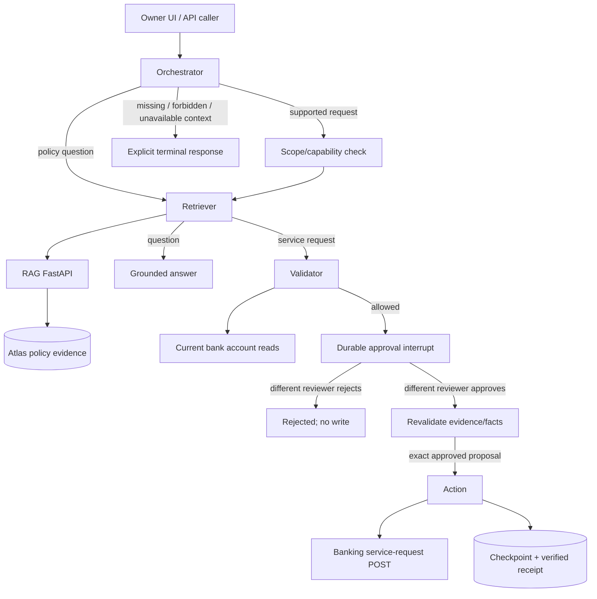

# Agent architecture and structural refactor report

**Follow-up:** the floor-checker and dependency-packaging blockers recorded below
were resolved in the [release fixes report](RELEASE_FIXES_REPORT.md). This document
preserves the earlier structural-refactor verification results.

Date: 30 October 2026. Scope: the explicitly approved Phase 2 structural plan and
Phase 3 verification. Changes are local commits; no push or deployment was performed.
The source baseline includes the existing maintained workflow, fixtures and quality
assets. Generated reports, presentation snapshots, `.archify` archives and local
skills were not swept into the baseline. Existing untracked work remains on disk.

## Outcome

The refactor moves shared startup and HTTP dependencies to their owning layers,
removes two verified unused test fragments, names four private banking callbacks,
and documents public Python interfaces. It retains APIs, scope rules, workflow
state, model import paths, graph node names and banking replay semantics.

**Release verdict: blocked by the pre-existing floor-checker failure.** Independent
checks pass, but `make check-full` stops at the floor guard. That is not waived.
The compatibility requirements file still omits the MongoDB checkpoint integration;
its correction remains a separately approved packaging follow-up.

## 1. Runtime entry points and agents

There is one classified LangGraph workflow with four main responsibilities, rather
than four independently running agent classes. The graph builder and supporting
response nodes are still in `app/agents/orchestrator.py`.

| Entry point | Responsibility |
|---|---|
| app.main:app / create_app | RAG FastAPI: retrieval, answers, evaluated answers, feedback, operations |
| app.agent_main:app / create_agent_app | Agent FastAPI: validation-only requests, durable runs, decisions and retries |
| app/streamlit_app.py / ui.app.main | Render policy, feedback and service-request workspaces |
| services.agent.build_workflow | Wire model classification, retrieval, validation and optional execution |
| AgentRunService.start/approve/retry | Persist or resume owner-scoped workflow execution |

| Agent responsibility | Invocation | Input/state read | Output/state written | Tools/services |
|---|---|---|---|---|
| Orchestrator: orchestrator / classify | First node after input screening | AgentRequest and explicit scope | resolved request, IntentDecision in decision | Versioned prompt and structured configured chat model; no authorization grant |
| Retriever: retrieve / retrieve_over_http | Policy questions or supported service requests | request, decision | policy_request, retrieved | RAG HTTP POST /retrieve; RAG uses OpenAI embeddings, scoped Atlas search, parents/amendments, optional reranker |
| Validator: validate / validate_service_request / validate_opt_in | After action-policy retrieval | request, retrieved, trusted ValidationAccess | validation, response, proposal_hash | Current banking account GET and deterministic evidence/ownership/eligibility checks; no LLM decision |
| Action: action / submit_service_request | Only after distinct reviewer approval and successful revalidation | exact request/validation, approved_hash, idempotency_key; service checks owner, bank identity, lease and retry window | submitted response and receipt; service records first attempt/final status | Banking POST /v1/service-requests with persisted Idempotency-Key and strict matching receipt |

The persisted graph state keys remain `request`, `decision`, `policy_request`,
`retrieved`, `validation`, `response`, `idempotency_key`, `proposal_hash` and
`approved_hash`. Ownership, expiry, banking fingerprint, execution lease and
recorded reviewer decision remain in the run record.

Supporting nodes are intentional: `supported_action` checks capability/scope;
`grounded_answer` calls the existing answer chain; `approval` pauses with an exact
fingerprint; `revalidate` refreshes evidence/facts; `clarification`, `forbidden`
and `customer_context` return explicit safe outcomes. Unsupported customer/case
operations are reachable fallback behavior, not dead code.

The policy-answer branch uses structured generation and at most one citation
repair attempt. Optional evaluation uses `StructuredJudge`, `RagasScorer` and
`MetricEmbeddings`; those judge/embedding adapters do not approve banking actions.
The Datadog Agent is infrastructure. Copied graphs under archives are snapshots,
not extra runtime agents.

### Worked example: interest certificate

1. The owner UI prepares customer `NXC-0010`, loan `NXL-HL-0010`, type
   `INTEREST_CERTIFICATE`, and policy date `2026-10-30`.
2. POST `/agent/runs` authenticates the owner and stores ownership, expiry and the
   operation key. Input screening and customer scope precede external work.
3. Orchestrator classifies `supported_action` and resolves required fields.
4. Retriever searches the bank-wide POL-OPS-001 operations clause through RAG;
   customer/action details are excluded from the retrieval request.
5. RAG returns scoped evidence and complete applicable amendments from Atlas.
6. Validator checks evidence and current bank accounts, including loan ownership
   and any explicitly selected product.
7. The graph retains the proposal hash and pauses at approval; UI shows
   `pending_approval` with the saved run ID.
8. A different authorized reviewer loads that run and submits the exact hash plus
   approve/reject. Self-approval and missing reviewer/customer permissions remain forbidden.
9. Reject returns without a bank write. Approve refreshes policy/account facts and
   blocks execution if the proposal no longer matches what was approved.
10. Action posts the exact payload with its persisted operation key, checks the
    returned customer/type/loan, and retains the submitted receipt.
11. Streamlit displays `submitted` and bank `RECEIVED`. This is a certificate
    service request, not a generated PDF or proof of downstream fulfillment.

This example is exercised through isolated graph/API/banking regression tests,
including the certificate scenario in the workflow dataset. No real bank write
or live provider call was performed by the refactor verification.



### Code/function navigation

- [app/main.py: create_app](../app/main.py#L14)
- [app/core/lifespan.py: lifespan](../app/core/lifespan.py#L18)
- [app/agent_main.py: create_agent_app](../app/agent_main.py#L12)
- [app/api/dependencies.py: rag_client](../app/api/dependencies.py#L14)
- [app/ui/agent.py: agent_workspace](../app/ui/agent.py#L89)
- [app/api/auth.py: get_validation_access](../app/api/auth.py#L18)
- [app/api/agent_runs.py: start](../app/api/agent_runs.py#L80)
- [app/services/agent_runs.py: AgentRunService](../app/services/agent_runs.py#L49)
- [app/services/agent.py: build_workflow](../app/services/agent.py#L41)
- [app/agents/orchestrator.py: build_agent_graph](../app/agents/orchestrator.py#L50)
- [app/services/agent_retrieval.py: retrieve_over_http](../app/services/agent_retrieval.py#L10)
- [app/services/validation.py: validate_service_request](../app/services/validation.py#L56)
- [app/services/service_requests.py: submit_service_request](../app/services/service_requests.py#L19)
- [app/database/agent_runs.py: MongoRunStore](../app/database/agent_runs.py#L49)

The [18-step architect CodeTour](../.tours/architect-agent-runtime.tour) and
[service-request tour](../.tours/feature-explainer-service-requests.tour) have verified
current-file line anchors. Neither pins a git ref that could hide working-tree files.

## 2. Change log

| Change | Reason / compatibility |
|---|---|
| Move lifespan from app/main.py to app/core/lifespan.py | Both factories share identical startup body/order; app.main.lifespan remains exported. Agent import no longer constructs the RAG app |
| Move rag_client/banking_client from app/api/agent.py to app/api/dependencies.py | Remove router-to-router import; legacy exports retain the exact same dependency objects |
| Update tests/test_ui.py startup monkeypatch | Patch the dependency at its new owning module, retaining the original fixture behavior |
| Remove unused TypeAdapter import in mock test | Explicit unused-import finding; no API behavior |
| Remove unused r1 binding in mock test | Preserve the POST that establishes idempotency; retain every assertion |
| Rename four private mock callbacks | h becomes create_case_record, append_case_note, escalate_case_record or create_service_request_record; paths/signatures/replay contract retained |
| Public Google-style docstrings | All 108 maintained modules and 475 public top-level definitions/methods are documented; nested application callbacks are documented where useful |
| Add tests/test_refactor_contracts.py | Verify shared dependency identity, startup order and absence of incidental RAG construction |
| Update maintained docs/tours | Keep startup/dependency ownership, examples and source anchors accurate |

No complete source file, public model, endpoint or graph node was deleted or
renamed. No generic agent class, loader abstraction, config option or dependency
was added. Documentation-only normalization removed no executable statements.

The AST comparison against the saved original files found **98 existing files
with documentation-only changes**. Executable changes were confined to the seven
planned existing files; all three relocated function bodies match their originals.
All existing assertions and skip markers were retained. No new skipped tests or
checker suppressions were introduced. Constraints, dependency files, lockfile, env example and CI file
contents match the captured pre-refactor versions.

## 3. Before and after tree

Only changed ownership is expanded below; other directories retain their files.

Before:

```text
app/
├── main.py                  lifespan + RAG factory
├── agent_main.py            imports lifespan from RAG entry point
├── api/
│   ├── agent.py             routes + shared HTTP client dependencies
│   └── agent_runs.py        imports dependencies from agent router
├── core/                    config, logging, telemetry, observability, budget
└── agents, chains, database, evaluation, models, services, ui/
tests/                       existing application suite
nexa_synthetic_data/api/mock_server/
├── server.py                four private callbacks named h
└── test_mock_api.py         unused import/binding
.tours/feature-explainer-service-requests.tour
```

After:

```text
app/
├── main.py                  RAG factory; retains lifespan export
├── agent_main.py            imports shared lifespan directly
├── api/
│   ├── dependencies.py      NEW: unchanged HTTP client implementations
│   ├── agent.py             existing routes + compatible dependency exports
│   └── agent_runs.py        imports shared dependencies
├── core/
│   ├── lifespan.py          NEW: unchanged startup implementation
│   └── existing modules
└── agents, chains, database, evaluation, models, services, ui/  retained
tests/
├── test_refactor_contracts.py  NEW: compatibility regressions
└── existing suite             retained, documented
nexa_synthetic_data/api/mock_server/
├── server.py                descriptive private callback names
└── test_mock_api.py         unused fragments removed; requests/assertions retained
.tours/
├── feature-explainer-service-requests.tour  refreshed anchors
└── architect-agent-runtime.tour            NEW: 18 verified steps
C4-Documentation/
├── AGENT_REFACTOR_REPORT.md
└── agent-refactor-verification-20261030.json
```

## 4. Before/after verification

| Check | Before | After |
|---|---|---|
| Application suite | 558 passed, 1 existing floor-checker failure | 561 passed, same 1 failure |
| Application coverage | 85.58% | 85.62%; floor 84.13% retained |
| Banking mock/OpenAPI contract suite | 22 passed | 22 passed |
| Ruff lint / formatting | Pass | Pass; 116 files formatted |
| mypy app tests | Pass, 103 source files | Pass, 106 source files |
| Task changed-line coverage | Baseline captured before edits | 37 executable lines, 0 missing, 100% |
| Security | Reviewed six-finding baseline | Semgrep 1.182.1: six existing findings, zero new ERROR findings, zero scan errors |
| API contracts | Captured before edits | Equal after removing documentation description fields only |
| Saved typed request | Serialized before edits | Restores AgentRequest and nested ServiceRequestDetails with original model paths |
| Dependency override identity | Existing router exports | Legacy/durable/new-module exports are the same objects |
| RAG/Agent/Streamlit startup | Existing factories and entry points | Isolated servers each returned HTTP200 on liveness, then were stopped |
| Overall make check-full | Floor guard crashes with KeyError | Same crash; release gate remains failed |

Changed-line coverage used the same final pytest coverage XML, with the complete
`git diff <dedicated-baseline> -- app` passed to standard diff-cover via
`--diff-file`. All application changes were committed/tracked; this checks the full
task application diff without recursively rediscovering unrelated archive paths.
No lines or files in that task diff were omitted to satisfy the 100% threshold.

The new checks retain dependency-override identity and startup order. Existing
workflow tests exercise all five request types, exact approval, rejection,
self-approval denial, scope, stale/expired decisions, revalidation and uncertain
write replay against isolated banking responses. The actual live banking service
was not used for a write. Startup liveness is not dependency readiness or a load test.

## 5. Remaining risks and exclusions

1. **Floor checker:** its diff contains copied Python files outside app/tests, while
   its source map contains only app/tests. Looking up such a path raises KeyError.
   Repairing that checker remains a separate change; no path was excluded and no
   assertion removed to hide it.
2. **Compatibility requirements:** requirements.txt still does not declare the
   directly imported MongoDB checkpoint package present in pyproject.toml. This
   packaging correction was explicitly excluded from structural approval.
3. **Existing security findings:** six reviewed browser-artifact findings remain.
   Zero new findings does not mean those six are safe or remediated.
4. **Mock deployment:** receipts, counters and replay records remain process-local;
   a restarted/multi-worker mock is not a production banking backend.
5. **Live quality and deployment:** no fresh provider/Atlas scored baseline,
   production deployment, sustained load or live banking action was performed.
6. **Retained contracts:** model module/class paths, graph keys/node names, published
   commands and public HTTP behavior remain stable. Historical snapshots and
   notebook cells were preserved rather than rewritten.

## 6. Commit ownership and review

Every new commit uses the prior repository identity **Pankaj** as author and
committer. No assistant identities or co-author trailers were added. The separate
baseline captures earlier work; each subsequent commit has one logical purpose.

| Commit | Purpose |
|---|---|
| `918730e` | chore: capture working-tree baseline before structural refactor |
| `0b66840` | refactor: share application startup without constructing the RAG app |
| `7dc86ad` | refactor: share agent HTTP dependencies and retain override identity |
| `3838796` | test: remove unused mock import and response binding |
| `bae667b` | refactor: name private mock banking callbacks by operation |
| `d165d11` | docs: document entry points and core with public API contracts |
| `be5fa2e` | docs: document agent graph and API with public API contracts |
| `a1db081` | docs: document shared contracts with public API contracts |
| `114abe7` | docs: document application services with public API contracts |
| `cd98bf3` | docs: document chains and storage with public API contracts |
| `060e641` | docs: document evaluation and UI with public API contracts |
| `0c5ec8b` | docs: document tests and mock contract with public API contracts |

A final documentation commit adds this report, the refreshed tours and public
run-method usage examples after the code/doc layer commits above.

What this change does: shares existing startup/dependencies, documents the public
contracts and removes only verified unused fragments. The source comparison,
contract checks and tests preserve the approved application behavior.

Verdict: the scoped refactor is verified; production release remains blocked by
the floor-checker failure and the separately identified packaging follow-up.
Not checked: live provider quality, live bank execution, production load or deployment.
