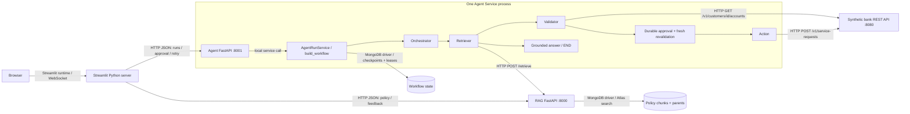

# NexaAssist: four-agent implementation and protocol guide

Current working-tree implementation, inspected **27 October 2026** on
`feat/prepayment-validator`, based on commit `032f3765`. Much of this implementation
is uncommitted; the commit alone does not contain everything described here.
All banking data and the supplied banking server are synthetic.

This guide accompanies the editable presentation in
[the presentation workspace](presentations/NexaAssist_Four_Agent_Workflow_ppt169_20261027/README.md).
It explains the implementation that exists, rather than the older proposed
architecture decks. See also the [session map](phase1-phase2-development-map.md)
and [recorded verification](../app/evaluation/results/phase12_completion_20261027/REPORT.md).

## 1. The system in one view

There are **four logical roles inside one Agent Service**: Orchestrator,
Retriever, Validator and Action. They are LangGraph nodes and injected Python
callables, not four separately deployed services or four independent models.
Only routing and grounded answer generation use the configured chat model.
The Validator and Action enforce deterministic rules.



The arrows between graph nodes represent **in-process asynchronous calls and
typed state updates**. REST occurs only at the labeled network boundaries.
Ports are local defaults and can be configured. The diagram omits the optional
reranker and telemetry to keep the main transaction visible.

## 2. Deployment, entry points and layers

| Component | Entry point / method | What it owns | Boundary |
| --- | --- | --- | --- |
| RAG application | [`app/main.py`](../app/main.py): `create_app()`, `lifespan()` | Retrieval, answers, evaluated answers, feedback, operational endpoints | Separate FastAPI app; default port 8000 |
| Agent application | [`app/agent_main.py`](../app/agent_main.py): `create_agent_app()` | Standalone orchestration and durable approved runs | Separate FastAPI app; default port 8001; reuses lifespan, not RAG routes |
| Streamlit entry | [`app/streamlit_app.py`](../app/streamlit_app.py) → [`ui/app.py`](../app/ui/app.py): `main()` | Policy chat, feedback review, service-request workspace | Browser uses Streamlit; Python server calls APIs |
| Batch ingestion | [`services/ingestion.py`](../app/services/ingestion.py): `main()`, `requests_from_register()`, `ingest()` | Document register and incremental policy ingestion | Separate batch execution; no agent endpoint needed |
| Pure chains | [`app/chains/`](../app/chains/) | LCEL prompts, retrieval/context/answer/embedding/reranking Runnables | No FastAPI or Streamlit business logic |
| API adapters | [`app/api/`](../app/api/) | Pydantic parsing, dependency injection, HTTP errors | Thin serving layer |
| Business services | [`app/services/`](../app/services/) | Composition, validation, bank submission and run lifecycle | Calls chains and adapters |
| Database adapters | [`app/database/`](../app/database/) | MongoDB clients, Atlas retrieval and workflow persistence | Driver traffic; policy access belongs to RAG |
| Synthetic bank | [`mock_server/server.py`](../nexa_synthetic_data/api/mock_server/server.py) | Supplied REST contract and fault-injection behavior | Local default port 8080; not a live-bank integration |

## 3. Protocol and interaction map

**JSON is a payload format. HTTP is a transport. REST and JSON-RPC are different
interface styles. Sending JSON with `httpx` does not make an API JSON-RPC.**

| Caller → callee | Method / protocol | Payload and response | Client / code |
| --- | --- | --- | --- |
| Browser → Streamlit | Streamlit runtime, including WebSocket interaction | Widget/session messages | Streamlit-managed; not a custom REST endpoint |
| Streamlit Python → RAG API | HTTP JSON REST: `POST /answer`, `/answer/evaluated`, `/retrieve`; feedback GET/POST | Shared request/response Pydantic models | `ui/app.py`: cached `api_client()` returns synchronous `httpx.Client`; `send_question()` |
| Streamlit Python → Agent API | HTTP JSON REST: run start/read/approval/retry | `AgentRequest`, `ApprovalDecision`, `AgentRunResponse` | `ui/agent.py`: `request_run()`, `agent_workspace()`; per-request bearer headers |
| Agent router → service | Local async Python call via FastAPI `Depends` | Already parsed models and trusted access | `api/agent_runs.py`: `run_service()` → `AgentRunService` |
| Graph node → graph node | In-process LangGraph state handoff | `AgentState` typed dictionary; Python/Pydantic objects | `StateGraph`, `RunnableLambda`, `.ainvoke()` |
| Retriever → RAG API | HTTP JSON REST: `POST /retrieve` | `RetrieveRequest` → `RetrieveResponse` | `services/agent_retrieval.py`: `retrieve_over_http()` with `httpx.AsyncClient` |
| RAG API → chain | Local async service/Runnable invocation | Retrieval/answer models | `retrieve_policy()`, `answer_policy()`, `.ainvoke()` |
| RAG → MongoDB Atlas | MongoDB driver wire protocol; Atlas Vector Search / optional Search | Vectors, filters, documents, parent sections and amendments | Official `langchain_mongodb`, PyMongo-backed adapters in `database/` |
| Agent lifecycle → MongoDB | MongoDB driver wire protocol | Ledger, checkpoints, checkpoint writes, leases and operation identity | `MongoRunStore`, official `MongoDBSaver`; bounded synchronous work offloaded with `asyncio.to_thread` |
| Validator → bank | HTTP JSON REST: `GET /v1/customers/{customer_id}/accounts` | `CustomerAccounts`; selected loan facts retained | `_read_accounts()` with async client and server-configured bank bearer token |
| Action → bank | HTTP JSON REST: `POST /v1/service-requests` | Exact `ServiceRequestProposal` → strict `ServiceRequestReceipt` | `submit_service_request()`; persisted `Idempotency-Key` |
| Routing / answer → model provider | Provider HTTPS JSON, Responses API via LangChain | Structured `IntentDecision` / `AnswerDraft` | `get_chat_model()` returns `ChatOpenAI(use_responses_api=True)` |
| Embeddings → provider | Provider HTTPS via integration SDK | Text batches → embeddings | `get_embeddings()` / `OpenAIEmbeddings` |
| Optional reranker → local model server | HTTP JSON; native llama.cpp `POST /completion`, Ollama `/api/generate`, or compatible `/completions` | Passage prompt → validated yes/no probabilities | `build_rerank_chain()`; selected provider/profile determines endpoint |
| App → Datadog | `ddtrace` / LLM Observability SDK telemetry | Workflow spans, model/token annotations, scored evaluations | `core/telemetry.py`, `core/observability.py`; destination depends on deployment |
| Future MCP clients → future tool server | **Not implemented**; MCP/JSON-RPC would be an additional adapter | No current MCP request/response contract | No application MCP server or JSON-RPC dispatch exists today |

Current application routes return ordinary JSON responses. They do not implement
token streaming, SSE, a custom WebSocket API or JSON-RPC envelopes.

## 4. Exact four-role and method map

| Role / control component | Source method | Input → output | How it works |
| --- | --- | --- | --- |
| Composition root | [`services/agent.py`](../app/services/agent.py): `build_workflow()` | Settings, HTTP clients, access, optional checkpoint/action adapter → compiled graph | Builds classifier, HTTP retriever, retained-evidence answer Runnable and deterministic Validator; injects them into `build_agent_graph()` |
| Orchestrator | [`agents/orchestrator.py`](../app/agents/orchestrator.py): nested `orchestrator()` in `build_agent_graph()` | `AgentRequest` → resolved request + `IntentDecision` | Screens unsafe input, invokes structured classifier, resolves explicit scope, detects conflicts and routes |
| Classification adapter | `build_workflow().classify()` | Request without action notes → `IntentDecision` | `ORCHESTRATOR_PROMPT \| llm.with_structured_output(..., strict=True)`; model output cannot grant customer access |
| Retriever node | `build_agent_graph().retrieve()` | Scoped request → `policy_request`, `retrieved` | Builds existing `RetrieveRequest`; fixed policy query for actions; invokes injected Runnable |
| HTTP retrieval adapter | [`services/agent_retrieval.py`](../app/services/agent_retrieval.py): `retrieve_over_http()` | `RetrieveRequest` → complete `RetrieveResponse` | One async POST, HTTP status check, strict response parse, exact `as_of` equality; no policy MongoDB access |
| Grounded answer control node | `build_agent_graph().grounded_answer()` → `build_workflow().answer()` | Retained request/evidence → `AnswerResponse` | Passes `RunnableLambda(lambda _: evidence)` into `build_answer_chain()`; consumes retained evidence without another HTTP lookup |
| Action preflight control | `build_agent_graph().supported_action()` | Resolved action + trusted scope → continue or safe stop | Requires allowed customer, supported operation, bank integration and correct opt-in product before retrieval |
| Validator | [`services/validation.py`](../app/services/validation.py): `validate_service_request()`, `validate_opt_in()`, `_read_accounts()` | Request + policy evidence + trusted access + bank facts → `ValidationResult` | Exact dated clauses, customer/loan ownership and deterministic predicates; performs GET only; returns approval-required proposal |
| Approval control node | `build_agent_graph().approval()` | Pending proposal/hash → reviewer resume or interrupt | LangGraph `interrupt()`; hash-bound `ApprovalDecision`; rejection ends without bank POST |
| Revalidation control node | `build_agent_graph().revalidate()` | Approved request/hash → fresh validation | Fresh policy retrieval and bank-fact GET; rechecks eligibility and exact request/validation digest |
| Action node | `build_agent_graph().action()` | Approved request + validation + saved key → submitted response | Checks trusted customer scope and exact approval digest before injected action adapter |
| Bank write adapter | [`services/service_requests.py`](../app/services/service_requests.py): `submit_service_request()` | Exact validated proposal + saved key → `SubmittedServiceRequest` | One fixed bank POST; strict receipt and customer/type/loan equality; no model-selected URLs or operations |
| Lifecycle owner | [`services/agent_runs.py`](../app/services/agent_runs.py): `AgentRunService.start()`, `get()`, `approve()`, `retry()`, `_drive()` | Authorized API operation → `AgentRunResponse` | Owns UUID, expiry, persisted operation identity, reviewer record, atomic mutation lease, deadlines and recovery |
| Persistence owner | [`database/agent_runs.py`](../app/database/agent_runs.py): `MongoRunStore.create()`, `get()`, `claim()`, `update()`, `release()` | Run metadata / lease-scoped updates → durable records | Institution-qualified access, official saver, restricted model serializer, majority/journaled writes, TTL |

Actual graph node names are `orchestrator`, `retriever`, `grounded_answer`,
`clarification`, `forbidden`, `customer_context`, `supported_action`, `validator`,
`approval`, `revalidate`, `action`. Approval, revalidation and answer generation
are supporting nodes; they do not increase the four agent-role count.

Routing correction, 29 October 2026: if the classifier labels an explicit
`createServiceRequest` with typed `action_details` as `customer_context`, the
graph routes it through `supported_action`. Forbidden decisions retain priority;
scope conflicts, missing fields, authorization, validation and approval still
apply. General customer-context queries remain unavailable. Restart the Agent
API and prepare a new run to use the correction; completed old runs retain their
saved result.

## 5. Policy question: one retrieval, retained evidence

1. A client posts an `AgentRequest` to `POST /agent`. Policy answering can work
   without an Agent bearer credential; action access remains conditional.
2. Unsafe requests stop; missing lookup date, required product or conflicting
   scope produces `needs_clarification` before retrieval. General policy
   questions do not require a customer. Jurisdiction is an optional explicit
   filter; it is preserved when supplied.
3. The Retriever calls existing `POST /retrieve` once with lookup date, product,
   jurisdiction and `top_k`. Institution/confidentiality scope comes from server
   configuration in the RAG service.
4. RAG returns `as_of`, ranked `results`, full `amendments` and `timings`. Each
   hit retains child text, complete parent text, score/rank and its `Citation`
   (`doc_id`, title, version, clause, effective date). Complete amendments take
   precedence in the response's combined `evidence` property.
5. The answer Runnable returns this same object to `build_answer_chain()`.
   The chain calls a Runnable named retriever, but that Runnable supplies the
   saved object: **it performs no second HTTP retrieval**.
6. Context assembly fits complete evidence into the token budget. If a required
   complete amendment cannot survive context assembly, the chain abstains.
   Inline markers must match evidence IDs and quoted text must be a nonblank,
   exact contiguous substring of its parent. One repair attempt is allowed.
7. Return `answered`, `insufficient_evidence` or `needs_clarification`, retaining
   existing answer statuses and citations; then end.

Example synthetic policy request:

```json
{
  "query": "What part-prepayment minimum applies to NexaHome as of 2026-07-15?",
  "as_of": "2026-07-15",
  "product_id": "NEXA-HL",
  "top_k": 5
}
```

## 6. RAG components reused by the agents

| Component | Source method | Responsibility |
| --- | --- | --- |
| Ingestion Runnable | [`chains/ingestion.py`](../app/chains/ingestion.py): `build_ingestion_chain()` | Parse → clause chunks/parents → metadata/checksum → compare → incremental embedding/upsert |
| Parsing / chunking | `parse_document()`, `chunk_by_clause()` | Preserve policy structure, tables and lists; keep full parent sections |
| Embeddings | [`chains/embeddings.py`](../app/chains/embeddings.py): `get_embeddings()` | Configured provider/model/dimensions; batched integration |
| Atlas stores | [`database/mongo.py`](../app/database/mongo.py): `get_vector_store()`, `get_parent_store()` | Explicit collection, embedding and index configuration; official MongoDB integration |
| Search composition | [`services/retrieval.py`](../app/services/retrieval.py): `retrieve_policy()` → `build_retrieval_chain()` | Dated scoped retrieval, parent validation and complete linked amendments |
| Hybrid / amendments | [`database/retrieval.py`](../app/database/retrieval.py): `build_hybrid_search()`, `build_amendment_search()` | Optional dense + BM25/RRF; complete scoped circular expansion |
| Reranking | [`chains/rerank.py`](../app/chains/rerank.py): `build_rerank_chain()` | Optional trained-model ordering; fail-closed probability validation |
| Context / answers | `assemble_context()`, `render_context()`, `build_answer_chain()` | Budgeted complete evidence, structured drafts and deterministic citation checks |
| Evaluation | `answer_with_quality()`, `collect_records()`, `RagasScorer`, `StructuredJudge`, `phase_gate.compare()` | Reuse answer evidence; measure quality and compare complete same-protocol baselines |
| Feedback | `submit_feedback()`, `list_recent()`, `review()` | Persistent staff feedback with separate reviewer protection |

Default settings use **dense retrieval** and `rerank_enabled=False`. The verified
hybrid/reranker profile requires its configuration, the documented text index
and a reachable compatible reranker. Ingestion currently writes multiple
collections without a transaction; concurrent ingestion needs a separate design.

## 7. Supported Validator use cases

All five types use one `createServiceRequest` workflow, shared access checks and
the same approval/Action path. They do not each introduce another Validator model.

| `request_type` | Required policy evidence | Extra deterministic conditions |
| --- | --- | --- |
| `STATEMENT_COPY` | Complete applicable `POL-OPS-001` v1.0 clause 5.1, effective 2025-01-01 | Authorized customer; any supplied loan must belong to that customer and match a supplied product |
| `CALLBACK` | Same operations permission | Same shared ownership/product checks |
| `RE_KYC_REMINDER` | Same operations permission | Reminder proposal only; does not complete KYC |
| `INTEREST_CERTIFICATE` | Same operations permission | Selected loan required; ownership/product checks; does not issue a certificate itself |
| `OPT_IN_CIR_2026_07_PART_PREPAY` | Complete `CIR-2026-07` v1.0 clause 5.2 amendment, effective 2026-07-01 | `NEXA-HL`, selected owned loan, policy `POL-HL-V3`, version `NHL-2025-10`, sanction before 2026-07-01, explicit current opt-in flag false |

Validator outcomes: `allowed`, `blocked`, `insufficient_evidence`, `unavailable`.
Only `allowed` may carry a proposal and must carry evidence. Every result keeps
`requires_approval=True`. A validation-only `/agent` response maps allowed to
`validated`; that status is not permission to bypass the durable approval gate.

## 8. Approved action: prepare, review, revalidate, execute

Example owner request to `POST /agent/runs` (illustrative synthetic IDs; select
an actually eligible loan from the configured corpus for a live demo):

```json
{
  "query": "Prepare my prepayment opt-in service request for review.",
  "as_of": "2026-07-15",
  "product_id": "NEXA-HL",
  "customer_id": "NXC-0001",
  "action": "createServiceRequest",
  "action_details": {
    "request_type": "OPT_IN_CIR_2026_07_PART_PREPAY",
    "loan_account_id": "SELECT_AN_OWNED_ELIGIBLE_LOAN"
  }
}
```

The client supplies a **named owner bearer token**. The service screens unsafe
input and explicit unauthorized customer scope before creating request-bearing
ledger/checkpoint data. It saves a UUID, owner, customer, expiry, stable operation
key and hash of the configured bank destination/credential identity.

```mermaid
sequenceDiagram
    actor Owner
    actor Reviewer
    participant API as Agent FastAPI
    participant Run as AgentRunService / LangGraph
    participant DB as Workflow MongoDB
    participant RAG as RAG FastAPI
    participant Bank as Synthetic bank REST
    Owner->>API: POST /agent/runs + owner bearer
    API->>Run: start(AgentRequest)
    Run->>DB: Ledger + key; atomic lease
    Run->>RAG: POST /retrieve (initial proposal)
    RAG-->>Run: Complete dated evidence
    Run->>Bank: GET /v1/customers/{id}/accounts
    Run->>DB: Synchronous checkpoint + request/validation digest
    Run-->>Owner: 201 pending_approval + run_id + proposal_hash
    Reviewer->>API: POST /agent/runs/{id}/approval + decision/hash
    API->>Run: approve(ApprovalDecision)
    Run->>DB: Authorize reviewer, claim lease, save decision
    Run->>RAG: POST /retrieve (fresh approval-time policy)
    Run->>Bank: GET current accounts / recheck predicates
    Note over Run: Require allowed + same approved digest
    Run->>DB: Persist action checkpoint + first_attempt_at
    Run->>Bank: POST /v1/service-requests + saved Idempotency-Key
    Bank-->>Run: Strict matching RECEIVED receipt
    Run->>DB: Save completed result, release lease
    Run-->>Reviewer: submitted + receipt + evidence
```

A **different named reviewer** must have `can_approve=True` and customer scope.
The approval body is `{"decision":"approve","proposal_hash":"<exact loaded 64-hex hash>"}`
or `reject`. It binds the exact request, proposal and retained validation evidence
using canonical JSON SHA-256 in `proposal_digest()`.

Approval-time revalidation is intentional **new retrieval in a later HTTP
request**, not duplicate retrieval during answer generation. It checks current
facts again. Failed predicates stop; a changed allowed proposal/relevant evidence
digest blocks and requires a new run and approval. The digest includes validation
evidence, not every raw banking field or every unrelated retrieval result.

The Action rechecks owner entitlement, bank identity, exact approved digest and
proposal equality. It POSTs only the fixed allowlisted operation. The receipt
must have a nonblank ID, timezone-aware creation time, `RECEIVED` status and the
same customer, request type and loan. **Bank acceptance is not business completion.**

## 9. Persistence, states and uncertain writes

| State / condition | Behavior |
| --- | --- |
| `running` | A bounded graph mutation owns an atomic lease |
| `pending_approval` | Durable interrupt and exact proposal hash; no bank write |
| `expired` | Approval TTL elapsed; default 900 seconds; reject stale approval |
| `rejected`, `blocked`, `insufficient_evidence`, `unavailable` | End safely without Action where applicable |
| `submitted` | Validated bank receipt saved; later retry returns saved result |
| `unconfirmed` | An Action attempt may have committed; 503 instructs recovery of the same run |
| `failed` | Failure before confirmed completion; response/storage path determines safe error |
| Concurrent mutation / stale hash | 409; reload/reconcile rather than create an uncontrolled second write |

`MongoRunStore` uses institution-qualified metadata and LangGraph thread IDs,
separate `agent_runs`, `agent_checkpoints`, `agent_checkpoint_writes` collections,
restricted model deserialization and majority/journaled writes. The default
retention is seven days, minimum two days; MongoDB TTL deletion is asynchronous.
Ledger updates require a still-valid lease. A checkpoint is not an exactly-once
guarantee for an external bank effect.

For ambiguous timeouts or invalid receipts, call
`POST /agent/runs/{run_id}/retry`. It resumes only an unfinished **approved
Action**, with the original key, body and bank identity. It does not repeat
eligibility after a possible successful opt-in write, because the first write
may already have changed the customer's opt-in flag. The service persists
`first_attempt_at` before the POST and refuses retry at or beyond 23 hours;
the supplied bank retains replay keys for 24 hours. Reconcile later uncertainty
with the bank. There is no automatic external-write retry or exactly-once claim.

## 10. Agent API reference

All routes use ordinary JSON. `Depends()` creates bounded `httpx.AsyncClient`
instances for RAG/bank calls; redirects are disabled. Inbound owner/reviewer
credentials and the server's outbound bank credential are different identities.

| Method / path | Router → service | Request → response | Access / behavior |
| --- | --- | --- | --- |
| `POST /agent` | `api.agent.agent()` → `orchestrate()` | `AgentRequest` → `AgentResponse`; 200 | Policy answering can be anonymous; actions need authorized scope. No durable approval or write; `submission` excluded |
| `POST /agent/runs` | `api.agent_runs.start()` → `AgentRunService.start()` | `AgentRequest` → `AgentRunResponse`; 201 | Named principal; starts durable policy/action run |
| `GET /agent/runs/{run_id}` | `read()` → `.get()` | UUID → `AgentRunResponse`; 200 | Owner or eligible scoped reviewer; foreign run hidden with 404 |
| `POST /agent/runs/{run_id}/approval` | `approve()` → `.approve()` | `ApprovalDecision` → `AgentRunResponse`; 200 | Different scoped approver; exact pending hash and unexpired run |
| `POST /agent/runs/{run_id}/retry` | `retry()` → `.retry()` | UUID, no body → `AgentRunResponse`; 200 | Authorized reader/mutator under service rules; only saved unfinished approved Action or saved submitted result |
| `POST /agent/submit` | `api.agent.submit()` → `orchestrate()` + `submit_service_request()` | `AgentSubmissionRequest` + `Idempotency-Key` → submitted or safe `AgentResponse`; 200 | Compatibility only; **disabled by default**; explicit flag and access required; immediate submission has no separate durable reviewer gate |
| `GET /health` | Reused `operations.health()` | → `{"status":"ok"}`; 200 | Liveness only; no dependency readiness test |
| `GET /metrics` | `api.agent.metrics()` | → request/completion counters; 200 | Process-local counters |

Shared models live in [`models/agent.py`](../app/models/agent.py),
[`models/agent_run.py`](../app/models/agent_run.py) and
[`models/validation.py`](../app/models/validation.py). Unexpected fields are
rejected. Typical HTTP failures are 422 malformed input, 403 access/disabled
operation, 404 hidden/not-found run, 409 state/lease/hash/retry conflict and
503 unavailable/unconfirmed dependency. Domain statuses may also be returned
inside HTTP 200 responses. Runtime errors are not all enumerated in OpenAPI.

## 11. Separate RAG API reference

| Method / path | Router → service | Request / response | Access / behavior |
| --- | --- | --- | --- |
| `POST /retrieve` | `api.retrieval.retrieve()` → `retrieve_policy()` | `RetrieveRequest` → `RetrieveResponse`; 200 | Existing policy retrieval contract; used by Agent HTTP adapter |
| `POST /answer` | `api.answer.answer()` → `answer_policy()` | `RetrieveRequest` → `AnswerResponse`; 200 | Ordinary RAG answer; independent of Agent graph |
| `POST /answer/evaluated` | `evaluated_answer()` → `answer_with_quality()` | `EvaluatedAnswerRequest` → `EvaluatedAnswerResponse` (answer + quality); 200 | Generates once and scores retained evidence |
| `POST /feedback` | `api.feedback.submit()` → `submit_feedback()` | `FeedbackRequest` → `FeedbackRecord`; 201 | Persists staff feedback |
| `GET /feedback` | `list_recent()` → service `list_recent()` | recent records; 200 | Separate `FeedbackReviewer` bearer; limit 1–100, default 20; no cursor |
| `POST /feedback/{feedback_id}/review` | `review()` → service `review()` | `FeedbackReview` → `{"status": request.status}`; 200 | Separate reviewer protection; service returns whether update succeeded |
| `GET /health` | `operations.health()` | status JSON; 200 | Liveness only |
| `GET /metrics` | `operations.metrics()` | counters/latency JSON; 200 | Process-local |
| `GET /metrics/latency` | `operations.latency_metrics()` | latency summary; 200 | Process-local recent samples |

The RAG app has eight distinct paths (feedback GET/POST share a path); Agent has
eight paths. Each app serves its own `/docs` and `/openapi.json`. The snapshot in
[`api-contract.json`](../app/evaluation/results/phase12_completion_20261027/api-contract.json)
records both generated schemas. OpenAPI currently displays bearer security for
`/agent` even though the implementation permits policy-only anonymous requests;
use the actual dependency behavior described above when integrating.

Feedback review returns 401 when reviewer credentials are missing/invalid,
503 if review is unconfigured or storage is unavailable, and 409 for an absent
or already reviewed record. Feedback submission also returns 409 when a saved
submission ID is reused with a different payload.

## 12. Guardrails, deadlines and safe failure

- `unsafe_input()` screens instruction overrides and selected sensitive-number,
  PAN-like and secret-key patterns before model/tools; durable runs reject before
  request-bearing storage. This is conservative screening, not complete DLP or
  adversarial-model protection.
- `get_validation_access()` resolves configured named credentials to frozen
  trusted `ValidationAccess`. Customer entitlement never comes from a model or
  request-body privilege claim. The legacy training token cannot own durable runs.
- The retriever checks HTTP status, strict response schema, finite scores/timings
  and returned lookup date. Invalid data and dependency errors fail safely.
- Bank GETs verify response/customer identity; Action checks exact payload and
  strict receipt identity. Public errors disclose safe messages, not raw payloads,
  credentials or model/driver tracebacks.
- Defaults: HTTP 60 seconds, run mutation 180 seconds, approval TTL 900 seconds.
  Agent graph recursion is 8 for standalone and 12 for durable runs. MongoDB work
  has five-second bounds. These settings are bounded in configuration.
- Agent model defaults: at most 3 calls, 2048 completion tokens per call and 64000
  conservative reserved tokens including a possible SDK retry. This is an
  estimate of Agent chat work, not a dollar budget or downstream/distributed quota.

## 13. UI, telemetry and recorded tests

The Streamlit **Policy chat** workspace uses the separate RAG endpoints.
**Service requests** uses the Agent run APIs: prepare as owner, load UUID,
inspect proposal/evidence, approve/reject as a different reviewer, recover the
same unconfirmed run. Cached HTTP clients are keyed by base URL. Bearer tokens
are attached to individual requests, not the shared client; credential changes
clear loaded proposal state. The UI is not the authorization authority.

`init_telemetry()` initializes Datadog instrumentation; structlog emits JSON.
Workflow spans cover orchestration, validation, Agent runs and submission.
Prompt/model annotations and token logging are in `core/observability.py`.
RAGAS/judge reports and source hashes are local evidence. Remote telemetry
receipt depends on the configured deployment and was not rechecked for this deck.

Recorded evidence for the 27 October source snapshot:

| Check | Recorded observation | Limit |
| --- | --- | --- |
| Application regression suite | 525 passed; 85.39% app line coverage; 100% changed lines | Deterministic E2E uses fake models and HTTP/ASGI bank boundaries |
| Real MongoDB workflow/persistence | 72 passed | Subset of 525, not 72 additional unique tests |
| Source/secret scan | 0 new findings, 0 scan errors | Six historical browser-artifact findings remain; no dependency-advisory claim |
| Live RAG quality | Dense and hybrid/reranker each match 10/10 expected statuses | Same ten cases; eight answerable cases scored by RAGAS per profile; one run each |
| Container/UI checks | Non-root image and reranker; desktop/mobile workflow checks | No production IAM, sustained-load or live-bank certification |

Relevant tests: `test_agent.py` (single retrieval/clarification/failures),
`test_agent_action_graph.py` (approval/revalidation/Action), `test_validation.py`
(five request types), `test_agent_runs.py`, `test_agent_persistence.py`,
`test_agent_run_auth.py`, `test_action_receipt.py`, `test_agent_ui.py`, and the
supplied bank's independent `test_mock_api.py` contract/fault suite.
Application/provider tests were not rerun solely to create this documentation;
the presentation validation records whether the source hashes still match.

## 14. Run and extend the current system

From the repository root, after configuring the required settings without
publishing credentials:

```bash
uv run --locked uvicorn app.main:app --port 8000
uv run --locked uvicorn app.agent_main:app --port 8001
uv run --no-sync --env-file .env python -m streamlit run app/streamlit_app.py
```

Use separate terminals. Launch Streamlit with `python -m` from the repository
root so the local `app` package remains importable; the bare `streamlit` console
command can raise `ModuleNotFoundError: No module named 'app'` in this setup.
Bank/Atlas/model dependencies and named principals must
be configured for the workflow being demonstrated. Consult
[the existing agent setup guide](../app/agents/README.md) rather than inventing
credentials or banking data. Keep `AGENT_ALLOW_DIRECT_SUBMIT=false` for approved
flows. To run routine checks, use `make check-full`; `make check-ai` makes live
provider/Atlas calls and follows the separately approved evaluation procedure.

To support another request type, change only the boundaries that actually need
it: the bank's documented request/receipt contract, `ServiceRequestType` and
required fields, deterministic policy/fact predicates, fixed action routing,
classification prompt when needed, and failure/approval/retry tests. The current
UI derives its type choices from the shared literal, but a new required input
also needs UI handling. Preserve evidence, owner/reviewer separation, exact
approval binding and idempotency; do not create a second generic model that
grants permission. For a different bank operation, add its explicit adapter and
receipt validation rather than letting the model construct a URL or payload.

Future seams are deliberately separate:

- **MCP / JSON-RPC:** add an MCP adapter around existing typed services with
  explicit transport, schemas and authorization; no current RPC integration to
  claim or demo.
- **Case tools / customer context:** some intent/action enum names exist, but
  those integrations are unavailable today. They need contracts, rules and tests.
- **Production operations:** gateway/TLS, OIDC/SSO/IAM, multi-instance telemetry,
  load and failure drills, backups, reconciliation, retention policy and provider
  costs need deployment-specific evidence. Existing local checks do not cover them.

## 15. How the presentation maps to this guide

| Slides | Teaching topic | Guide sections |
| --- | --- | --- |
| 1–5 | System boundaries, protocols, layers and four roles | 1–4 |
| 6–10 | Routing, one-retrieval policy path, evidence, grounding and RAG | 4–6 |
| 11–17 | Five use cases, prepayment, approval, execution and recovery | 7–9 |
| 18–22 | Agent/RAG APIs, security, UI and operations | 10–13 |
| 23–24 | Test evidence and measured AI quality | 13; recorded verification report |
| 25–26 | Safe extension and developer navigation | 14–15 |

Speaker notes name the implementation methods and their source files. Editable
diagrams explain the process; this README retains the exhaustive engineering map.
