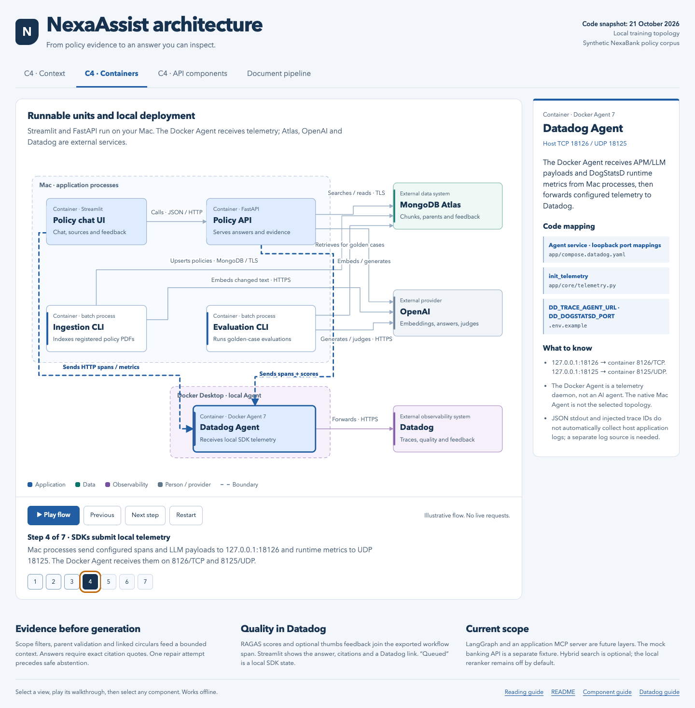

# NexaAssist architecture explorer

The latest [Archify architecture](../.archify/architecture-nexaassist-20261021-214925/nexaassist.html)
adds a source-verified overview of the current RAG, RAGAS, feedback and Docker
Agent paths. Choose **Live** for animated flows; select a component to see its
source files and line ranges. Use **Route** to follow a directed path, and zoom
in to reveal tags. Its [source notes](../.archify/architecture-nexaassist-20261021-214925/SOURCE_NOTES.md)
describe the local snapshot. Animation illustrates configured calls, not live traffic.

Open [the interactive architecture](nexaassist-architecture.html) in a browser.
It is a self-contained HTML file: no server, account, build step or internet
connection is needed. Keep it in this folder for its relative code links to work.

For a quick look without opening HTML, use the
[static preview](nexaassist-architecture-preview.png). The
[validation notes](architecture-validation.md) record the browser and source checks.

This view was mapped to the source on **21 October 2026**. It describes the
implemented local training topology, not a verified production deployment.
Animation illustrates calls and data movement; it makes no application requests
and shows no live telemetry or measured timing.

## Reading the diagrams

| View | What it explains | Use it when |
|---|---|---|
| C4 Context | People, NexaAssist and its external dependencies | Introducing the system and its scope |
| C4 Containers | Independently runnable applications, CLI jobs, data stores and the Docker Agent | Explaining deployment and connections |
| C4 API components | Responsibilities inside the FastAPI process | Following retrieval, answers, RAGAS and feedback in code |
| Document pipeline | Sequential ingestion stages and database writes | Explaining how a PDF becomes searchable evidence |

A C4 **container** means a runnable unit, not necessarily a Docker container.
LangChain, RAGAS, `ddtrace` and `structlog` are libraries inside application
processes. They are not extra microservices. The document pipeline is a dynamic
view of stages inside the ingestion CLI, rather than another deployment view.

Select a box for its purpose, code mapping and limitations. Use **Play flow**
for animated arrows and moving markers, **Pause** to inspect a step, or
**Next step** to advance manually. The numbered buttons jump directly to a step.
**Restart** returns to the first step and pauses. Switching views also pauses.
Keyboard users can tab to boxes and press Enter or Space. On small screens,
scroll inside the diagram; the details panel appears beneath it. Reduced-motion
preferences suppress moving arrows and markers while retaining step navigation.

Blue indicates application logic, green data, purple observability, and gray a
person/provider. Dashed enclosing rectangles identify process/deployment
boundaries. Arrows are directional and labelled with the call or transfer. A
highlighted path represents
the selected walkthrough step, not a running request. Response legs and some
ancillary SDK dependencies are omitted to keep each view readable.

## The current runtime topology

- **Streamlit** runs on the Mac at `127.0.0.1:8501`. Its cached HTTP client calls
  FastAPI; retrieval and model logic stay outside the UI.
- **FastAPI** runs on the Mac at `127.0.0.1:8000`. Thin routers validate requests
  and call services, which compose chains and database adapters.
- **MongoDB Atlas** stores child vectors, parent sections and feedback in
  separate configured collections. The vector and optional hybrid text indexes
  are provisioned using [the checked-in definitions](../app/database/indexes.md).
- **OpenAI** supplies configured embeddings, generated answers and evaluation
  model calls. Secrets and actual `.env` overrides are not embedded in the diagram.
- **Docker Datadog Agent 7** receives host HTTP telemetry on
  `127.0.0.1:18126` → `8126/TCP` and runtime metrics on
  `127.0.0.1:18125` → `8125/UDP`, then forwards to Datadog over HTTPS.
  This is the selected Agent topology, rather than the native macOS Agent.
- **Ingestion and evaluation CLIs** import the shared application logic directly.
  They run independently of FastAPI, while sharing Atlas/provider capacity.

See [the Compose service](../app/compose.datadog.yaml),
[settings template](../.env.example) and [Datadog guide](../DATADOG_README.md).
JSON logs go to stdout; trace ID injection alone does not configure host log
collection. `/health` is liveness. Retrieval counters and latency percentiles
are process-local, not fleet-wide readiness or SLO measurements.

## A question through the application

1. Streamlit submits the query, `as_of`, `top_k` and optional scope fields to
   `/answer/evaluated` by default. A supplied reference is optional. Plain answer
   mode uses `/answer`; evidence mode uses `/retrieve`.
2. The service retrieves once. Search filters institution, effective date range,
   jurisdiction, confidentiality and optional product. Ranked children expand to
   parents only when their source/scope metadata match. A missing or mismatched
   parent falls back to the matched child.
3. Linked circular discovery follows policy/supersedes identities and validates
   all stored parts of each circular. Inconsistent scope fails closed. Complete
   amendments supplement the ranked results; they are not similarity scores.
4. Context assembly prioritizes amendments and fits complete evidence units into
   the default 6000-token evidence budget. If a required amendment cannot fit,
   generation abstains. This budget excludes the prompt and output tokens.
5. The prompt and structured model generate a draft. Every inline evidence ID
   must match its citation and every quoted string must occur in the source.
   A failed draft gets one repair attempt using the same evidence, then safe
   abstention. Clarification and insufficient-evidence responses use fixed text.
6. The evaluated path scores the **final returned answer** against the same
   budgeted context. Faithfulness and answer relevancy can score without a
   reference; context precision and recall require a supplied or matching golden
   reference. Individual metric errors/timeouts remain explicit.
7. Scored `ragas_*` values join the exported
   `policy_answer_live_evaluation` span in Datadog. Streamlit displays the answer,
   sources and a Datadog link, without RAGAS score cards. The API and saved
   evaluation reports still retain metric results.
8. Optional feedback saves an Atlas record before best-effort `thumbs` delivery
   to the answer span. Exact retries require both the same `submitter_id` and
   `submission_id`. Reviewer-token access protects listing and review updates.

The real API response returns to the UI after live evaluation completes. In the
animation, independent SDK exports and later feedback are explained sequentially
for teaching; their visual order is not a distributed scheduling guarantee.

## Where to look in code

| Responsibility | Source |
|---|---|
| Chat, API calls and Datadog link | [app/ui/app.py](../app/ui/app.py) |
| API creation and startup | [app/main.py](../app/main.py) |
| Plain/evaluated answer routes | [app/api/answer.py](../app/api/answer.py) |
| Retrieval wiring and LCEL chain | [services/retrieval.py](../app/services/retrieval.py), [chains/retrieval.py](../app/chains/retrieval.py) |
| Linked circulars and optional hybrid search | [database/retrieval.py](../app/database/retrieval.py) |
| Whole-source context packing | [chains/context.py](../app/chains/context.py) |
| Draft generation, citation repair and abstention | [chains/answer.py](../app/chains/answer.py) |
| Live evaluation and Datadog span association | [services/evaluation.py](../app/services/evaluation.py), [evaluation/live.py](../app/evaluation/live.py) |
| Feedback persistence, retry protection and review | [services/feedback.py](../app/services/feedback.py), [database/feedback.py](../app/database/feedback.py), [api/auth.py](../app/api/auth.py) |
| Register → parsing → chunking → indexing | [services/ingestion.py](../app/services/ingestion.py), [chains/ingestion.py](../app/chains/ingestion.py) |
| Batch evaluation | [evaluation/run.py](../app/evaluation/run.py) |
| Operational tracing and JSON logs | [core/telemetry.py](../app/core/telemetry.py), [core/logging.py](../app/core/logging.py) |

The interactive HTML's embedded `architecture-data` block is its editable diagram
source. `catalog` holds node explanations and source paths; `views` defines node
positions, labelled relationships and walkthrough steps. It uses inline SVG,
CSS and JavaScript without third-party runtime assets.

## Limits to keep visible

Dense retrieval is the default. Atlas hybrid search is optional and needs its
manual text index; a full live quality comparison remains open. The local
reranker adapter is wired but disabled by default, with a recorded compatibility
failure. LangGraph and an application MCP server remain future layers. The mock
banking API is a separate fixture and is not connected to chat.

Citation validation checks exact source membership, not semantic truth. Model
scope/date interpretation can still fail or abstain. An institution filter does
not establish complete multi-tenant write isolation, and a shared reviewer token
does not establish individual user roles. There is no durable Datadog feedback
outbox. Ingestion writes across collections are not a transaction or a locked job.
“Queued” does not prove telemetry reached Datadog.

For the saved application test evidence and outstanding gaps, read the
[21 October fix report](../app/evaluation/results/fixes_20261021/FIX_REPORT.md).
This diagram does not rerun that application validation or verify cloud delivery.
The older C4 inventories in this folder are dated historical snapshots; this
explorer and the current [README](../README.md) describe the updated topology.

