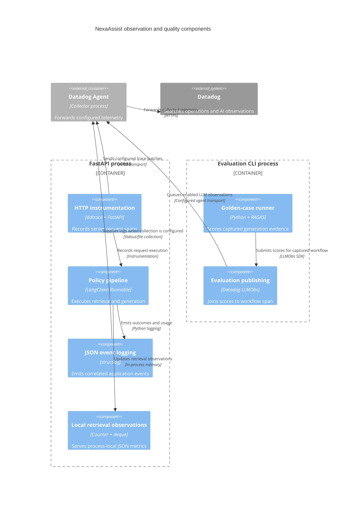

# C4 component — observability and evaluation hooks

> Earlier architecture snapshot. For the current Docker Agent,
> live evaluation, feedback authorization and citation-repair flows, use the
> [21 October interactive architecture](nexaassist-architecture.html) and
> [reading guide](architecture-explorer.md).

**Type:** cross-cutting library components inside the API and CLI processes. **Technology:** `ddtrace`, Datadog `LLMObs`, `structlog`, LangChain callbacks, RAGAS, Python `Counter` and bounded `deque`.

**Purpose:** explain operational behavior separately from answer quality, preserving evidence about startup order, request timing, model usage, citations and offline score provenance.

## Implemented interfaces and evidence

| Interface | Behavior | Source |
|---|---|---|
| `init_telemetry(enabled: bool) -> None` | Conditionally calls `ddtrace.patch_all()`; its docstring requires `ddtrace-run` before FastAPI construction and environment loading before SDK startup | [telemetry.py:4](../app/core/telemetry.py#L4) |
| `lifespan(_app: FastAPI) -> AsyncIterator[None]` | Loads settings, initializes telemetry/logging, prewarms token encoder | [main.py:20](../app/main.py#L20) |
| `configure_logging(level: str) -> None` | Adds context variables, level, ISO timestamp, exception formatting and JSON renderer | [logging.py:8](../app/core/logging.py#L8) |
| `TokenUsageLogger.on_llm_end(...) -> None` | Emits `model_token_usage` for returned `AIMessage.usage_metadata` | [observability.py:23](../app/core/observability.py#L23) |
| `latency_summary() -> dict[str, int | float]` | Nearest-rank p50/p95/p99 from at most 1,000 successful retrievals in this process; empty buffer produces zeros | [observability.py:15](../app/core/observability.py#L15) |
| `GET /metrics` | Retrieves request/error/empty counts and accumulated successful retrieval latency; counter resets on process restart | [operations.py:16](../app/api/operations.py#L16) |
| `GET /metrics/latency` | Exposes the local retrieval sample count and percentiles as JSON | [operations.py:26](../app/api/operations.py#L26) |
| `assemble_context(...)` | Packs complete evidence units within the token budget | [context.py:31](../app/chains/context.py#L31) |
| `collect_records(...)` | Offline generation with an optional Datadog `policy_answer_evaluation` workflow per case; reuses the exact retrieval response during generation | [run.py:80](../app/evaluation/run.py#L80) |
| `publish_datadog_evaluations(...) -> int` | Joins numeric judge and eligible RAGAS scores plus boolean status agreement to exported workflow span references | [run.py:231](../app/evaluation/run.py#L231) |
| `quality_gate(report, minimum) -> bool` | Explicit supplied minimum only; checks aggregate RAGAS means, each judge score and status agreement | [run.py:215](../app/evaluation/run.py#L215) |

Complete signatures, dependencies and all ancillary evaluation classes/functions are documented in [core inventory](c4-code-app-core.md), [evaluation inventory](c4-code-app-evaluation.md) and [test inventory](c4-code-tests.md).

## Trace and log paths

1. Early `ddtrace-run` instruments supported integrations before [create_app()](../app/main.py#L28) constructs FastAPI. The runtime environment determines service/env/version, transport and feature settings.
2. An Answer-mode Streamlit action calls `POST /answer` via [send_question()](../app/ui/app.py#L107). Evidence mode calls `POST /retrieve`; UI state is not a business-logic layer.
3. Router → service → named `answer_policy` / `retrieve_policy` Runnables. MongoDB and provider SDK spans depend on enabled, supported automatic instrumentation. Captured nesting should be verified in a trace rather than inferred from a service name.
4. The service records `retrieval_completed` with count/latency and `answer_completed` with answer status, citation count and generation duration. Provider usage metadata, when present, becomes `model_token_usage`.
5. Configured Datadog tracing can inject trace/span identifiers into structlog records; [test_telemetry.py:10](../tests/test_telemetry.py#L10) validates nonzero IDs and service/env/version plus FastAPI server spans locally. JSON logging itself does not ship logs.
6. SDK trace data goes to its configured transport; a separately configured Agent can collect stdout/file logs.

Useful JSON events include `retrieval_stages`, `parent_section_missing`, `retrieval_empty`, `retrieval_completed`, `model_token_usage`, `answer_citation_validation_failed`, `answer_completed`, `answer_failed`, `retrieval_failed`, `document_ingested`, `document_retired`, `evaluation_completed` and `evaluation_failed`.

## Offline quality path

The executable runner's default dataset is root-level `evaluation/datasets/answer.jsonl`: 10 cases, including two expected abstentions. [tests/test_evaluation.py:18](../tests/test_evaluation.py#L18) enforces these counts.

For each case, `collect_records` resolves reference text from Atlas, retrieves once, packs context, replays that retrieval into answer generation, and records actual supplied context. The selected `EVAL_JUDGE_MODEL`, falling back to `CHAT_MODEL`, returns correctness, groundedness and rationale. RAGAS separately computes faithfulness, answer relevancy, context precision and context recall for answerable cases. Answerable cases with empty supplied evidence receive zeros in the executable runner. Expected abstentions skip RAGAS and receive judge/status checks.

With LLMObs enabled, the workflow stores inputs/outputs, prompt version and settings metadata, exports its span reference, submits scores with `eval_scope="span"`, and flushes. The report says `queued`, not confirmed UI visibility. The separate `/answer/evaluated` endpoint also scores new chat questions when the Streamlit RAGAS toggle is enabled.

`RagasScorer` constructs the shared Responses API and embedding adapters used by both batch and live RAGAS. Its unused alternate `score` method was removed. Batch failures fail the quality run; optional live failures preserve the answer and return explicit metric statuses. Teaching fixtures distinguish mechanical citation checks from semantic truth.

## Component diagram

The shown Agent route represents the normal agentful configuration, not an assertion that agentless LLMObs is unsupported. Deployment configuration determines actual transport. Local JSON metric endpoints intentionally have no outbound export arrow.

## Implemented versus absent

| Capability | Source-level status |
|---|---|
| HTTP server spans and correlation | Supported and locally tested under early `ddtrace-run`; cloud ingestion remains environment-dependent |
| MongoDB/provider tracing | Supported integration path; deployment and installed integration compatibility determine captured details |
| Structured JSON application logs | Implemented; collection/forwarding must be configured separately |
| Retrieval counters and latency percentiles | Implemented per process; not global fleet percentiles, persistent metrics or Datadog custom metric export |
| Token event logging | Implemented when provider returns usage metadata; not an independent billing reconciliation |
| Offline judge + RAGAS + score join | Implemented, conditional Datadog publishing and explicit optional gate |
| Local LCEL run collection | Evaluation callbacks retain named chain runs in local reports |
| Online semantic evaluation for every question | Absent from the normal answer service |
| Trace links in chat UI | Absent from current response contracts/UI |
| Browser RUM / synthetic tests / Continuous Profiler | No setup in this source scope |
| Datadog dashboards, monitors, SLOs as code | No definitions in this source scope; an external account may have separately configured objects |
| Prometheus/OpenMetrics or DogStatsD exporter | No implementation in the inventoried source |
| Separate judge model selection in the main runner | Not wired; `Settings.eval_judge_model` is not used by `run.py` |

## Verification limits

This is a source inventory and architectural synthesis. The telemetry test uses a trace processor that consumes spans without an Agent, so a passing test proves local instrumentation and correlation only. MongoDB handshake spans such as `hello`/`ismaster` can occur without a policy query. Matching a server `fastapi.request` span for `POST /answer` is the appropriate first request-level check. No new application behavior or remote configuration was introduced by this documentation work.
