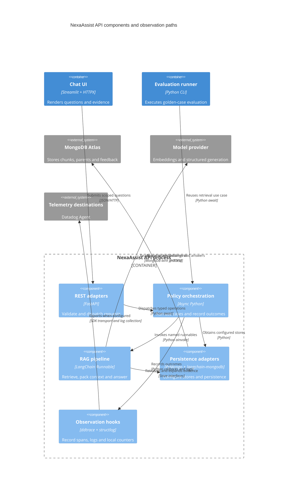

# C4 component index — NexaAssist

> Earlier architecture snapshot. For the current Docker Agent,
> live evaluation, feedback authorization and citation-repair flows, use the
> [21 October interactive architecture](nexaassist-architecture.html) and
> [reading guide](architecture-explorer.md).

This index synthesizes the bottom-up inventory of 63 Python modules in `app/` and `tests/`. It describes source behavior, not a claim that every optional integration is enabled in a running environment. Libraries below execute inside their owning process; they are not additional deployable containers.

| Component | Owner / technology | Interfaces and responsibility | Source inventory |
|---|---|---|---|
| Chat and review presentation | Streamlit process / Streamlit + HTTPX | `main()`, `send_question()`; HTTP calls to `/answer`, `/retrieve` and feedback endpoints; session-only chats | [UI](c4-code-app-ui.md), [entry points](c4-code-app.md) |
| REST adapters | API process / FastAPI | `POST /answer`, `POST /retrieve`, `POST /feedback`, `GET /feedback`, `POST /feedback/{feedback_id}/review`, `GET /health`, `GET /metrics`, `GET /metrics/latency` | [API](c4-code-app-api.md) |
| Policy orchestration | API process / typed async Python | `answer_policy(request, settings)`, `retrieve_policy(request, settings)`, feedback services; owns completion logs and retrieval counters | [Services](c4-code-app-services.md) |
| Retrieval, context and grounded answer pipeline | API process / LangChain Runnable + ChatOpenAI | Date/product/jurisdiction filtering; child search, parent expansion; budgeted context; structured answer and mechanical citation validation | [Chains](c4-code-app-chains.md), [prompts](c4-code-app-chains-prompts.md) |
| Persistence adapters | API or CLI process / PyMongo + langchain-mongodb | Explicit Atlas vector index/store factories, parent docstore, feedback persistence, reference text resolution | [Database](c4-code-app-database.md) |
| Configuration and observation hooks | API or CLI process / pydantic-settings + structlog + ddtrace | Configuration loading, JSON logs, early patching, token callback, bounded local latency samples | [Core](c4-code-app-core.md), [observability component](c4-component-observability.md) |
| Domain contracts | API, UI and CLI / Pydantic v2 | Strict retrieval/answer/feedback/ingestion data structures and validation | [Models](c4-code-app-models.md) |
| Ingestion workflow | CLI process / Python + LangChain | Parses authoritative register documents, chunks/enriches, embeds changed children, replaces parents, removes stale chunks; explicit retirement | [Services](c4-code-app-services.md), [chains](c4-code-app-chains.md) |
| Offline quality evaluation | Evaluation CLI / RAGAS + Datadog LLMObs | Golden-case execution, exact generation-context reuse, numeric judge, four RAGAS metrics, optional score submission and quality gate | [Evaluation](c4-code-app-evaluation.md), [teaching snapshots](c4-code-app-evaluation-datasets.md) |
| Verification suite | Test process / pytest + mocks + local subprocess | Controlled behavior checks; trace/log correlation test consumes spans locally without Agent calls | [Tests](c4-code-tests.md) |

## Component relationships

The diagram focuses on the API boundary; evaluation imports the same chain/core/database libraries into its own process. Datadog APM ordinarily uses the local Agent; JSON logs need separate collection configuration. Local `/metrics` JSON has no automatic outbound exporter.

## Important source boundaries

- The ordinary service path is dense retrieval: [services/retrieval.py:21](../app/services/retrieval.py#L21) does not pass a candidate-search or reranker adapter. Hybrid and reranking components exist, with unit tests and teaching callers, but merely enabling their configuration fields does not activate them for ordinary API requests.
- `Settings.eval_judge_model` exists, but [evaluation/run.py:83](../app/evaluation/run.py#L83) uses the answer chat model for the numeric judge. The generated report explicitly records this same-model limitation.
- [chains/answer.py:60](../app/chains/answer.py#L60) validates markers, evidence IDs and quoted substrings. A genuine quote does not mechanically prove that a generated policy claim is correct; semantic evaluation and human review remain separate.
- There is no LangGraph or MCP implementation under the inventoried application tree. Neither is needed to describe the present request path.

## Bottom-up coverage

The code inventories cover every Python-containing directory in the specified source scope, including complete explicit function/method signatures, class fields, source line links, imported dependencies and local call relationships. The `datasets` inventory covers JSON teaching observations without treating them as executable code. Generated evaluation results, corpus files, installed dependencies and assets are excluded.
