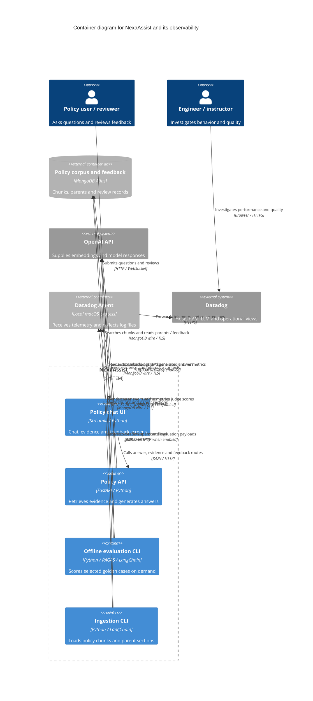

# NexaAssist container architecture

> Earlier architecture snapshot. For the current Docker Agent,
> live evaluation, feedback authorization and citation-repair flows, use the
> [21 October interactive architecture](nexaassist-architecture.html) and
> [reading guide](architecture-explorer.md).

Source snapshot: 19 October 2026. Containers here are independently runnable applications or data stores, not Python packages and not necessarily Docker containers. This describes the implemented local development topology; it does not assert that every optional telemetry feature is currently enabled.

## Runnable units and interfaces

| Unit | Implemented responsibility | Interface / deployment |
|---|---|---|
| Streamlit UI | Session-local chat, date/product/source filters, answer/evidence mode, user feedback and review | `app/streamlit_app.py` → `app/ui/app.py`; local process, documented port 8501; a preview may use another port |
| FastAPI API | Thin routes delegate to service functions; LCEL chains perform retrieval and answer generation | `app.main:app`; local Uvicorn process on 8000; API-only Dockerfile available |
| Evaluation CLI | Reuses retrieval/answer chains, evaluates the exact supplied evidence, writes JSON reports; optionally exports Datadog workflow evaluations | `python -m app.evaluation.run`; batch process, not called by UI requests |
| Ingestion CLI | Parses source register, stores parents, embeds/upserts policy chunks | `python -m app.services.ingestion`; batch write process |
| MongoDB Atlas | Separate chunk, parent-section and feedback collections | Configured connection string; manually provisioned vector index |
| Datadog Agent | Independent local telemetry daemon; not a LangGraph/LLM agent | APM/LLM HTTP receiver; DogStatsD UDP receiver; separately configured file-log collector |

LangChain, `ddtrace`, `structlog`, `pydantic-settings` and the MongoDB integration are libraries inside these units. They are not separate deployment containers. RAGAS is an optional evaluation dependency. The current Dockerfile installs API dependencies without the Streamlit/evaluation extras and contains neither an Agent nor `.env`.

## Exact API contract

The generated [OpenAPI 3.1 contract](apis/nexaassist-api.json) comes directly from `app.main.app.openapi()`, without starting lifespan, reading application secrets, or calling Atlas/models.

| Method | Path | Behavior |
|---|---|---|
| GET | `/health` | Process liveness; does not check Atlas or the provider |
| GET | `/metrics` | Process-local retrieval counts and cumulative successful retrieval latency |
| GET | `/metrics/latency` | Nearest-rank percentiles over up to 1,000 successful retrievals in this process |
| POST | `/retrieve` | Filtered dense vector retrieval with parent-section expansion |
| POST | `/answer` | Same retrieval plus structured generation and citation validation |
| POST | `/feedback` | Saves a review record; returns 201 |
| GET | `/feedback` | Reads recent records; limit 1–100 |
| POST | `/feedback/{feedback_id}/review` | Records a review decision; 409 when absent or already reviewed |

The generated schema documents typed payloads and validation errors exactly as FastAPI emits them. Source handlers additionally raise explicit 503 dependency failures and feedback review 409 responses; these raised errors are not all explicitly declared in the generated OpenAPI responses. No authentication dependency is implemented on these routers. Restrict access according to deployment needs before exposing reviewer operations beyond the local training setup.

## Telemetry contracts and boundaries

- APM spans describe HTTP/database/model execution timing. `ddtrace-run` must start before application imports for complete FastAPI instrumentation; the lifespan `patch_all()` hook alone is insufficient.
- `structlog` writes JSON events to stdout. Native Datadog log injection can add IDs when enabled. Separate Agent file-source configuration and readable files are required to ingest those logs.
- Runtime metrics use the SDK/Agent metrics path when enabled. The API's JSON `/metrics` routes are not wired to Datadog custom metrics or a fleet-wide histogram.
- Offline `policy_answer_evaluation` workflow spans receive existing judge/RAGAS score submissions through `LLMObs.submit_evaluation`. These are separate SDK payloads joined to exported span identifiers, not scores computed by APM itself. In selected Agent mode the SDK uses the Agent proxy; optional agentless export is a different deployment choice.
- Datadog is the telemetry destination. Local LCEL run collection supports evaluation reports without a separate trace service.

## Evidence and implementation limits

Source anchors: [API startup](../app/main.py#L19), [UI HTTP calls](../app/ui/app.py#L107), [API settings](../app/core/config.py#L10), [dense service wiring](../app/services/retrieval.py#L18), [vector/parent stores](../app/database/mongo.py#L25), [token logs](../app/core/observability.py#L23), [JSON logging](../app/core/logging.py#L8), [metrics](../app/api/operations.py#L11), [evaluation workflow](../app/evaluation/run.py#L81), [evaluation submissions](../app/evaluation/run.py#L231), [API image](../app/Dockerfile#L1).

Hybrid search and reranker helpers exist but `retrieve_policy` does not pass either into `build_retrieval_chain`; configuration fields alone do not activate them. UI chat history is session-local and is not sent as conversational memory. A distributed UI→API trace requires an active UI parent context and propagated HTTP headers. This document does not verify running processes, current Agent configuration, signed-in Datadog visibility, Docker delivery, or cloud provisioning.

Related: [Context](c4-context.md), [Deployment](c4-deployment.md), [Question flow](c4-dynamic-policy-question.md), [Component index](c4-component.md), [Datadog operational guide](../DATADOG_README.md).

Bottom-up inventories supporting this synthesis: [application entrypoints](c4-code-app.md), [UI](c4-code-app-ui.md), [API](c4-code-app-api.md), [services](c4-code-app-services.md), [database](c4-code-app-database.md), [core](c4-code-app-core.md), [evaluation](c4-code-app-evaluation.md), and [observability component](c4-component-observability.md).
