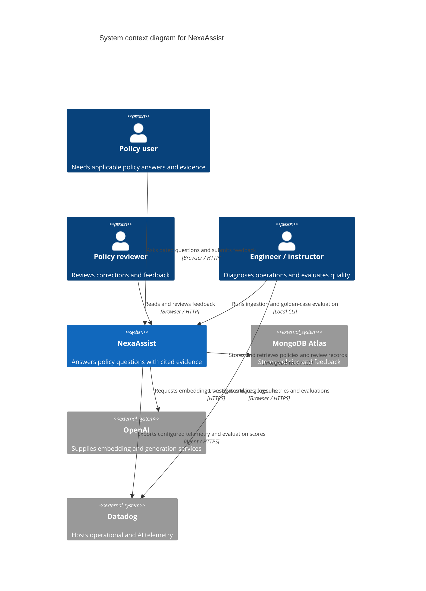

# NexaAssist system context

> Earlier architecture snapshot. For the current Docker Agent,
> live evaluation, feedback authorization and citation-repair flows, use the
> [21 October interactive architecture](nexaassist-architecture.html) and
> [reading guide](architecture-explorer.md).

NexaAssist helps NexaBank policy users find date-applicable policy evidence and receive answers with quotations and citations. Engineers investigate request performance and evaluate AI answer quality through separate observability and offline evaluation workflows.

## Personas and journeys

| Persona | Goal | Implemented journey |
|---|---|---|
| Policy user | Obtain an applicable answer with evidence | Open Streamlit → choose policy date/product/source limit → ask in Answer mode → read answer and quoted citations, or an explicit insufficient-evidence response → optionally submit feedback |
| Evidence explorer | Examine relevant source material directly | Select Evidence mode → submit a question → inspect matching parent sections and child citation metadata |
| Reviewer | Triage proposed corrections | Open Review feedback → load recent records → enter reviewer identity and review note → accept/reject a pending record |
| Engineer / instructor | Diagnose latency and failures | Generate a request → search the corresponding API span/time window → inspect child operations and correlated logs → compare process metrics |
| Evaluation operator | Assess answers against selected golden cases | Invoke evaluation CLI → retrieve once per case → generate using that evidence → compute judge/RAGAS scores → save report → inspect optional Datadog evaluations tied to the workflow |
| Ingestion operator | Refresh the versioned corpus | Invoke ingestion CLI with document register → parse/chunk/enrich/embed → upsert chunks and parent sections in configured Atlas stores |

The same human may act in several personas. The current UI exposes reviewer identity as entered data; it is not an authenticated authorization role. Programmatic callers use the same FastAPI JSON interfaces as the UI.

## Current scope and evidence

The current question path is retrieval-augmented generation with date/applicability filtering, parent context and citation validation. It is not a LangGraph agent or MCP service. MongoDB Atlas is the external data system; the embedding/generation provider is configured by the application. Datadog's local Agent is a telemetry process, not an AI agent. Datadog handles configured telemetry; this task does not inspect secret `.env` values.

The user-facing chat displays recent conversations within a Streamlit session. Each request sends one question with filters; model memory across turns is not implemented. Offline quality evaluation is a deliberate separate execution and is not triggered automatically by chatting.

Source anchors: [question UI](../app/ui/app.py#L107), [answer/citation rendering](../app/ui/app.py#L22), [review UI](../app/ui/app.py#L60), [answer chain](../app/chains/answer.py#L20), [ingestion CLI](../app/services/ingestion.py#L76), [evaluation entrypoint](../app/evaluation/run.py#L293), [application settings](../app/core/config.py#L10).

Related: [Container architecture and API](c4-container.md), [Deployment](c4-deployment.md), [Dynamic question flow](c4-dynamic-policy-question.md), [Component index](c4-component.md).

Bottom-up evidence: [UI inventory](c4-code-app-ui.md), [chain inventory](c4-code-app-chains.md), [service inventory](c4-code-app-services.md), [evaluation inventory](c4-code-app-evaluation.md).
