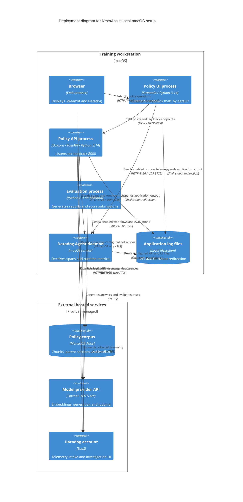

# NexaAssist local deployment and deployment options

> Earlier architecture snapshot. For the current Docker Agent,
> live evaluation, feedback authorization and citation-repair flows, use the
> [21 October interactive architecture](nexaassist-architecture.html) and
> [reading guide](architecture-explorer.md).

This diagram represents the documented local macOS topology, not a claim that new runtime validation was performed. API/UI ports are the documented defaults; a preview process may use 8502. See the [Datadog runbook](../DATADOG_README.md#4-local-setup-on-macos) for exact setup commands.

## Startup contract

1. Install locked dependencies including `ui` and `evaluation` extras when using both workflows.
2. Load `.env` into the process environment before `ddtrace-run`; Pydantic reading `.env` does not export SDK settings.
3. Launch API under `ddtrace-run uvicorn app.main:app` so instrumentation is installed before FastAPI imports/routes.
4. Launch UI under its own `nexaassist-ui` service identity; point `API_BASE_URL` to the API.
5. Configure the Agent independently for its site/API key, APM, runtime-metric receiver and readable API/UI log sources.

The documented file-log location is `/Library/Logs/NexaAssist/`, outside the cloud-synced checkout. Log collection needs explicit source configuration; JSON output and trace-ID injection alone do not deliver logs.

## Available options versus implemented deployment artifacts

| Topology | Repository evidence | Operational implication |
|---|---|---|
| Local macOS processes + Agent | `DATADOG_README.md`, application entrypoints | Selected documented development setup; independent API/UI/Agent processes |
| API Docker image | `app/Dockerfile` | Python 3.14 API image starts with `ddtrace-run`; does not include UI, evaluation extras, secrets or Agent |
| Separate app/Agent containers | Runbook instructions | Use reachable private Agent hostname; loopback normally addresses the same container only |
| Linux VM | Runbook instructions | Same SDK contract; provision Agent/service manager/secrets/log collection separately |
| ECS Fargate sidecar | Runbook instructions | Same-task Agent, injected secrets and independent supported log pipeline required |
| Agentless LLM export | Optional runbook configuration | Different export path; does not provision Agent-based host metrics, file logs or DogStatsD |

No Docker Compose, Kubernetes, Terraform or tested cloud stack is supplied by this observability implementation. Docker builds and cloud delivery are explicitly unverified in the runbook. No CPU/memory sizing, autoscaling policy, SLO or alert threshold has been established by this code.

Datadog is the configured telemetry destination. The selected Docker Agent path is documented in the current architecture explorer; actual running-process state is not inspected here.

Source anchors: [Docker image](../app/Dockerfile#L1), [startup hook](../app/main.py#L19), [early-instrumentation guidance](../app/core/telemetry.py#L4), [telemetry regression test](../tests/test_telemetry.py#L10), [settings](../app/core/config.py#L10), [UI base URL](../app/core/config.py#L61), [local/cloud runbook](../DATADOG_README.md).

Related: [Containers](c4-container.md), [Context](c4-context.md), [Question flow](c4-dynamic-policy-question.md).

Bottom-up evidence: [application entrypoint inventory](c4-code-app.md), [core inventory](c4-code-app-core.md), [test inventory](c4-code-tests.md), [observability component](c4-component-observability.md).
