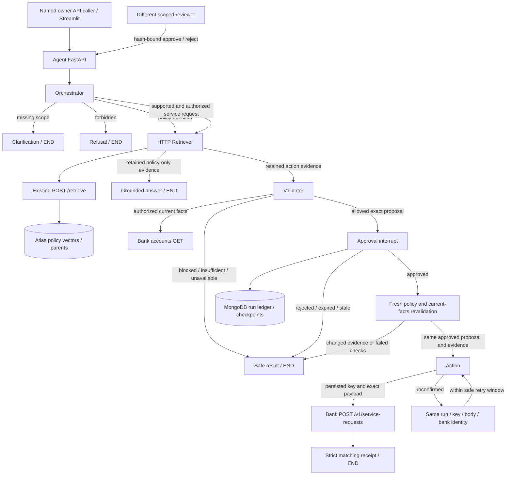

# Approved service request: current dynamic architecture

27 October 2026. This view describes the integrated implementation, rather than
the older proposed architecture deck. Four roles run in one Agent Service;
approval and revalidation are control nodes, not additional agent roles.
The current Streamlit service-request workspace calls the same APIs for owner
preparation, reviewer decisions and uncertain-operation recovery. See the
[complete session map](phase1-phase2-development-map.md) for Phase 1 and future seams.



The RAG retrieval client never queries MongoDB directly. MongoDB access from
the Agent Service is limited to the separate workflow persistence layer. The
existing RAG app and Streamlit policy UI remain available. These roles do not
require four models or four deployments: only interpretation/answer generation
uses the configured model; deterministic validation and execution enforce policy.

```mermaid
sequenceDiagram
    actor Owner
    actor Reviewer
    participant API as Agent API
    participant Graph as Orchestrator / Retriever / Validator / Action
    participant RAG as Existing RAG API
    participant Mongo as Workflow MongoDB
    participant Bank as Banking API
    Owner->>API: POST /agent/runs + owner bearer token
    API->>Mongo: Create owner-bound run and stable operation key
    API->>Graph: Start bounded graph with server customer scope
    Graph->>RAG: POST /retrieve (once in this request)
    RAG-->>Graph: Full response, amendments, parents, citations and as_of
    Graph->>Bank: GET authorized customer accounts
    Graph->>Mongo: Synchronous checkpoint with proposal/evidence hash
    Graph-->>API: Approval interrupt
    API-->>Owner: 201 pending_approval + run_id + proposal_hash
    Reviewer->>API: POST /runs/{run_id}/approval + decision/hash
    API->>Mongo: Authorize reviewer/owner scope; atomically claim run lease
    API->>Graph: Command(resume=decision)
    Graph->>RAG: Fresh lookup for this approval request
    Graph->>Bank: Recheck current customer facts
    Graph->>Mongo: Persist approved state before Action
    Graph->>Bank: POST exact proposal + saved Idempotency-Key
    Bank-->>Graph: Actual service-request receipt
    Graph->>Mongo: Persist validated result
    API-->>Reviewer: submitted + RECEIVED receipt + evidence
```

On an ambiguous timeout or invalid receipt, the bank may have committed. Retry
only the persisted Action, using the original key, path, caller and exact body.
The graph does not rerun eligibility after an uncertain opt-in write because a
successful first attempt may already have changed the customer's opt-in flag.
Repeated successful retries return the saved result without another write.
Concurrent mutations return 409; rejected approvals and failed validations write
nothing. The conservative retry limit is less than 23 hours from the first
attempt, below the supplied mock's 24-hour replay window; later attempts require
bank reconciliation. Checkpoints do not establish exactly-once effects.

| Owner | Current files and responsibility |
| --- | --- |
| API boundary | `app/api/agent_runs.py`: strict models, UUID paths, named credentials, safe status/errors |
| Graph | `app/agents/orchestrator.py`: common routing, retained evidence, approval, fresh revalidation and Action edges |
| Composition | `app/services/agent.py`: one reusable graph factory; preserves the independent policy/validation API |
| Workflow lifecycle | `app/services/agent_runs.py`: owner/reviewer access, exact approval, run leases, deadlines and retry limits |
| Rule checks | `app/services/validation.py`: shared operations permission plus the original narrow prepayment predicate |
| Bank write | `app/services/service_requests.py`: exact proposal equality, fixed endpoint, strict matching receipt |
| Persistence | `app/database/agent_runs.py`: official MongoDB saver, restricted serializer types, majority/journaled writes, TTL and atomic ledger updates |
| Contracts | `app/models/agent_run.py`, `agent.py`, `validation.py`: request/state/result and exact approval digest |
| Verification | `tests/test_agent_runs.py`, `test_agent_action_graph.py`, `test_agent_persistence.py`, `test_agent_run_auth.py`, `test_action_receipt.py` |

The run and checkpoint retention default is seven days, with a two-day minimum
to retain uncertain operation identity beyond the retry window. TTL cleanup is
asynchronous. Production operators must choose retention, encryption, backups,
access roles, TLS, gateway identity and reconciliation procedures for their
deployment; the training defaults are not regulatory policy.

Named API keys are server-configured identities, not completed OIDC/SSO or
multi-tenant operations. The legacy shared token cannot own durable runs. The
immediate `/agent/submit` compatibility path is disabled by default. Case tools,
MCP, currency budgets and AWS rollout remain explicit gaps.

Implementation uses [LangGraph interrupts](https://docs.langchain.com/oss/python/langgraph/interrupts)
and the [official MongoDB checkpoint integration](https://www.mongodb.com/docs/atlas/ai-integrations/langgraph/).
Installed adapter compatibility is recorded in the syllabus gap analysis.
