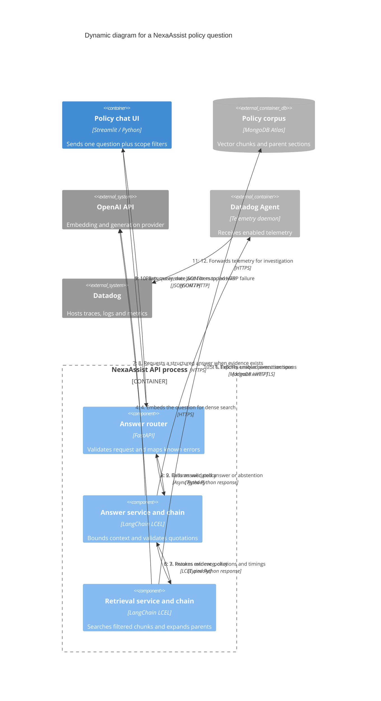

# NexaAssist policy question: execution and observation

> Earlier architecture snapshot. For the current Docker Agent,
> live evaluation, feedback authorization and citation-repair flows, use the
> [21 October interactive architecture](nexaassist-architecture.html) and
> [reading guide](architecture-explorer.md).

This dynamic view describes one Answer-mode request. Numbered relationships show causal order; telemetry arrows describe export alongside execution rather than synchronous business dependencies.

## What actually happens

- The UI sends the current question, policy date, optional product and source limit. Previous displayed turns are not added to the request as model memory.
- The current service constructs a dense retrieval chain without a hybrid candidate-search runnable or reranker. The chain filters for applicability dates, jurisdiction, confidentiality and optional product. Helpers supporting other modes are not active in this API path.
- Atlas chunk hits expand to unique parent sections. Context assembly enforces a token budget before generation. If there is no usable context, the answer chain returns insufficient evidence and skips generation.
- A generated structured draft is accepted only when citation markers match evidence IDs and quotations occur in the supplied parent context. Otherwise the chain abstains. This validates quotation/source consistency; it does not prove complete answer correctness.
- The API maps supported provider/database/parser/HTTP failures to a generic 503 and emits `answer_failed`. Successful HTTP delivery can still contain an insufficient-evidence status.

## Observation paths

| Signal | Trigger | Where to inspect | Limit |
|---|---|---|---|
| FastAPI request span | Early `ddtrace-run` instrumentation | APM: `fastapi.request`, `POST /answer`, server kind | MongoDB heartbeat spans alone do not prove this span exists |
| Dependency spans | Supported instrumented database/HTTP/model calls | Trace flame graph/waterfall | Library instrumentation/configuration determines captured spans |
| LLM telemetry | Supported enabled LangChain/OpenAI integration | Agent / LLM Observability | No offline judge/RAGAS scores are computed by the ordinary UI path |
| JSON events | `retrieval_stages`, `retrieval_completed`, `model_token_usage`, `answer_completed`, failures | Collected and correlated Logs Explorer | Requires Agent file collection and parsing |
| Runtime metrics | Enabled SDK runtime metrics | Runtime/infrastructure views | Separate from API JSON retrieval counters |
| Local retrieval diagnostics | Successful retrieval response and metrics routes | API response, `/metrics`, `/metrics/latency` | Process-local, successful-request latency window; no fleet aggregation |

The Datadog Agent is a daemon, not an LLM agent. Logs, spans, runtime metrics and evaluation SDK submissions are separate telemetry types. A single distributed UI/API trace requires an active UI parent trace and propagated context; the HTTP call being instrumented is insufficient by itself to guarantee every browser interaction is represented.

Offline evaluation follows another execution: CLI → retrieval → generation using the same retrieved evidence → same-model judge and RAGAS → local report → optional `policy_answer_evaluation` workflow score submissions. Expected abstentions get judge/status metrics, not invented RAGAS scores. An SDK `queued` result plus flush is not proof of ingestion or signed-in UI visibility.

Source anchors: [UI request](../app/ui/app.py#L107), [router](../app/api/answer.py#L23), [service](../app/services/answer.py#L16), [active retrieval construction](../app/services/retrieval.py#L18), [retrieval algorithm](../app/chains/retrieval.py#L34), [answer validation](../app/chains/answer.py#L30), [evaluation workflow](../app/evaluation/run.py#L81), [score export](../app/evaluation/run.py#L231).

Related: [Containers](c4-container.md), [Context](c4-context.md), [Deployment](c4-deployment.md), [Component index](c4-component.md).

Bottom-up evidence: [chain inventory](c4-code-app-chains.md), [service inventory](c4-code-app-services.md), [API inventory](c4-code-app-api.md), [observability component](c4-component-observability.md).
