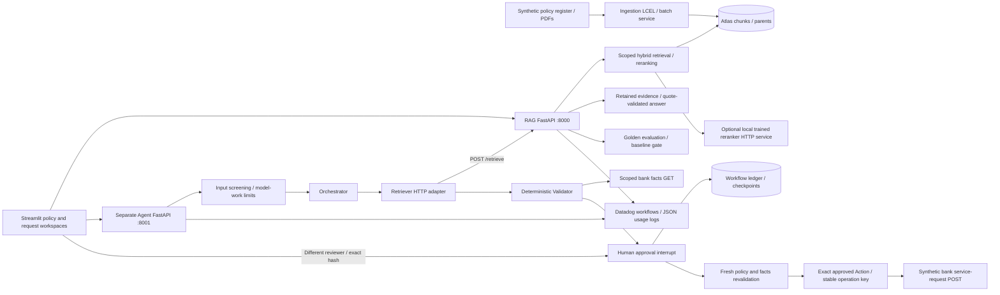

# Phase 1 and Phase 2: code and development map

27 October 2026. This maps the supplied syllabus's first twenty sessions to the
current implementation, its verification, and the places to extend it. The
syllabus is training evidence; its example stacks and cloud-design columns do
not override this repository's MongoDB, LangChain, FastAPI, Streamlit and Datadog
choices. Later phases extend these services rather than replacing them.

## Runtime ownership



Only the Orchestrator and answer generation use the configured chat model.
Validator and Action enforce typed rules and HTTP contracts. Four logical roles
do not require four models. The Retriever never queries MongoDB directly;
workflow persistence is a separate Agent Service responsibility.

## Phase 1 session map

| Session / topic | Implementing files and boundary | Verification / demonstration |
| --- | --- | --- |
| 1: enterprise RAG and ingestion | `app/main.py`, `app/services/ingestion.py`, `app/chains/ingestion.py`, `app/chains/parsing.py` | `tests/test_ingestion.py`; batch ingestion and serving remain separate processes |
| 2: hybrid chunking and parent retrieval | `app/chains/chunking.py`, `app/chains/ingestion.py`, `app/database/mongo.py` | Whole tables, overlapping narrative, complete lists, parent replacement, stale-chunk cleanup and idempotent re-ingestion tests |
| 2: scaling design | Checksums and batching in ingestion; scoped indexes in `app/database/indexes.md` | Existing tests verify incremental embedding and dimension/model changes; worker pools, queues and sharding require deployment/load work |
| 3: embeddings and indexing | `app/chains/embeddings.py`, `app/database/mongo.py`, `app/database/indexes.md` | Shared model/dimensions and batches up to 100; explicit versioned vector/text index definitions; no automatic index mutation on requests |
| 4: reusable retrieval API | `app/api/retrieval.py`, `app/models/retrieval.py`, `app/services/retrieval.py` | `tests/test_retrieval.py`; strict `/retrieve` request/response and safe failure contract |
| 5: production failure modes | `app/evaluation/rag_failure_modes.py`, `app/database/diagnostics.py`, `app/api/operations.py` | `tests/test_rag_failure_modes.py`; empty-result/error counters and latency summaries |
| 6: dense + BM25 fusion | `app/database/retrieval.py:build_hybrid_search`, `app/chains/retrieval.py` | `tests/test_hybrid_rerank.py`; filters apply to both branches before candidate limiting; live text index provisioned with user approval |
| 6: trained reranking | `app/chains/rerank.py`, `app/chains/prompts/rerank.py`, `app/evaluation/check_reranker.py` | Real trained Qwen3 model; exact lowercase yes/no likelihood validation; endpoint-format and malformed-score tests |
| 7: context assembly and model selection | `app/chains/context.py`, `app/chains/answer.py`, `app/chains/llm.py` | `tests/test_answer.py`, `tests/test_amendments.py`; token packing, complete amendments, exact quotes, bounded citation repair and safe abstention |
| 8: RAGAS and structured judge | `app/evaluation/run.py`, `ragas_metrics.py`, `phase_gate.py`, `app/chains/prompts/judge.py` | Full ten-case live baseline, four RAGAS metrics and separate judge; incomplete reports, missing metrics and changed protocols cannot pass the release gate |
| 9: golden data and feedback | `evaluation/datasets/answer.jsonl`, `app/services/feedback.py`, `app/database/feedback.py`, `app/ui/app.py` | Ten versioned answer cases; `tests/test_feedback.py`, `tests/test_ui.py`; protected feedback review and retry protection |
| 10: dev-time observability and walkthrough | `app/core/telemetry.py`, `logging.py`, `observability.py`, `app/api/operations.py` | `tests/test_telemetry.py`; live baseline retains 90 nested LangChain trace records and per-stage timings; instructor walkthrough below |

## Phase 2 session map

| Session / topic | Implementing files and boundary | Verification / demonstration |
| --- | --- | --- |
| 1: RAG to agents / LangGraph | `app/agent_main.py`, `app/agents/orchestrator.py:build_agent_graph` | Separate service, explicit state, conditional edges and node-level tests; original RAG routes remain separate |
| 2: Orchestrator and HTTP Retriever | `app/services/agent.py`, `agent_retrieval.py`, `app/models/agent.py` | `tests/test_agent.py`; one HTTP retrieval per policy request, retained Runnable evidence, early clarification/refusal and date/schema validation |
| 3: tool design and memory | `app/models/validation.py`, `app/models/agent_run.py`, `app/database/agent_runs.py` | Fixed typed tools; official MongoDB checkpointer and explicit serializer allowlist; real MongoDB restart/fresh-process tests |
| 4: errors, retries and idempotency | `app/services/agent_runs.py`, `service_requests.py` | All five request types tested for 503, invalid receipt and commit-then-timeout; same key/body/caller and bounded replay window; successful replay returns saved receipt |
| 5: runaway work and failures | `app/core/agent_budget.py`, `AgentSettings`, graph recursion limit and mutation deadline | Maximum three model calls, bounded completion size, conservative token-work reservations including one SDK retry; budget and timeout failures stop safely |
| 6: shared Validator and safety | `app/services/validation.py`, `app/agents/guardrails.py`, `app/chains/prompts/orchestrator.py` | Shared operations permission plus narrow circular eligibility; deterministic customer/loan checks; instruction overrides and sensitive identifiers stop before model/tool calls |
| 7: Action and handoff | `app/agents/orchestrator.py`, `app/services/service_requests.py` | Exact proposal/evidence hash, fresh revalidation and fixed bank endpoint; strict matching receipt; no write on failed scope, validation or approval |
| 8: human approval | `app/api/agent_runs.py`, `app/services/agent_runs.py`, `app/ui/agent.py` | Owner prepares; a different scoped reviewer loads and approves/rejects; credential changes clear loaded evidence; expiry/stale hash/self-approval tests |
| 9: concurrency and scaling design | Atomic MongoDB run leases, institution-qualified thread IDs, server-issued principal/customer scope | Concurrent approval gets explicit conflict; foreign reads fail; retained operation identity survives application restart. Fleet rate limits, tenant currency caps and queues are deployment work |
| 10: end-to-end integration | `tests/test_agent_runs.py`, `test_agent_action_graph.py`, `test_agent_persistence.py`, `test_agent_ui.py` | Actual Streamlit → Agent API → real graph → RAG HTTP boundary → synthetic bank approval/rejection tests; five-type backend matrix; CI includes real MongoDB and the supplied bank contract |

The five current request types are statement copy, callback, re-KYC reminder,
the specified circular's prepayment opt-in, and interest certificate. Case
creation, case notes, escalation and broad customer-context reads stay explicitly
unavailable until their separate business and access rules are supplied. They
are extensions, not a hidden fallback around the Validator.

## Verified development profiles

Start the ordinary RAG and Agent services using their existing entrypoints:

```sh
uv sync --locked --group dev --extra ui --extra evaluation
uv run --locked --no-sync --env-file .env python -m uvicorn app.main:app --port 8000
uv run --locked --no-sync --env-file .env python -m uvicorn app.agent_main:app --port 8001
uv run --locked --no-sync --env-file .env python -m streamlit run app/streamlit_app.py
```

Use **Service requests** in Streamlit. The policy date/product in the sidebar
apply to the request. Configure `AGENT_API_BASE_URL` and distinct server-side
`AGENT_PRINCIPALS` as shown in `app/agents/README.md`; secrets belong in local
configuration or a secret manager, not in source. The reviewer must load the
saved run again after changing credentials. No UI flag grants reviewer access.

For hybrid retrieval, both documented Atlas indexes must be queryable. The
live-approved `policy_text_v1` indexes only `text` with `lucene.standard`.
Keep the existing `.env` unchanged when comparing profiles by using explicit
environment overrides. The verified trained local profile uses
`RERANK_API=llamacpp`, `RERANK_BASE_URL=http://127.0.0.1:18516` and
`RERANK_MODEL=qwen3-reranker`, with `RETRIEVAL_MODE=hybrid` and
`RERANK_ENABLED=true`.

Ollama's top-20 alternative limit can omit a required scoring token, so that
adapter correctly fails closed on this model. The llama.cpp profile constrains
output to lowercase yes/no and applies the same positive logit bias to both
target tokens, at unit temperature with neutral sampling controls. This makes
both targets observable even when one ranks below the API's alternative limit.
Normalizing their probabilities cancels the common bias and preserves their
original logit ratio. A live full-vocabulary comparison confirmed that numerical
equivalence on the abstention case; prefixes and capitalization are never
substituted for the exact scoring tokens. Tests cover the numerical equivalence
and reject missing, nonfinite, zero or invalid target probabilities.

The downloaded Q8 model is a community conversion of
`Qwen/Qwen3-Reranker-0.6B`, not an MLX runtime claim. Its exact approved weight
checksum is `c525a7449243f690a7062e6377d6cf5adbb289354bd4316312367cd20e187ab7`.
Its source and inference-container identity are recorded with the verification
results. The existing Ollama settings and models were preserved.

To recreate the isolated native service, set `RERANKER_MODEL_FILE` to that
verified GGUF and run `docker compose -f app/compose.reranker.yaml up -d`.
The compose file pins the tested image digest, mounts only that model read-only,
uses a non-root user, limits CPU/memory and binds the host port to loopback.

## Quality gate and baseline ownership

`make check-full` remains the local source, type, coverage and security gate.
`make check-ai` deliberately performs live model/Atlas calls, then compares the
complete result with `evaluation/datasets/phase1_dense_baseline.json`. It must
run only with authorized data and provider credentials. It does not run on
untrusted pull requests with secrets.

The AI gate verifies every golden request/reference/status, all answerable
contexts, all four finite metric rows and their recomputed means, the judge,
the exact dataset digest and scoring protocol. It then holds all six measured
means. The initial dense baseline is faithfulness 0.9821, relevancy 0.7103,
precision 0.5861, recall 0.9583, judge correctness 1.0 and groundedness 1.0.
These are measured floors, not a claim of ideal quality. Stochastic changes may
block a future run and need investigation or explicit reviewed re-baselining.

The separately scored hybrid/reranker baseline is faithfulness 1.0, relevancy
0.7374, precision 0.6429, recall 0.9583, and both judge means 1.0. All ten expected
statuses matched in both live runs. This is one observation per profile, not a
statistical guarantee of improvement. To check the hybrid profile explicitly:

```sh
RETRIEVAL_MODE=hybrid RERANK_ENABLED=true RERANK_API=llamacpp \
RERANK_BASE_URL=http://127.0.0.1:18516 RERANK_MODEL=qwen3-reranker \
make check-ai AI_BASELINE=evaluation/datasets/phase1_hybrid_rerank_baseline.json
```

`evaluation/datasets/agent.jsonl` retains the earlier router-only lesson's ten
cases, including unavailable banking integrations. Current approval-flow cases
are in `agent_workflows.jsonl`; `validator.jsonl` and `service_requests.jsonl`
cover the earlier Validator increments. Do not grade the fully configured
workflow against the router-only stage's expected unavailable responses.

The [current OpenAPI/schema snapshot](../app/evaluation/results/phase12_completion_20261027/api-contract.json)
contains both services' exact route and model inventories. Keep `/retrieve`,
`/answer`, `/answer/evaluated` and feedback on the RAG service; `/agent`, the
compatibility submit route and `/agent/runs` lifecycle belong to the Agent
service. The latter shares typed request/evidence models without direct policy
database access. Extend these contracts additively and preserve existing node,
thread and checkpoint identifiers when resuming stored workflows.

The reusable `.github/workflows/ai-evaluation.yml` expects the `ai-evaluation`
environment's approved secrets and corpus/model variables. A future deployment
job must depend on that gate. GitHub environment approvals/branch protection are
repository-owner settings; adding a YAML file does not enable those protections.
The dense baseline must not silently be applied to a different model, hybrid
mode or reranker. Capture a separately reviewed baseline for a changed protocol.

## Where future changes belong

| Change | First edits and contract to preserve | Required proof |
| --- | --- | --- |
| Another service-request type | Add its published contract to `ServiceRequestType`; add deterministic permission/fact predicates in `services/validation.py`; update classifier policy and the bank contract | Allowed, blocked, missing-scope, evidence-change, authorization, approval/rejection and uncertain-replay tests. The UI derives its options from the shared type |
| Another policy/product | Register the document/version and applicable metadata; keep ingestion checksums and index dimensions consistent | Golden questions before/after effective dates; complete parent/amendment evidence; quote/status validation |
| A case workflow or new write API | Define typed action details, receipts and published access/rule decisions first; reuse the workflow's approval and stable operation identity | Exact new API contract, wrong-owner denial, repeat-submit/replay, stale approval and ambiguous-write recovery. Do not reuse a service-request permission for a case |
| A different chat/judge/rerank model | Change configuration and verify its structured-output/likelihood API; preserve graph/state/thread names and response schemas | Full golden evaluation and a reviewed protocol-specific baseline; malformed/missing-token failure tests |
| Phase 3 MCP | Thin wrappers around `retrieve_over_http`, `validate_service_request` and `submit_service_request` with server-issued scope | Independent tool/resource/prompt contracts, gateway authorization and a second-client demonstration; avoid duplicating business logic |
| Phase 4 reviewer queue | Add a scoped database query and thin API/UI over the existing durable run model | Queue/read/decision access must use the same customer, reviewer, expiry and exact-hash checks |
| Phase 4 production scaling | Deployment/gateway configuration, shared admission/rate limits, queues, tenant quotas and operational reconciliation | Sustained load, multi-worker/process-crash recovery, backup/restore, TLS/IAM and release-gated deployment evidence |
| Currency cost ceilings | Use approved model prices and actual reported token usage, attributed to run/tenant | Atomic shared accounting and pre-call reservations. Current token-work limits are not a monetary billing guarantee |

## Instructor walkthrough

1. Explain ingestion versus serving and show a dated answer with an exact quote.
2. Call `/retrieve` directly, then show the Agent calling the same HTTP contract.
3. Show missing scope and a forbidden request ending before retrieval.
4. Prepare a callback or loan-specific opt-in through **Service requests** and
   inspect the retained policy evidence; the bank has not received a write yet.
5. Use a different scoped reviewer to reject once, then approve a new proposal.
   Show the bank's `RECEIVED` receipt and explain acceptance versus completion.
6. Demonstrate commit-then-timeout recovery with the same saved run/key/body and
   a restart/checkpoint test. Revalidation happens at approval, not after a
   potentially committed opt-in replay.
7. Open the full golden baseline and per-stage traces. Run the local tests and
   explain what blocks the evaluation gate and what still needs cloud/load proof.

## Official sources

- https://docs.langchain.com/oss/python/langgraph/interrupts
- https://docs.langchain.com/oss/python/integrations/chat/openai#instantiation
- https://docs.langchain.com/oss/python/langchain/models#token-usage
- https://github.com/langchain-ai/langchain/blob/master/libs/core/langchain_core/callbacks/base.py
- https://docs.streamlit.io/develop/api-reference/execution-flow/st.form
- https://docs.streamlit.io/develop/api-reference/caching-and-state/st.session_state
- https://docs.streamlit.io/develop/api-reference/app-testing/st.testing.v1.apptest
- https://www.mongodb.com/docs/languages/python/pymongo-driver/current/indexes/#mongodb-search-and-vector-search-indexes
- https://huggingface.co/Qwen/Qwen3-Reranker-0.6B
- https://github.com/ggml-org/llama.cpp/tree/master/tools/server#post-completion
- https://huggingface.co/docs/hub/en/ollama
