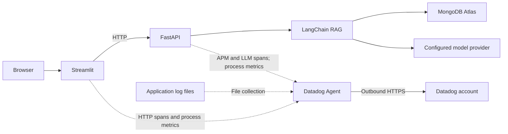

# Datadog for NexaAssist and LLM applications

This guide explains what Datadog measures, how to configure it on a local Mac or
in the cloud, and how to investigate this project's FastAPI, Streamlit and RAG
requests. Commands run from the repository root unless stated otherwise.

“Cloud” means deploying the application on a VM or container platform. For
Claude/Anthropic models and Claude Code, see [Claude and other model providers](#8-claude-and-other-model-providers).

## 1. What Datadog does

Datadog brings application traces, logs and infrastructure metrics into one
hosted service. A **trace** follows an operation across its calls; a **span** is
one timed operation within that trace. The **Agent** receives telemetry near your
application and forwards it to your Datadog account. Installing the Agent locally
still sends telemetry to Datadog's cloud; it does not install an offline dashboard.

For an AI application, use these signals together:

| Signal | What it helps you investigate | NexaAssist example |
| --- | --- | --- |
| APM: Application Performance Monitoring | Request duration, errors and dependency calls | Is `/answer` waiting on Atlas, embeddings or generation? |
| LLM Observability | Supported model/chain calls, inputs, outputs, latency and token usage | Which context reached the model, and how many tokens did it use? |
| Correlated logs | Application events associated with a trace | Find `retrieval_completed`, `answer_completed` or `answer_failed` for a request. |
| Runtime and host/container metrics | Memory, garbage collection, threads and resource pressure | Does latency rise when the Python process runs short of resources? |
| Evaluations | Answer quality against defined criteria | Evaluate grounding and relevance with the project's separate evaluation runners. |

Datadog also offers managed and custom evaluations, but enabling tracing does
not configure them or calculate this project's RAGAS scores. Keep operational
monitoring alongside the existing LangSmith and dataset-based evaluation workflow.
See [Datadog's AI observability concepts](https://docs.datadoghq.com/llm_observability/quickstart/terms/).
Some current documentation calls LLM Observability **Agent Observability**; the
Python configuration still uses `DD_LLMOBS_*`.

## 2. How it fits this project



The diagram shows the telemetry paths. A single trace spanning UI and API
depends on an active UI trace and propagated HTTP context; automatic HTTP client
instrumentation alone does not guarantee a span for every Streamlit interaction.

| Existing implementation | Responsibility |
| --- | --- |
| [app/core/telemetry.py](app/core/telemetry.py) | Calls `ddtrace.patch_all()` when application telemetry is enabled. |
| [app/main.py](app/main.py) | Initializes telemetry and logging during FastAPI startup. |
| [app/core/logging.py](app/core/logging.py) | Writes JSON application logs with `structlog`. |
| [app/core/observability.py](app/core/observability.py) | Logs returned model token usage; summarizes recent retrieval latency. |
| [app/chains/llm.py](app/chains/llm.py) | Configures `ChatOpenAI` with the token-usage callback. |
| [app/evaluation/run.py](app/evaluation/run.py) | Creates one workflow per evaluated answer and joins existing judge/RAGAS scores to that trace when LLM Observability is enabled. |
| [app/services/evaluation.py](app/services/evaluation.py) | Retrieves and generates once for a live UI question, then returns RAGAS results and queues those same values against its Datadog workflow. |
| [app/evaluation/live.py](app/evaluation/live.py) | Scores the exact generated answer and assembled context; gives explicit unavailable/error statuses when a metric cannot be measured. |
| [app/api/operations.py](app/api/operations.py) | Exposes liveness, retrieval counters and latency summaries. |
| [app/Dockerfile](app/Dockerfile) | Starts the API under `ddtrace-run`. |
| [tests/test_telemetry.py](tests/test_telemetry.py) | Verifies FastAPI spans and JSON log correlation without exporting spans. |

Start serving processes with `ddtrace-run` so instrumentation loads **before**
application imports and route construction. The startup hook alone is too late
to rely on for complete FastAPI instrumentation. Do not add a second manual
`LLMObs.enable()` bootstrap to these launch commands.
See [Python tracing setup](https://docs.datadoghq.com/tracing/trace_collection/dd_libraries/python/)
and the [LLM SDK setup options](https://docs.datadoghq.com/llm_observability/instrumentation/sdk/).

## 3. Configure the application

You need a Datadog account with access to APM, logs and LLM Observability, a
Datadog API key, and the correct Datadog site. This project's selected site is
`datadoghq.com`. Model-provider credentials and MongoDB credentials are separate.

For a new checkout, copy [.env.example](.env.example) to `.env` and fill in the
existing application settings. Preserve an existing `.env`. Its Datadog block is:

```dotenv
DD_TRACE_ENABLED=true
DD_SERVICE=nexaassist-api
DD_ENV=dev
DD_VERSION=0.1.0
DD_SITE=datadoghq.com
DD_TRACE_AGENT_URL=http://127.0.0.1:18126
DD_DOGSTATSD_URL=udp://127.0.0.1:18125
DD_LOGS_INJECTION=true
DD_RUNTIME_METRICS_ENABLED=true
DD_LLMOBS_ENABLED=true
DD_LLMOBS_AGENTLESS_ENABLED=false
DD_API_KEY=
```

| Setting | Purpose |
| --- | --- |
| `DD_TRACE_ENABLED` | Enables tracing and the project's instrumentation hook. |
| `DD_SERVICE`, `DD_ENV`, `DD_VERSION` | Identify a service, environment and release consistently. |
| `DD_TRACE_AGENT_URL` | Agent endpoint for APM and Agent-based LLM telemetry. |
| `DD_DOGSTATSD_URL` | Agent endpoint for Python runtime metrics. |
| `DD_LOGS_INJECTION` | Adds trace/service identifiers to supported application logs. |
| `DD_RUNTIME_METRICS_ENABLED` | Enables Python runtime metrics. |
| `DD_LLMOBS_ENABLED` | Enables LLM Observability for supported integrations. |
| `DD_LLMOBS_AGENTLESS_ENABLED=false` | Routes LLM telemetry through the Agent. |
| `DD_API_KEY` | Used by Agent setup, or by the SDK when explicitly using agentless mode. |

The locked `ddtrace 4.15.4` uses `DD_SERVICE` as the default LLM application name
and deprecates `DD_LLMOBS_ML_APP`. This guide keeps one service identity rather
than adding the deprecated variable. Recheck SDK compatibility when upgrading.
See the [Python SDK configuration reference](https://docs.datadoghq.com/tracing/trace_collection/library_config/python/).

**Load `.env` before SDK startup:** use `uv run --env-file .env ddtrace-run ...`.
Pydantic reading `.env` does not export those values into the process environment.
Uvicorn's own `--env-file` is not a substitute for loading configuration before
the tracer starts.

## 4. Local setup on macOS

The selected collector is now the **Docker Desktop Datadog Agent**. The native
macOS Agent service and native GUI/desktop-monitor helpers were stopped and
disabled on 20 October 2026. Use the Docker instructions below for this project.

### Run the Agent in Docker Desktop

Use this instead of the native macOS Agent when FastAPI and Streamlit run from
your Mac terminal. Start Docker Desktop, then run these commands from the
`Week_1_code` repository root. Set a real `DD_API_KEY` in the ignored project
`.env` and retain the correct `DD_SITE` (`datadoghq.com` for the supplied account
URL). Compose passes only the selected Datadog variables to the Agent, not the
application's MongoDB or model credentials.

Select Docker Desktop's context before running Compose. On this Mac the Docker
socket is `/Users/pankaj/.docker/run/docker.sock`; the `default` context points
to the absent `/var/run/docker.sock`. Clear shell overrides and select the
existing context:

```bash
unset DOCKER_HOST DOCKER_CONTEXT
docker context use desktop-linux
docker info --format '{{.ServerVersion}}'
```

If a client still tries `/var/run/docker.sock`, explicitly set the Desktop
endpoint in that terminal and retry:

```bash
export DOCKER_HOST="unix://$HOME/.docker/run/docker.sock"
```

See [Docker Desktop macOS socket configuration](https://docs.docker.com/desktop/setup/install/mac-permission-requirements/)
and [Docker contexts](https://docs.docker.com/engine/manage-resources/contexts/).

```bash
docker compose --env-file .env -f app/compose.datadog.yaml config --quiet
docker compose --env-file .env -f app/compose.datadog.yaml up -d
docker compose --env-file .env -f app/compose.datadog.yaml ps
docker compose --env-file .env -f app/compose.datadog.yaml exec datadog-agent agent status
curl --fail http://127.0.0.1:18126/info
```

Use `config --quiet`: ordinary `docker compose config` expands the API key into
its output. The image follows the official Agent 7 release tag; record or pin its
resolved digest when reproducible deployment is required.

The Compose file publishes APM on `127.0.0.1:18126` and DogStatsD on
`127.0.0.1:18125/udp`. These host ports avoid the existing collector occupying
8126 on this Mac; inside the Agent container the ports remain 8126 and 8125.
The file enables receiver traffic across the Docker network and mounts the
Docker socket for container discovery. To send the Mac application's telemetry
to this Docker Agent, update these values in the project's `.env`:

```dotenv
DD_TRACE_AGENT_URL=http://127.0.0.1:18126
DD_DOGSTATSD_URL=udp://127.0.0.1:18125
DD_TRACE_ENABLED=true
DD_LOGS_INJECTION=true
DD_RUNTIME_METRICS_ENABLED=true
DD_LLMOBS_ENABLED=true
DD_LLMOBS_AGENTLESS_ENABLED=false
```

Restart the API with the existing instrumented command after changing `.env`.
If an API is already running on port 8000, stop it with Ctrl+C in its terminal
before launching another process:

```bash
uv run --no-sync --env-file .env ddtrace-run python -m uvicorn app.main:app --host 127.0.0.1 --port 8000
```

For Streamlit, use a separate terminal and restart it after the same `.env`
change if you also want UI HTTP-client spans:

```bash
uv run --no-sync --env-file .env env DD_SERVICE=nexaassist-ui ddtrace-run python -m streamlit run app/streamlit_app.py --server.address 127.0.0.1 --server.port 8501
```

Send an Answer-mode question in Streamlit, then check Agent status and Datadog
APM's recent Live Search for `service:nexaassist-api env:dev`. `/health` is useful
for checking HTTP instrumentation but does not exercise an LLM call. Agent health
and the local receiver do not by themselves prove cloud delivery; inspect status
for authentication or forwarding failures.

If publishing 18126 or 18125 fails, check for an existing container or process
using those ports before starting another collector. The Docker Agent reports
the Docker Desktop Linux environment and discovered containers; it does not
replace native macOS host monitoring. This minimal configuration does not tail
the Mac application's log files. JSON log injection still works in the app, but
shipping those files needs an explicitly mounted log path and collection config.

To inspect recent container output, or stop this Compose deployment:

```bash
docker compose --env-file .env -f app/compose.datadog.yaml logs --tail 100 datadog-agent
docker compose --env-file .env -f app/compose.datadog.yaml down
```

Official references: [Docker Agent](https://docs.datadoghq.com/containers/docker/),
[host-to-container APM](https://docs.datadoghq.com/containers/docker/apm/), and
[DogStatsD networking](https://docs.datadoghq.com/extend/dogstatsd/).

### Switch from the native macOS Agent to Docker

The migration performed on 20 October 2026 stopped and disabled the native
system service:

```bash
sudo launchctl disable system/com.datadoghq.agent
sudo launchctl bootout system/com.datadoghq.agent
```

It also stopped and disabled the native user GUI and desktop monitor:

```bash
launchctl disable "gui/$(id -u)/com.datadoghq.gui"
launchctl bootout "gui/$(id -u)/com.datadoghq.gui"
launchctl disable "gui/$(id -u)/com.datadoghq.ai-usage-agent.desktop-monitor"
launchctl bootout "gui/$(id -u)/com.datadoghq.ai-usage-agent.desktop-monitor"
```

These are migration commands, not commands to run on every application start.
After `bootout`, `launchctl print system/com.datadoghq.agent` reporting that the
service cannot be found is the expected stopped state. `launchctl print-disabled
system` should show `com.datadoghq.agent` as disabled.

The project's `.env` and `.env.example` select Docker's published APM port 18126
and DogStatsD port 18125. FastAPI on port 8000 and the existing Streamlit
instances on ports 8501 and 8502 were restarted; their running process settings
were checked to confirm these Docker endpoints. API liveness, a validation-only
request and both UI health endpoints were verified without calling a model:

- `/health`: HTTP 200; `/answer` with an empty request: expected HTTP 422.
- Both Streamlit `/_stcore/health` endpoints: HTTP 200.
- Docker Agent: healthy, APM running and API key valid.
- Docker APM receiver: `Service: nexaassist-api`, one trace, two spans, one
  accepted payload and zero refused payloads in the inspected reporting window.
- DogStatsD metric parse errors: zero.

These checks establish application-to-Docker collection. They do not establish
that a model was called or a new trace was inspected in the signed-in cloud UI.
The Docker configuration currently collects APM/runtime telemetry; the native
Agent's former file-log configuration does not automatically transfer to Docker.

### Recorded Docker status: 20 October 2026

Source: the user-provided terminal output after selecting `desktop-linux` and
running Compose `ps` and `agent status`. The status timestamp was
**20 October 2026, 09:41:18 IST** (`04:11:18 UTC`). These are observations from
that snapshot, not continuously updated health results. Full credentials and
unnecessary host/session identifiers are omitted.

The successful context selection was:

```console
$ unset DOCKER_HOST DOCKER_CONTEXT
$ docker context use desktop-linux
desktop-linux
Current context is now "desktop-linux"
```

Compose then reported the following container:

| Field | Observed value |
| --- | --- |
| Container | `nexaassist-observability-datadog-agent-1` |
| Compose service | `datadog-agent` |
| Image | `registry.datadoghq.com/agent:7` |
| Status | `Up 14 minutes (healthy)` |
| APM mapping | Mac `127.0.0.1:18126` → container `8126/tcp` |
| DogStatsD mapping | Mac `127.0.0.1:18125` → container `8125/udp` |

Interpret the Agent sections separately:

| Agent section | Observation | Meaning for this setup |
| --- | --- | --- |
| Agent | Version `7.84.4`, build `arm64` | This is the installed version at capture time; the `:7` image tag can change on a later pull. |
| Hostname / tags | `nexaassist-docker-desktop`, `env:dev` | The configured collector identity and environment. |
| Host Info | Linux, Ubuntu 24.04, `aarch64`, LinuxKit kernel | The container's Linux environment under Docker Desktop; this is not the Mac's native operating-system inventory. |
| Configuration paths | `/etc/datadog-agent/datadog.yaml`, `/etc/datadog-agent/conf.d`, `/etc/datadog-agent/checks.d` | Paths inside the Agent container, distinct from the native macOS Agent configuration. |
| Agent log | `/var/log/datadog/agent.log`, level `info` | The Agent's own log inside the container, not the FastAPI application's log. |
| Collector | Container, Docker, CPU, disk, memory, I/O and other listed checks reported `[OK]` | These checks were running successfully in the Docker environment. |
| APM Agent | `Status: Running`, receiver `0.0.0.0:8126` | The trace receiver was running inside the container. Mac applications must use published port **18126**. |
| APM Receiver — previous minute | `No traces received in the previous minute` | No inbound traces were observed in that reporting window. This is not the lifetime trace count and does not negate an earlier successful smoke test. |
| APM Writer — previous minute | `0 payloads, 0 traces, 0 events, 0 bytes`; stats also zero | No trace/stat payloads were written in that window. This snapshot does not prove delivery of a new application request. |
| DogStatsD | `11,616` metric packets; `4,470` UDP packets; metric/UDP parse or reading errors `0` | The metrics receiver was receiving traffic. These counters do not establish APM receipt or identify every packet as NexaAssist traffic. |
| Forwarder | `216` successful transactions; `0` dropped, retried or requeued transactions | The listed general forwarding endpoints were reporting successes. They are separate from the APM trace writer. |
| API key | `API Key valid` | The configured key passed the Agent's validation; its value is not reproduced here. |
| Logs Agent | `Logs Agent is not running`; metadata `feature_logs_enabled: false` | Log shipping is disabled in this minimal Compose configuration. Trace-ID injection in application JSON does not enable collection. |
| Process collection | Separate Process Agent not running; Process Component enabled `service_discovery`, with `1` container, `12` processes and `0` submission errors | Container discovery and the process component have separate statuses from the optional Process Agent. |
| OTel / OTLP / SSI | Disabled or not enabled | The current application uses `ddtrace`; these optional components are not part of the selected setup. |
| Remote Configuration | Organization enabled; API key authorized; last error `None` | Remote-configuration authorization was working, independently of trace delivery. |
| Network diagnostic | APM `/_health` probe returned HTTP `404`; LLM intake connectivity probe succeeded | Preserve this diagnostic result, but do not interpret either probe as proof that an actual APM or LLM payload was ingested. See the next check below. |

#### Verify fresh application traffic after an idle status window

First ensure the application was restarted with the Docker-specific URLs:

```dotenv
DD_TRACE_AGENT_URL=http://127.0.0.1:18126
DD_DOGSTATSD_URL=udp://127.0.0.1:18125
```

With the instrumented FastAPI process running, generate an inexpensive request:

```bash
curl --fail http://127.0.0.1:8000/health
docker compose --env-file .env -f app/compose.datadog.yaml exec datadog-agent agent status
```

Allow for the SDK flush and status reporting window, then inspect **APM Agent →
Receiver** and **Writer**. A health request exercises HTTP tracing but does not
call a model or verify LLM Observability. Send an Answer-mode question from
Streamlit to exercise the actual `/answer` and model path.

If Receiver stays at zero, confirm the **running process** uses port 18126;
editing `.env` alone does not update a process already running. Check its
`ddtrace-run` launch and SDK send errors. If Receiver increases but Writer reports
errors or the request is absent in Datadog, inspect Agent logs, API key/site,
network forwarding and the recent Trace Explorer filters. The captured HTTP
`404` from an APM health probe alone does not establish whether real trace
payloads were accepted or rejected.

```bash
docker compose --env-file .env -f app/compose.datadog.yaml logs --tail 100 datadog-agent
```

This snapshot confirms a healthy Docker collector, valid authentication and
received metrics. It does **not** establish that a newly submitted Streamlit
question, its LLM payload or its application logs are visible in the signed-in
Datadog account.

### Optional alternative: native macOS Agent (inactive)

This section documents the previous native setup. For the selected Docker
deployment, use the instructions above; restarting this native service would
reintroduce a second collector. Re-enabling a disabled native launch service
requires `sudo launchctl enable system/com.datadoghq.agent` before loading it.

In Datadog, open Fleet Automation and follow its installation flow for macOS,
choosing your account's site and architecture. The project's previous local setup
installed the official Agent; check its status before reinstalling.
See the [official macOS Agent instructions](https://docs.datadoghq.com/agent/supported_platforms/osx/).

Edit `/opt/datadog-agent/etc/datadog.yaml`. Merge these settings into the existing
file, retaining other required configuration:

```yaml
api_key: "REPLACE_WITH_YOUR_DATADOG_API_KEY"
site: datadoghq.com
logs_enabled: true
logs_config:
  force_use_http: true
apm_config:
  enabled: true
```

The Agent runs independently of the application. Adding `DD_API_KEY` to the
project's `.env` does **not** update this Agent file. Configure the same key
locally through the installer or Agent configuration; never commit its value.
An empty key produces `API Key invalid` / HTTP 403 errors. The APM component
also refuses to start without a key; the Agent process running is not sufficient.
`logs_config.force_use_http` selects HTTPS log transport instead of the TCP
fallback warning seen during the failed setup. It does not correct an invalid
API key. See [Agent log transport configuration](https://docs.datadoghq.com/agent/logs/).

### Collect API and UI logs

Use a dedicated log directory outside the Google Drive checkout. Create it with
the application's user as owner and the Agent user's primary group as its group:

```bash
sudo install -d -o "$USER" -g "$(id -gn _dd-agent)" -m 2750 /Library/Logs/NexaAssist
touch /Library/Logs/NexaAssist/api.log /Library/Logs/NexaAssist/ui.log
chmod 640 /Library/Logs/NexaAssist/api.log /Library/Logs/NexaAssist/ui.log
sudo -u _dd-agent test -r /Library/Logs/NexaAssist/api.log
sudo -u _dd-agent test -r /Library/Logs/NexaAssist/ui.log
```

The directory's set-group-ID permission keeps newly created logs in the Agent's
group. The final commands succeed silently when both files are readable.

Create `/opt/datadog-agent/etc/conf.d/nexaassist.d/conf.yaml` with:

```yaml
logs:
  - type: file
    path: "/Library/Logs/NexaAssist/api.log"
    service: nexaassist-api
    source: python
    tags: ["env:dev", "version:0.1.0"]
  - type: file
    path: "/Library/Logs/NexaAssist/ui.log"
    service: nexaassist-ui
    source: python
    tags: ["env:dev", "version:0.1.0"]
```

Match the environment and release tags to `.env`. This location avoids the
permission errors observed when `_dd-agent` tries to traverse the cloud-synced
checkout. Grant access to these logs rather than broadening access to the home
directory. When configuring log rotation, retain the owner/group and readable
file permissions. See [Agent file-log collection](https://docs.datadoghq.com/agent/logs/)
and [log permission troubleshooting](https://docs.datadoghq.com/logs/guide/log-collection-troubleshooting-guide/).

Restart and inspect the Agent:

```bash
sudo launchctl kickstart -k system/com.datadoghq.agent
sudo datadog-agent status
```

### Start NexaAssist

Install the locked dependencies with both existing project extras:

```bash
uv sync --locked --extra ui --extra evaluation
```

`uv sync` selects an exact environment. Specifying only `--extra ui` removes
evaluation-only packages such as `ragas`; the uninstall list is expected, not a
Datadog error. The command above restores both sets. Launch commands below use
`--no-sync` after this setup to keep that environment intact.
See [uv's syncing and extras behavior](https://docs.astral.sh/uv/concepts/projects/sync/).

API, in terminal 1:

```bash
umask 027
uv run --no-sync --env-file .env ddtrace-run uvicorn app.main:app --host 127.0.0.1 --port 8000 >> /Library/Logs/NexaAssist/api.log 2>&1
```

Streamlit, in terminal 2:

```bash
umask 027
uv run --no-sync --env-file .env env DD_SERVICE=nexaassist-ui ddtrace-run python -m streamlit run app/streamlit_app.py --server.address 127.0.0.1 --server.port 8501 >> /Library/Logs/NexaAssist/ui.log 2>&1
```

Stop an existing API/UI process before relaunching it on the same port. Appending
with `>>` retains earlier logs; use your deployment's log rotation for retention.

Use `python -m streamlit` as shown so the repository package remains importable.
Open [NexaAssist](http://127.0.0.1:8501) and
[FastAPI documentation](http://127.0.0.1:8000/docs). `API_BASE_URL` should point to
the running API; its default is `http://127.0.0.1:8000`.

The SDK's native `structlog` integration injects `dd.trace_id`, `dd.span_id`,
`dd.service`, `dd.env` and `dd.version`; another injection processor is unnecessary
for this setup. Logs outside an active trace can have zero trace/span IDs. Logs
must still be collected and parsed for correlation in Datadog.
See [Python log correlation](https://docs.datadoghq.com/tracing/other_telemetry/connect_logs_and_traces/python/).

## 5. Run an example and inspect it

First check application liveness and SDK/Agent configuration:

```bash
curl --fail-with-body http://127.0.0.1:8000/health
uv run --env-file .env ddtrace-run --info
sudo datadog-agent status
```

`/health` is a liveness response. It does not connect to Atlas or the model
provider. To exercise the RAG path, submit this synthetic policy example in
Streamlit:

| UI input | Example |
| --- | --- |
| Question | What is the maximum loan amount for a NexaHome Loan? |
| As-of date | 2026-10-01 |
| Product | NEXA-HL |
| Sources / top_k | 20 |

Alternatively, call the existing API:

```bash
curl --fail-with-body --max-time 180 http://127.0.0.1:8000/answer \
  -H 'Content-Type: application/json' \
  -d '{"query":"What is the maximum loan amount for a NexaHome Loan?","as_of":"2026-10-01","product_id":"NEXA-HL","top_k":20}'
```

This example requires configured Atlas indexes, an ingested corpus and valid
provider credentials. It makes real database/model calls and can incur usage
charges. With LLM tracing enabled, the question, context and generated answer can
also be sent to Datadog. Use synthetic examples when first validating the setup.

After generating traffic, use Datadog's matching time range:

1. **APM:** select service `nexaassist-api`, environment `dev`, and the
   `POST /answer` request. Inspect the trace waterfall and dependency spans.
2. **LLM / Agent Observability:** find the application identified by
   `nexaassist-api`; inspect supported LangChain/OpenAI spans, model metadata,
   inputs/outputs, duration and reported token usage.
3. **Logs:** search `service:nexaassist-api env:dev`. Inspect
   `retrieval_completed`, `model_token_usage`, `answer_completed` or failure
   events, and follow the trace link when available.
4. **Runtime metrics / Infrastructure:** inspect memory, garbage collection,
   threads and the host alongside the slow-request time window.

Automatic integration coverage depends on the actual libraries and SDK versions.
Custom LCEL functions are not guaranteed to become individually named Datadog
LLM spans. Existing LangSmith run names help investigate the chain separately.
See [supported automatic LLM instrumentation](https://docs.datadoghq.com/llm_observability/instrument/auto_instrumentation/)
and [runtime metrics](https://docs.datadoghq.com/tracing/metrics/runtime_metrics/).

### View traces and evaluations on the web

Open [NexaAssist in Datadog](https://app.datadoghq.com/llm/applications?query=%40ml_app%3Anexaassist-api)
and sign in to the account containing your API key. Select the application,
open **Traces**, choose a time range covering the run, and filter by
`ml_app:nexaassist-api env:dev`. APM request traces and LLM workflow traces are
different views; `/health` traffic alone does not produce model evaluations.

Run one golden case using the existing evaluation pipeline:

```bash
uv run --no-sync --env-file .env ddtrace-run python -m app.evaluation.run --limit 1 --output app/evaluation/results/datadog_live_example.json
```

This performs real retrieval, answer generation, judging and RAGAS scoring. It
uses the configured provider and can incur usage charges. It does not run a
second scoring pipeline for Datadog: the existing scores are reused.

Select the `policy_answer_evaluation` workflow and open its **Evaluations** tab.
The runner submits these results at span scope against that workflow's exported
span/trace IDs, so they belong to the selected workflow span:

| Datadog evaluation | Source |
| --- | --- |
| `judge_correctness`, `judge_groundedness` | Existing LLM judge, with its rationale. |
| `status_matches` | Whether the actual answer/abstention status matches the golden case. |
| `ragas_faithfulness`, `ragas_answer_relevancy` | Existing RAGAS scores for answerable cases. |
| `ragas_context_precision`, `ragas_context_recall` | Existing RAGAS evidence scores for answerable cases. |

#### View the saved RAGAS measurements

Ordinary `/answer` calls capture API/LLM traces. Batch evaluations use the
separate runner and `policy_answer_evaluation` workflow. The Streamlit quality
option below uses `/answer/evaluated` and a `policy_answer_live_evaluation`
workflow to compute scores for the newly generated answer.

Open [the existing RAGAS-evaluated spans](https://app.datadoghq.com/llm/traces?query=service%3Anexaassist-api%20%40evaluation.ragas_faithfulness.value%3A%3E%3D0&start=1792419000000&end=1792420800000&paused=true),
which covers **19 October 2026, 19:40–20:10 IST**. Select the
`policy_answer_evaluation` workflow for the desired question, then open its
**Evaluations** tab. These scores are attached at span scope: select that
workflow rather than assuming every child model span has the same evaluations.
The query is:

```text
service:nexaassist-api @evaluation.ragas_faithfulness.value:>=0
```

The saved NexaHome maximum-loan evaluation contains these results:

| Datadog label | Measures | Saved score |
| --- | --- | --- |
| `ragas_faithfulness` | Answer claims supported by the retrieved evidence | 1.000 |
| `ragas_answer_relevancy` | How well the answer addresses the question | 0.958 |
| `ragas_context_precision` | Relevant evidence ranked ahead of irrelevant evidence | Approximately 1.000 |
| `ragas_context_recall` | Reference claims covered by the retrieved evidence | 1.000 |

Source: [the saved one-case report](app/evaluation/results/datadog_live_example.json).
These measurements belong to the 19 October evaluation with `top_k=20`, not the
20 October API diagnostic with `top_k=5`. They do not establish dataset-wide
quality. [The additional report](app/evaluation/results/datadog_additional_examples.json)
contains five more RAGAS-scored cases and one expected abstention for which
RAGAS was not applicable. Opening these reports or spans does not rerun scoring.

#### End-user feedback from Streamlit

For a new answer, expand **Give feedback**, select Yes or No, optionally enter a
correction, and choose **Send feedback**. The API saves the feedback in MongoDB
first, then queues Datadog feedback labeled `thumbs` (boolean), with a `pass` or
`fail` assessment and the correction as reasoning. The submitter is an anonymous
browser-session UUID, not an authenticated user identity.

Feedback targets the answer's exported `datadog_span_id` under the API service
(`nexaassist-api` by default), even though it was submitted through the UI.
In Datadog LLM Observability, select this service and the matching answer workflow:
`policy_answer_live_evaluation` when RAGAS is enabled, otherwise `policy_answer`.
Inspect the span's end-user feedback for `thumbs`. RAGAS scores remain in Datadog.

Requires `DD_LLMOBS_ENABLED=true` and the existing working Agent connection.
Restart FastAPI and refresh Streamlit after updating the code, then ask a new
question: older chat turns without a span reference still save feedback for
review but cannot attach it to Datadog. A Datadog submission error does not undo
the MongoDB save; it logs `feedback_datadog_publish_failed`. Submission queues
locally and does not confirm cloud receipt or automatically retry a failed call.

SDK reference: https://docs.datadoghq.com/llm_observability/instrument/sdk/

#### RAGAS scores in Datadog for Streamlit questions

In the sidebar, leave **Answer quality → Evaluate with RAGAS** enabled, then
submit a new question in **Answer** mode. The UI calls `POST /answer/evaluated`;
the original `/answer` and `/retrieve` contracts remain available.

The service retrieves once, generates once, and scores that answer against the
same budgeted, deduplicated evidence passed into generation. Metrics are shown
in Datadog only; Streamlit displays the answer, citations and a Datadog link,
without score cards or metric-status messages. The UI stores the result with that chat turn, so
rerendering or reopening the chat does not repeat scoring.

- Faithfulness and answer relevancy use the answer and its evidence/question.
- Context precision and context recall also need a reference answer. Enter it
  in **Reference answer for the next question**, or use a golden question with
  the same query, policy date, product and jurisdiction as the dataset. Retrieval
  `top_k` may differ; the golden reference is not treated as a previous score.
- The reference text applies to one submitted question and is cleared afterward.
  The reference actually used is recorded in the API result and workflow metadata.
- Missing references, abstentions, missing evidence and scorer errors remain
  explicit in the API result. Unmeasured values are not reported
  as zero or sent to Datadog as numeric evaluations.

To try all four metrics with the existing first golden case, select policy date
**2026-10-01**, product **NEXA-HL**, and ask exactly:
**What is the maximum loan amount for a NexaHome Loan?**
The service automatically uses that case's expected answer as the reference.
Alternatively, enter your own reference for the question and date being tested.

Scoring makes additional model/embedding calls. It uses `EVAL_JUDGE_MODEL` when
configured, otherwise `CHAT_MODEL`, with the existing LangChain Responses API
adapter. Install both extras with `uv sync --locked --extra ui --extra evaluation`.
If generation succeeds but an individual scorer fails, the answer and the other
metrics remain available. Each scoring call is bounded by a 120-second timeout.

With LLM Observability enabled, successfully measured values are submitted as
`ragas_faithfulness`, `ragas_answer_relevancy`, `ragas_context_precision`, and
`ragas_context_recall` at **span scope** on `policy_answer_live_evaluation`.
Choose **View evaluation in Datadog** below the answer, select that workflow,
and open **Evaluations**. The link includes the request's time window. `queued`
means the SDK accepted the submission; cloud visibility still requires checking
the Datadog view. A Datadog submission failure preserves the API's scores.

The live verification on **20 October 2026 at 13:25 IST** ran Streamlit AppTest
against the running FastAPI server, Atlas and the configured model providers.
Before the later Datadog-only display change, all four Streamlit cards rendered
measured values: faithfulness **1.000**, answer relevancy
**0.958387**, context precision **0.9999999999**, and context recall **1.000**.
The API reported those evaluations queued for Datadog. The user then confirmed
that all four `ragas_*` scores appear in the **Evaluations** tab of
`policy_answer_live_evaluation`, verifying cloud visibility for this live test.
The saved
[live UI report](app/evaluation/results/live_ui_ragas_example.json) contains the
request, generated answer, reference and metric statuses. This is one golden
case, not a dataset-wide quality claim.

That live test also exposed cosine-similarity roundoff returning
`1.0000000000000002`. Score validation now normalizes only boundary noise within
`1e-12`; larger out-of-range values and non-finite values remain errors. The
regression suite verifies this behavior, Datadog export, hidden Streamlit scores, exact evidence
reuse, missing references and independent scorer failures.

For expected abstentions, the runner publishes the judge/status results and
does not invent RAGAS scores. Numeric scores retain their measured values; no
pass threshold is assumed. An example search for evaluated traces is
`ml_app:nexaassist-api @evaluation.judge_groundedness.value:*`.
See [querying evaluations](https://docs.datadoghq.com/llm_observability/investigate/querying/)
and [custom evaluation submission](https://docs.datadoghq.com/llm_observability/instrument/sdk/).

The local JSON report includes `datadog_span` for each case and a Datadog export
status. `queued` means scores were handed to the SDK and a flush was requested;
it is not proof of Datadog ingestion or web visibility. Inspect SDK/Agent errors
and the web view separately. With LLM Observability disabled, the same runner
retains local reporting and makes no Datadog submissions.

The application uses these Datadog capabilities:

| Capability | Where to use it |
| --- | --- |
| API, HTTP and MongoDB dependency traces | [APM services](https://app.datadoghq.com/apm/services?env=dev); choose `nexaassist-api`. |
| LLM traces, model metadata and reported token usage | NexaAssist's Agent/LLM Observability application. Cost estimates depend on supported model pricing. |
| Per-case answer-quality evaluations | The workflow's Evaluations tab and evaluation search filters above. |
| Correlated JSON logs | [Logs Explorer](https://app.datadoghq.com/logs?query=service%3Anexaassist-api%20env%3Adev). |
| Python runtime and host metrics | The service's runtime metrics and Infrastructure views. |
| Native AI operational dashboards | The application's Operational Insights dashboard for latency, errors and token trends. |

The existing telemetry feeds Datadog's built-in views. Custom alert thresholds,
SLO targets and account-managed evaluators require explicit configuration; this
setup does not invent those targets or provision unrelated products. See
[Datadog's operational investigation views](https://docs.datadoghq.com/llm_observability/investigate/).

## 6. Cloud setup

The same Python instrumentation runs in the cloud. What changes is the Agent's
location, secret delivery, networking and log collection. The following are
deployment instructions; this repository does not include a tested cloud stack.

### Linux VM: application and Agent on the same host

1. Install the official Linux Agent through Datadog's Fleet Automation flow.
2. Configure `/etc/datadog-agent/datadog.yaml` with your API key, site, enabled
   APM and logs, using the same YAML settings as the local setup.
3. Put file-log sources under `/etc/datadog-agent/conf.d/nexaassist.d/conf.yaml`;
   use the VM's real log paths and production service/env/version tags.
4. Supply application settings through your deployment secret/config mechanism.
   Set `DD_ENV=prod`, a real release value for `DD_VERSION`, and the same tracing
   flags. Loopback Agent addresses work when both processes run on this VM.
5. Start the API under a service manager using the existing `ddtrace-run uvicorn
   app.main:app` entry point. Configure a working directory, environment and log
   destination for the service; do not depend on an interactive shell session.

Restart and verify the Agent:

```bash
sudo systemctl restart datadog-agent
sudo datadog-agent status
```

See [Linux Agent setup](https://docs.datadoghq.com/agent/supported_platforms/linux/).
The MongoDB Atlas integration remains the application's database; a host Agent
does not automatically monitor the internals of a remote Atlas cluster.

### Containers

Build the existing API image from the repository root:

```bash
docker build -f app/Dockerfile -t nexaassist-api:0.1.0 .
```

The image starts with `ddtrace-run` and includes the API, the evaluation extra
and the golden answer dataset, so `/answer/evaluated` can score answers and match
saved references. Streamlit and the Datadog Agent run separately. Inject
configuration when starting it. `app/Dockerfile.dockerignore` limits the build
context to application sources, dependency manifests and the golden answer
dataset; local secrets, virtual environments and captured result reports are
excluded. The Dockerfile does not copy `.env` into the image.

The dependency build stage installs a C++ compiler because the locked
`scikit-network` dependency builds from source on Linux ARM64/Python 3.14.
The runtime stage contains the virtual environment and OpenMP runtime, without
the compiler. See [Docker multi-stage builds](https://docs.docker.com/build/building/multi-stage/).

On 20 October 2026, `nexaassist-api:repo-validation` built successfully on this
Mac's Linux ARM64 Docker engine. A disposable container with dummy credentials
started through `ddtrace-run`, returned `/health` 200, rejected empty requests to
both answer endpoints with 422, imported RAGAS 0.4.3 and `scikit-network`, and
loaded all ten golden answer cases. `.env`, `.git`, captured result reports and
the compiler were absent. This smoke check made no database or model calls and
published no host ports. It verifies local packaging/startup; the earlier Mac
API-to-Docker-Agent test separately verifies Datadog delivery.

| Deployment topology | Application SDK addresses |
| --- | --- |
| App and Agent processes on one VM | `DD_TRACE_AGENT_URL=http://127.0.0.1:8126`; `DD_DOGSTATSD_URL=udp://127.0.0.1:8125` |
| Separate Docker containers on a shared private network; Agent service named `datadog-agent` | `DD_TRACE_AGENT_URL=http://datadog-agent:8126`; `DD_DOGSTATSD_URL=udp://datadog-agent:8125` |
| ECS Fargate app and Agent sidecar in the same task | Loopback endpoints as above; do not set a remote `DD_AGENT_HOST`. |

For separate containers, enable the Agent receivers for that private network:
`DD_APM_ENABLED=true`, `DD_APM_NON_LOCAL_TRAFFIC=true` and
`DD_DOGSTATSD_NON_LOCAL_TRAFFIC=true`. Keep ports 8126/TCP and 8125/UDP reachable
only by trusted application workloads. Separate container namespaces generally
cannot reach each other through `127.0.0.1`.
See [Docker tracing](https://docs.datadoghq.com/containers/docker/apm/).

For **ECS Fargate**:

1. Add the official Datadog Agent container to the **same task definition** as
   the API, following Datadog's Fargate installation example.
2. On the Agent container set `ECS_FARGATE=true`, `DD_APM_ENABLED=true` and
   `DD_SITE=datadoghq.com`; inject `DD_API_KEY` from AWS Secrets Manager or your
   approved secret store. Select and pin an approved Agent image version.
3. On the API container supply the application settings and Datadog flags from
   section 3, using `DD_ENV=prod` and the deployed release version. In Agent mode
   the Datadog API key belongs on the Agent, not in the application image.
4. Configure a supported log pipeline separately, such as FireLens or
   CloudWatch Logs with the Datadog Forwarder. The Mac's file-source configuration
   does not collect cloud container stdout. Match service/env/version tags.
5. Verify outbound access to the selected Datadog intake and repeat the example
   request. Check the task's traces, logs and metrics in Datadog.

See [Datadog's ECS Fargate setup, logs and tracing guide](https://docs.datadoghq.com/integrations/aws-fargate/).
Cloud container deployment has not been verified. The Docker Agent collecting
the Mac-hosted API and its Datadog delivery were verified separately; see
[Docker verification results](#docker-verification-results--20-october-2026).

### Optional: LLM telemetry without an Agent

For an LLM-only application where an Agent cannot run, Datadog supports agentless
LLM export. Set `DD_LLMOBS_AGENTLESS_ENABLED=true`, `DD_LLMOBS_ENABLED=true`,
`DD_SITE` and a real `DD_API_KEY` in the application's process environment before
startup. Keep its service identity and automatic instrumentation.

This option does not replace Agent-based APM, host monitoring, file-log collection
or DogStatsD runtime metrics. This project's selected setup remains Agent-based.
See the [SDK's agentless configuration](https://docs.datadoghq.com/llm_observability/instrumentation/sdk/).

## 7. How to use the signals for AI applications

| Symptom | Investigation |
| --- | --- |
| Streamlit says the policy service is unavailable | Confirm API connectivity, then inspect the failed endpoint's APM span and correlated `answer_failed` / `retrieval_failed` logs. A generic UI message is not the underlying error. |
| Answers are slow | Compare retrieval `search_ms`, `parent_ms`, `total_ms` and answer `generation_ms`; inspect database/model spans to locate the delay. |
| Token usage rises | Compare model calls and `model_token_usage` logs against context size and request volume. Cost estimates depend on supported model pricing and reported usage; check provider billing separately. |
| Answers are wrong despite successful requests | Inspect the actual retrieved passages, as-of date and citations; run the golden-dataset evaluations. An HTTP 200 or fast trace does not establish policy correctness. |
| Latency rises under load | Compare APM request/error rates with memory, garbage collection and host/container utilization. |
| An optional local reranker is hard to diagnose | Inspect its HTTP request duration/errors and the existing reranker diagnostic artifacts. A successful HTTP call does not establish meaningful relevance scores. |

Start dashboards with request rate, errors, request latency, dependency latency,
reported token usage and resource utilization. Establish a measured baseline
before setting alert thresholds. Custom business metrics and fleet-wide retrieval
histograms are not implemented. The evaluation runner exports per-case quality
scores when LLM Observability is enabled, as described above.

For ingestion, use the same early bootstrap with a separate service name:

```bash
uv run --env-file .env env DD_SERVICE=nexaassist-ingestion ddtrace-run python -m app.services.ingestion nexa_synthetic_data/document_register.json
```

This writes to the configured MongoDB stores and calls the embedding provider;
use it when ingesting documents, not merely to test telemetry connectivity.

LangSmith is independent: configure its existing API key/project settings and
enable `LANGCHAIN_TRACING_V2` when you want LCEL trajectory traces. The
[main README](README.md) documents the evaluation runners and datasets. LangGraph
agents and MCP services are future layers here; this setup does not create them
or promise tool trajectories for workflows that do not exist.

## 8. Claude and other model providers

Datadog supports automatic instrumentation for the Anthropic Python SDK as well
as OpenAI and supported LangChain integrations. In an application that actually
uses an Anthropic client, run that application under the same tracing bootstrap
with its provider credentials and Datadog configuration.
See the [supported integrations](https://docs.datadoghq.com/llm_observability/instrument/auto_instrumentation/).

NexaAssist currently constructs `ChatOpenAI`; changing `CHAT_MODEL` alone does
not implement an Anthropic provider. Likewise, an OpenAI-compatible local server
does not automatically supply model pricing or token usage. Verify what its
responses and the installed instrumentation actually report.

**Claude Code** is a development tool. Tracing this Python application does not
automatically trace your conversations in Claude Code. Monitoring that tool is
a separate setup from monitoring NexaAssist or deploying it in the cloud.

## 9. Verification and troubleshooting

The existing offline regression verifies early SDK instrumentation, a real
FastAPI request span and nonzero correlation IDs inside an active trace:

```bash
uv run --locked pytest tests/test_telemetry.py
```

It consumes spans locally and does not call Atlas, a model or a Datadog collector.
Passing it proves instrumentation behavior, not successful cloud ingestion.

### Docker verification results — 20 October 2026

At 11:44:59 IST, a provider-free `GET /health` returned HTTP 200 with diagnostic
trace ID `1066702991621494078`. The user confirmed that this exact trace appears
in Datadog Trace Explorer using Live Search / All ingested data, Last 15 minutes.
The running API targets the Docker Agent at `http://127.0.0.1:18126`; the Agent's
trace writer reported outgoing payloads with zero errors or retries. This verifies
the FastAPI → Docker Agent → Datadog APM path. The diagnostic request explicitly
requested keep sampling; it does not establish retention of every other request
or verify LLM Observability. Later API searches remained empty, as described below.

At 11:56:35 IST, the user-approved real `/answer` diagnostic asked “What is the
maximum loan amount for a NexaHome Loan?” with `as_of=2026-10-01`, `top_k=5` and
`product_id=NEXA-HL`. The API returned HTTP 200, status `answered`, and
₹7,50,00,000 (₹7.5 crore), citing POL-HL-V3 clause 4.1. Its diagnostic APM trace ID
is `2266885026182126625`. Docker reported one `nexaassist-api` trace with 17 spans,
one accepted payload, zero refused payloads, zero dropped spans and zero filtered
traces. The subsequent trace writer status reported zero errors and retries.
The user initially reported that neither the real APM request nor its LLM
entry appeared in the Datadog UI. The user subsequently confirmed that both the
direct HTTP 200 trace and its LLM question/answer are visible using the links
below. This verifies the real FastAPI → Docker Agent → Datadog APM/LLM path.
Receipt by the Agent and zero writer errors alone would not establish this
cloud visibility. This diagnostic also
explicitly requested keep sampling. Follow-up checks found matching Mac, Docker
and Datadog HTTP server clocks, matching native/project API keys and site, and no
Agent reject-tag or require-tag filters. The next cloud-side check is the recent
`nexaassist-api` ingestion volume in the active organization's Ingestion Control
page; retention or sampling settings have not been changed speculatively.

The running Docker container's key was also compared directly with the project
configuration and matches. Its site is `datadoghq.com`. If the service cannot be
found in Ingestion Control, distinguish an absent service from a page-access
error before changing configuration. In the active Datadog organization, verify
that **Organization Settings → API Keys** contains the Agent's configured key;
compare locally and do not paste the full key into a chat or ticket. A valid
Agent key alone does not prove that the browser is viewing that key's organization.

The user confirmed a matching key suffix in the current organization and then
confirmed that `nexaassist-api` appears after opening the direct
[Ingestion Control page](https://app.datadoghq.com/apm/traces/ingestion-control).
The earlier inability to find that page was not an observed permission error.
A separate provider-free SDK process using the API's service/environment and
Docker endpoint observed tracing enabled and no remote sampling rules during a
12-second check. This checks a separate client's configuration, not the private
runtime state of the running API. Recent ingested-byte and rate values from the
service row were subsequently supplied by the user: `POST /answer` showed one
span, 463 B ingested, and 100% ingestion; `GET /health` showed one span, 649 B,
and 100% ingestion. Most reported traffic was MongoDB `ismaster` and `hello`
commands. This confirms API-request ingestion in Datadog. The successful answer
was subsequently confirmed in the direct APM viewer and LLM Observability.
The displayed configuration was APM Remote / Adaptive; ingestion has not been
changed to a global 100% rule.

At 12:23 IST, the open live trace search covered approximately 12:07–12:22 IST,
excluding the real diagnostic from 11:56 IST. That request was then outside the
rolling 15-minute Live Search window; an older search requires indexed data.
A fresh validation-only `POST /answer` with `{}` returned the expected HTTP 422
at 12:23:59 IST with trace ID `3599039405809263155`. Its exact search was opened
with all span types and no service-entry filter. The user reported that this
fresh search was also empty before the 15-minute window expired. The older
request's time mismatch therefore does not fully explain the issue. This probe
makes no database or model call and does not verify LLM input/output capture.

An isolated SDK/FastAPI test, with HTTP client auto-injection removed, verified
that incoming Datadog trace headers preserve the supplied trace ID and keep
sampling priority. This is not a direct inspection of the running API's spans.
The diagnostic was then opened through the direct trace viewer:
[validation trace](https://app.datadoghq.com/apm/trace/3599039405809263155?timeHint=1792479239493&env=dev&graphType=flamegraph).
The user supplied metadata from this page: `component=fastapi`, `span.kind=server`,
`POST /answer`, `http.status_code=422`, `env=dev`, process ID `5167`, span ID
`13668336118535127048`, and start time `2026-10-20T06:53:59.491Z` (12:23:59 IST).
Duration was 1,625,000 ns (1.625 ms). This confirms that the API span can be
retrieved from Datadog through its direct viewer, despite the empty search list.
The 422 was intentional validation of `{}`, not a failed model call. The search
behavior is not yet explained, and no retention or sampling change was made.

For the already-completed real answer, the
[direct 200 trace](https://app.datadoghq.com/apm/trace/2266885026182126625?timeHint=1792477595214&env=dev&graphType=flamegraph)
and an [LLM search scoped to its original time window](https://app.datadoghq.com/llm/traces?query=service%3Anexaassist-api&start=1792477535214&end=1792477835214&paused=true)
were opened. The user confirmed that **both the HTTP 200 trace and the LLM
question/answer appear**. These views reuse the previous request; they do not
make another model or database call. The earlier empty search-list behavior
remains unexplained; the Docker delivery and real request visibility are verified.

A separate provider-free validation at 12:29:20 IST exported a complete caller
trace, avoiding an artificial missing parent. Its trace ID is
`6ad71148000000003e089dafcb570851` (decimal
`142014861883177033577837114947456665681`). It returned HTTP 422 as expected;
cloud visibility of this control trace is not yet verified.

To find an actual chat response, open [Trace Explorer](https://app.datadoghq.com/apm/traces),
select **Live Search / All ingested data**, **Last 15 minutes**, clear existing
filters, and start with:

```text
service:nexaassist-api env:dev
```

Submit a question through Streamlit or the FastAPI docs, then narrow the search:

```text
service:nexaassist-api env:dev operation_name:fastapi.request resource_name:"POST /answer"
```

Remove `(type:llm OR type:LLM)` from an HTTP-request search: FastAPI request spans
have type `web`. Inspect model/workflow spans separately in LLM Observability.
Live Search includes ingested spans from the rolling last 15 minutes; older
searches depend on indexed retention. See [Datadog Trace Explorer](https://docs.datadoghq.com/tracing/trace_explorer/).

| Issue | Check or correction |
| --- | --- |
| FastAPI service page is empty with `(type:llm OR type:LLM)` | Remove this filter. FastAPI request spans have APM type `web`; combining an LLM-only type query with `operationName=fastapi.request` / server spans excludes HTTP requests. In Trace Explorer start with `service:nexaassist-api env:dev`, select Live Search / Past 15 minutes, then add `operation_name:fastapi.request` or `resource_name:"POST /answer"`. Use the separate LLM Observability explorer for model/workflow spans. Switching the collector to Docker retains the application's service name. |
| `Dropping prompt on non-LLM span kind` | In the installed `ddtrace 4.15.4`, this warning removes the prompt metadata field from a non-LLM span and continues processing that span. It does not by itself prove trace export failed. Inspect receiver/writer evidence and search filters separately; prompt annotations are supported on LLM spans. |
| Compose cannot connect to `/var/run/docker.sock` on this Mac | Clear `DOCKER_HOST`/`DOCKER_CONTEXT` and select `desktop-linux`. Docker Desktop's socket is `~/.docker/run/docker.sock`; see the Docker setup above. |
| `failed to send` / connection refused | Check Agent credentials, service status and the configured receiver address. Use `curl http://127.0.0.1:8126/info` for the native Agent, or `curl http://127.0.0.1:18126/info` for this Docker setup. This tests the local receiver, not cloud delivery. |
| APM says no traces in the previous minute | This is a reporting window, not a lifetime total. Generate a fresh traced request and recheck Receiver/Writer after SDK flushing and status refresh; verify that the running app targets port 18126 for Docker. |
| Agent receives data but nothing appears in Datadog | Check API key/site, outbound connectivity, account access, time range, service and environment filters. |
| MongoDB traces appear but `fastapi.request` server spans do not | Restart the API with `.env` loaded before `ddtrace-run python -m uvicorn app.main:app --host 127.0.0.1 --port 8000`. Verify operation `fastapi.request`, resource `POST /answer`, and `span.kind=server` on an actual API request. Background `hello` / `ismaster` spans and an aggregate Agent span count alone do not verify request instrumentation. |
| A Streamlit question is missing from a `pymongo.cmd` service view | Open [Trace Explorer](https://app.datadoghq.com/apm/traces?query=service%3Anexaassist-api%20env%3Adev), choose Live Search / Past 15 minutes and search `service:nexaassist-api env:dev`. Clear MongoDB operation and client-span filters; select `fastapi.request` / `POST /answer` to inspect the API entry span. A saved absolute window may exclude a new query. |
| Preview UI produces no HTTP client spans | Start it with `.env` loaded before `ddtrace-run` and `DD_SERVICE=nexaassist-ui`, using the launch command above. A UI started with `DD_TRACE_ENABLED=false` cannot contribute UI spans; independently traced API requests can still appear under `nexaassist-api`. |
| `API Key invalid`, HTTP 403 and APM will not start | For the native Agent, configure `api_key` in its own YAML and restart. For this Docker setup, set `DD_API_KEY` in the project `.env` and rerun Compose `up -d` to recreate the container with the new value. |
| Linux Agent status shows APM not running before any traffic | Agent 7.80+ can start the trace agent on demand. Generate a traced request and recheck before diagnosing a startup failure. |
| `.env` flags appear ignored | Put `--env-file .env` on `uv run`, before `ddtrace-run`, and restart the process. |
| `Server.run_operation` error while patching PyMongo | Preserve the repository's `pymongo<4.18` bound with locked `ddtrace 4.15.4`. Verify a compatible SDK upgrade before removing it. |
| Streamlit cannot import `app` | Run from the repository root using the documented `ddtrace-run python -m streamlit` command. |
| No logs or trace links | Verify log redirections, Agent file paths/read permissions, `logs_enabled`, Python log parsing and string trace/span IDs. Log injection alone does not ship logs. |
| No runtime metrics | Check `DD_RUNTIME_METRICS_ENABLED` and DogStatsD reachability on UDP 8125 for the native Agent, or published UDP 18125 for this Docker setup; successful APM does not verify this separate path. |
| APM works but there are no LLM spans | Exercise a real supported model call; `/health` does not call a model. Check `DD_LLMOBS_ENABLED`, library support and the Agent's LLM forwarding path. |
| Container reports connection refused to localhost | Match the endpoint to the topology table; use the Agent's private DNS name for separate Docker containers. |
| `uv sync --extra ui` uninstalls RAGAS packages | Select both `--extra ui --extra evaluation` when syncing this development environment. |
| OTel/OTLP, SSI or Private Action Runner are disabled | These components are not needed by the existing `ddtrace` setup. Their disabled status alone is not a tracing failure. |

See [Datadog's connection troubleshooting](https://docs.datadoghq.com/tracing/troubleshooting/connection_errors/).

The local metrics endpoints have a narrower scope than Datadog:

- `/metrics` returns JSON counters for retrieval requests, errors, empty results
  and accumulated latency. It is not a Prometheus exporter.
- `/metrics/latency` reports nearest-rank p50/p95/p99 for at most the last 1000
  successful retrievals in one process. It excludes failed requests and resets
  on restart; multiple workers have separate samples.
- These values are not automatically exported as custom Datadog metrics.
- The existing Streamlit UI covers the business endpoints, not health or metrics.

The local repair on 19 October 2026 verified:

- The saved Datadog API key was applied to the Agent without displaying it;
  Agent status reported `API Key valid` with no key failures.
- FastAPI, Streamlit and the APM receiver returned HTTP 200. The Agent received
  traces from both `nexaassist-api` and `nexaassist-ui`; its trace writer reported
  outgoing payloads with zero errors or retries.
- Both sources under `/Library/Logs/NexaAssist` reported `OK`. The logs Agent
  reported three logs sent over HTTPS with no errors or warnings.
- DogStatsD received metric packets without parse errors. A diagnostic JSON log
  had nonzero trace/span IDs, and the isolated telemetry regression passed.
- The evaluation extra was restored after a UI-only sync removed it.

Those initial checks used liveness requests and a diagnostic APM/log probe.
The subsequent live evaluation ran the first golden NexaHome question through
Atlas and the configured model, generating a real workflow and seven evaluation
submissions. Its local report is
`app/evaluation/results/datadog_live_example.json`. One case scored correctness,
groundedness, faithfulness and context recall at 1.0, context precision at
approximately 1.0, and answer relevance at approximately 0.958; status matched.
These are measurements of one case, not a dataset-wide quality claim. The runner
uses the generation model as judge, so self-preference remains a limitation.
The user confirmed that the workflow and its scores are visible in Datadog after
the scores were attached at span scope. Cloud deployment remains unverified.

A follow-up run used six more existing golden cases, selected from the README's
policy examples, without regenerating the first answer. It submitted 38
span-level evaluations; the SDK reported successful delivery and no send errors.
Full answers, references, scores and Datadog span IDs are saved in
[the additional example report](app/evaluation/results/datadog_additional_examples.json).

| Additional question | Observed result |
| --- | --- |
| Current NexaHome processing fee | Answered 0.30%, minimum ₹5,000 and maximum ₹10,000, plus GST; judge correctness 0.90 for omitting the 18% GST rate. |
| NexaFlex foreclosure charge | Answered 4% after the six-EMI lock-in, plus GST; judge correctness 0.95. |
| NexaDrive new/used-car LTV | Incorrect abstention despite supporting context; judge correctness 0. |
| NexaHome part prepayment on 31 March 2024 | Incorrect abstention despite supporting context; judge correctness 0. |
| NexaHome part prepayment on 1 April 2024 | Answered ₹25,000; judge correctness 1. |
| Current NRLR | Correct abstention because the current rate is outside the indexed policies; RAGAS not applicable. |

These runs exercise seven of the ten cases in total. No quality threshold was
configured. Four of the six additional cases matched their expected status;
this is not a quality-gate pass. Inspect the two incorrect-abstention workflow
spans, generation outputs and citation checks before drawing conclusions about
the failure source.

## 10. Trace data and credentials

LLM traces can include questions, retrieved documents and generated text. This
project's policies are synthetic; review data handling before using real customer
or internal material. Configure appropriate access, retention and redaction for
LLM payloads, and verify the result with an actual trace. Log masking alone does
not redact a separate LLM trace payload.
See [Sensitive Data Scanner](https://docs.datadoghq.com/security/sensitive_data_scanner/).

Keep `.env` ignored, store production credentials in the deployment secret store,
and keep Datadog API keys out of prompts, logs, images and committed configuration.
An application key is not required for the basic Agent-based telemetry setup
described here. Configure additional Datadog features only when needed.
